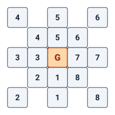
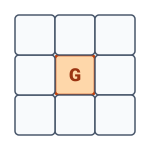
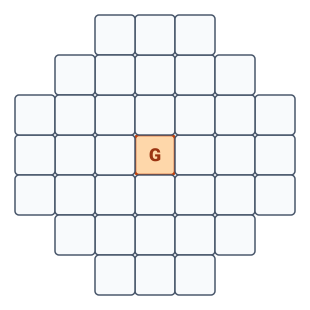
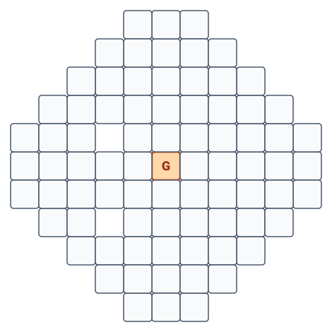

# Bombardier Skill & Reaction Manifolds

- **Topic:** The Bombardier Skill, Specialized Grenade Synthesizers/Dispensers, Ballistics, and Spell-Equivalent Ordnance
- **Location:** `ClockworkPathfinder/Rules/Bombardier.md`
- **Primary Classes:** Influence Classes (**Noble**, **Merchant**, **Grey Marketeer**)
- **Core Concept:** In a world without supernatural spellcasters, incredibly expensive miniaturized clockwork-chemical devices exist that synthesize, prime, and safely store specialized tactical grenades. These deliver area-of-effect and single-target attacks (poison clouds, incendiaries, static discharges, high explosives, blinding flashes, and debilitating chemical debuffs). Instead of magical incantations, the character uses the **Bombardier** skill to calculate trajectory, prime the payload, and set the detonation threshold.

---

## 1. The Bombardier Proficiency Tracks & Class Access

Bombardier advances along structured proficiency tracks depending on class role, representing access to institutional patronage, laboratories, and specialized reaction manifolds:

### Track A: Primary Influence Classes (Noble, Merchant, Grey Marketeer)
*Full 1–20 Progression (Wizard Spellcasting Parity)*
- **Trained (Level 1):** Unlocks **1 chosen effect profile**; dispenser stabilizes **3 grenade slots per effect**. Reservoir stores **15 total charges** ($5 \times \text{Capacity}$). You can create and hold only Tier 1 grenades.
- **Expert (Level 7):** Unlocks **2 chosen effect profiles**; dispenser capacity increases to **4 grenade slots per effect** (up to 8 ready grenades). Reservoir stores **20 total charges per effect** ($5 \times \text{Capacity}$). You can create and hold grenades up to Tier 2.
- **Master (Level 15):** Unlocks **3 chosen effect profiles**; dispenser capacity increases to **5 grenade slots per effect** (up to 15 ready grenades). Reservoir stores **25 total charges per effect** ($5 \times \text{Capacity}$). You can create and hold grenades up to Tier 3.
- **Legendary (Level 19):** Unlocks **4 chosen effect profiles**; dispenser capacity increases to **6 grenade slots per effect** (up to 24 ready grenades). Reservoir stores **30 total charges per effect** ($5 \times \text{Capacity}$). You can create and hold grenades up to Tier 4.

---

### Track B: Technical & Scholastic Specialists (Clockwork Engineer, Scholar, Artisan)
*Delayed Start & Capped Progression (Boosting Technical Specialists)*
Technical classes gain access to Bombardier through university research, guild workshops, and precision machining, but begin their training later than high-society patrons and cap at Expert or Master:
- **Starting Level (Trained):** Begins at **Level 3** (or Level 5 depending on class feature/archetype dedication). Unlocks **1 chosen effect profile** with **3 ready slots** and a 15-charge reservoir. You can create and hold only Tier 1 grenades.
- **Expert (Level 9 or 11):** Unlocks **2 chosen effect profiles** with **4 ready slots each** (8 total ready grenades) and 40 reservoir charges. You can create and hold grenades up to Tier 2.
- **Master (Level 17, Scholar/Engineer Cap):** Unlocks **3 chosen effect profiles** with **5 ready slots each** (15 total ready grenades) and 75 reservoir charges. You can create and hold grenades up to Tier 3. *(Artisans cap at Expert; Scholars and Clockwork Engineers can reach Master; neither can reach Legendary without an Influence Class)*.

---

### Track C: Influence Archetypes (Multiclass Dedication)
*Archetype Progression for Other Classes (Capped at Expert)*
Characters of other classes (such as Soldiers, Inspectors, or Dandies) who take an **Influence Archetype** (Noble Dedication, Merchant Dedication, or Grey Marketeer Dedication) can gain access to Bombardier through their new social sponsor:
- **Archetype Dedication (Feat 4 or 6):** Grants **Trained** proficiency in Bombardier and an issued baseline Reaction Manifold (1 Effect Profile, 3 ready slots, 15-charge reservoir). You can create and hold only Tier 1 grenades.
- **Advanced Munitions Feat (Feat 12):** Upgrades proficiency to **Expert** (2 Effect Profiles, 4 ready slots each, 40-charge reservoir). You can create and hold grenades up to Tier 2.
- **Strict Cap:** Archetype access is **strictly capped at Expert**. They cannot reach Master or Legendary without full primary class progression.

---

### Progression Summary Table

| Class Track                                               |   Trained    |   Expert    |    Master    |  Legendary   | Max Effects / Max Ready Slots  |
| --------------------------------------------------------- | :----------: | :---------: | :----------: | :----------: | :----------------------------: |
| **Primary Influence** (*Noble, Merchant, Grey Marketeer*) |   **Lv 1**   |  **Lv 7**   |  **Lv 15**   |  **Lv 19**   | 4 Profiles / 24 Ready Grenades |
| **Scholars & Clockwork Engineers**                        |   **Lv 3**   |  **Lv 9**   |  **Lv 17**   | — *(Capped)* | 3 Profiles / 15 Ready Grenades |
| **Artisans**                                              |   **Lv 5**   |  **Lv 11**  | — *(Capped)* | — *(Capped)* | 2 Profiles / 8 Ready Grenades  |
| **Influence Archetypes** (*Dedication Feats*)             | **Feat 4/6** | **Feat 12** | — *(Capped)* | — *(Capped)* | 2 Profiles / 8 Ready Grenades  |

### Manifold Reaction Selection (Dual & Triple Effect Generation)
Rather than locking a dispenser slot into a single rigid payload, the internal pneumatic manifold expands to synthesize alternative reactive payloads for each tier:
- **Maximum Grenade Tier:** Your Bombardier proficiency rank limits the highest-tier grenades you can create, load, or hold: Trained allows Tier 1, Expert Tier 2, Master Tier 3, and Legendary Tier 4. You can still create and hold grenades of any lower tier you have unlocked.
- **Level 1 (Single Effect):** The Tier 1 generator stabilizes 1 chosen chemical reaction (e.g., *Concentrated Acid*).
- **Level 3 (Dual Reaction Generator — Tier 1):** The Tier 1 manifold expands to store **2 distinct reactions**. When drawing a Tier 1 ready grenade, the Bombardier chooses which of the 2 reactions to prime and toss.
- **Level 5 (Triple Reaction Generator — Tier 1):** The Tier 1 manifold expands to store **3 distinct reactions** (e.g., choosing on use between *Acid*, *Shrapnel*, or *Rime Pellet*).
- **Level 7 (Tier 2 Unlocked — Single Reaction):** Unlocks Tier 2 payloads with 1 chosen reaction (e.g., *Fireball*).
- **Level 9 (Dual Reaction Generator — Tier 2):** The Tier 2 manifold expands to store **2 distinct reactions**.
- **Level 11 (Triple Reaction Generator — Tier 2):** The Tier 2 manifold expands to store **3 distinct reactions**.
- **Level 15 (Tier 3 Unlocked — Single Reaction):** Unlocks Tier 3 payloads with 1 chosen reaction.
- **Level 17 (Dual Reaction Generator — Tier 3):** The Tier 3 manifold expands to store **2 distinct reactions**.
- **Level 19 (Tier 4 Unlocked — Dual Reaction):** Unlocks Tier 4 apex payloads with 2 distinct reactions; Tier 3 expands to **3 distinct reactions**.
- **Level 20 (Apex Masterwork — Triple Reaction All Tiers):** The Tier 4 manifold achieves masterwork calibration, expanding to **3 distinct reactions**. At Level 20, **every active tier (Tiers 1, 2, 3, and 4) offers 3 distinct effects on use**.

#### Choosing & Reconfiguring Stored Reactions (Workshop, Supply Lines & Military Logistics)
- **Selection by Dispenser Tier (1 to 3 Items):** Depending on the dispenser\'s calibration and character level, players choose the **1 to 3 items** it makes for each active tier manifold (e.g. 1 at Lv 1, 2 at Lv 3, 3 at Lv 5).
- **Workshop & Raw Materials Requirement:** Changing a configured reaction is not a simple field swap; it requires **direct access to a proper workshop and raw materials for the new items, including the specific empty grenade casings and chemical catalysts**.
- **Spire Ease vs. Remote Locations:**
  - **In a Spire / Guild Home Base:** This reconfiguration is easily done at your sponsoring Guildhouse, Great House armory, or Wall Merchant estate. Materials and specialized casings are provided as normal operational gear support (money is not an issue), provided your guild/family has access and your level meets the tier requirement.
  - **Guild-Controlled Outposts (Pre-Arranged Logistics):** Changes can also be made at remote branch offices or forward holdings controlled by the Guild or Family, provided **advance arrangements were made for the specific replacement casings and reagents to be shipped there**.
  - **The Field Restriction (No Field Swapping / Reloading):** Swapping configured abilities or reloading depleted reservoirs is **not normally available in the field** unless **military-level logistical support has been explicitly arranged** (such as an accompanied heavy military supply wagon, forward mobile ordnance workshop, or airship quartermaster tender). Out in the sumps, ruins, or deep wild without such military logistics, a Bombardier is strictly locked to what they carried.

---

### Device Architecture (Single Modular Chassis vs. Multiple Linked Dispensers)
- **Modular Multi-Chamber Housing:** A high-level dispenser can be engineered as a single, multi-valved brass harness worn across the chest or belt, with independent pneumatic pressurized chutes for each unlocked effect profile. Alternatively, a Bombardier may carry separate linked canister modules clipped into a master priming rig. Either way, the total ready slots and consumable reservoirs are maintained per effect.

### Bombardier DC Calculation
When a grenade detonates, targets in the area of effect roll saving throws against the user's **Bombardier DC**:
$$\mathbf{\text{Bombardier DC}} = 10 + \text{Key Attribute Modifier} + \text{Bombardier Proficiency Bonus}$$
*(Proficiency Bonus: Trained = Level + 2, Expert = Level + 4, Master = Level + 6, Legendary = Level + 8)*.  
- Key Attribute: **Intelligence** (calculation, chemical precision) or **Charisma** (as designated by class feature).

---

## 2. Standardized Reaction Manifolds Across All Users

The physical devices themselves are **standardized across all individuals trained in the skill**. Rather than forcing different classes to carry different mechanical contraptions, every Reaction Manifold operates under the exact same standardized engineering:
- **Universal Chassis & Spell-Level Restrictions:** The physical dispenser is identical whether wielded by a Grand Duke, an underground Grey Marketeer, a University Scholar, or an Artisan. What dictates what the device can do is strictly the user's **Bombardier proficiency rank and character level**, which limits the spell-rank equivalence of the synthesized payloads.
- **Unreachable Market Cost:** These devices represent the pinnacle of clockwork miniaturization, hermetic pneumatic valves, and stabilized catalytic chemistry. On the open or illicit market, a dispenser carries an **astronomical, effectively unreachable price tag** (priced in tens of thousands of gold pieces / multiple Sovereigns and Princes)—far beyond the legal personal wealth or lifetime earnings of ordinary citizens and common soldiers. They simply cannot be bought off a shelf.
- **Institutional Backing & Sponsorship Requirement (Collegium, Merchant, Noble, or Patron):**
  - Owning, maintaining, and reloading a Reaction Manifold is **strictly restricted** by social and institutional standing. Because the apparatus requires ongoing supplies of expensive volatile salts, pre-formed brass casings, and guild cleanroom calibration, an operator **must possess one of the following institutional backings**:
    1. **University Collegium Standing:** Academic fellows, certified Scholars, Chirurgeons, or Clockwork Engineers backed by university laboratories.
    2. **Merchant House Standing:** Merchants (Status 3+) or Wall Merchants (Status 6+) with commercial credit lines and company armories.
    3. **Noble Estate Backing:** Nobles (Status 4+) or Great Nobles (Status 6+) with hereditary house armories.
    4. **The Social Patron Edge (For Lower Status PCs):** Characters of lower social rank (Status 0–2, such as Warrens survivors or mercenary soldiers) **must purchase the 2-Point Patron Edge (Merchant/Noble) or 3-Point Patron Edge (Wall Merchant/Great Noble)** (or be the sworn retainer of a PC Noble/Merchant). Their patron intercedes legally, covers replacement chemical salts/casings, and grants workshop access.
  - **Free Issued Apparatus:** Anyone who meets the institutional training and backing requirements **receives their baseline Reaction Manifold completely for free** from their sponsoring institution. The sponsor views the trained Bombardier as a premier tactical investment.
- **Reload & Synthesis Cycle (8 Hours, 15 Minutes):**
  - **Total Reload Time:** Restocking expended grenades requires **8 hours and 15 minutes** (15 minutes of hands-on calibration + 8 hours of uninterrupted internal chemical synthesis during a long rest).
  - **Step 1 — Active Prep (15 Minutes):** The Bombardier spends 15 minutes of manual maintenance aligning clockwork gears, measuring volatile salts, and priming the chemical manifold.
  - **Step 2 — Automatic Processing (8 Hours):** Over the next 8 hours, the sealed internal mechanism safely synthesizes and restocks all expended grenades back up to full ready capacity (consuming charges from the reservoir).
  - **Tactical Impact:** Because a reload requires **8 hours and 15 minutes**, ready grenades **cannot be reloaded mid-combat or during a short rest**. A Bombardier\'s ready slots represent their strict daily combat limit.
  - **Consumable Reservoir:** Stored grenades remain inert in shock-dampened ports until primed. Each device reservoir holds enough bulk chemical charges for **5 full reloads** (5 cycles of 8 hrs 15 min each), providing multi-day autonomous operation before needing laboratory or guild replenishment.

---

### Spire Infrastructure: Rapid Recharge Stations
While field reloads are bound to the strict 8-hour, 15-minute chemical synthesis cycle, the monumental power grids, steam conduits, and chemical refineries of the great **Spires** support specialized **Rapid Recharge Stations**:
- **Core Narrative & Gameplay Purpose (Immediate Readiness at Departure):**
  - The critical design and world-logic purpose of these stations is that **characters leaving the safety of the Spire or embarking on an airship flight do NOT start their journey unarmed or vulnerable for 8+ hours**.
  - Without these stations, departing characters who reconfigured their reaction manifolds or arrived from a prior engagement would be forced to wait over eight hours into an overland march or flight before their first grenade was synthesized.
  - By visiting a Rapid Recharge Station at the gatehouse or transit gantry immediately before departure, a party steps through the Spire gates into the dangerous Wilds or lifts off into hostile airspace **fully armed, with 100% of their ready grenade slots primed and maximum reservoir charges stored**.
- **Instantaneous Resupply, Pre-Loading & Charged Cartridge Depots:**
  - By tapping directly into high-pressure industrial Neither/steam conduits and pressurized chemical bulk-lines, a Rapid Recharge Station bypasses the portable dispenser's internal catalytic clockwork timers. In **under 5 to 10 minutes**, the station:
    1. Completely flushes, scrubs, and **tops off the dispenser's internal consumable chemical reservoir** to maximum capacity ( \times \text{Capacity}$).
    2. Mechanically feeds pre-formed brass casings, volatile catalysts, and stabilized reactive payloads directly into the pneumatic carousel, **fully pre-loading all ready grenade slots across every active tier without the normal 8-hour synthesis delay**.
  - **Fully Stocked Replacement Cartridges:** Each station maintains massive, climate-controlled dry-stores of pre-synthesized, factory-sealed **charged chemical cartridges, catalytic capsules, and casing clips**. Operators can immediately swap out depleted manifold cells or draw auxiliary reload reserves without waiting for batch synthesis.
- **Military Administration & Institutional Multi-Key Access (Military, Nobles, Merchants & University):**
  - All Rapid Recharge Stations are **strictly operated and guarded under permanent Military authority** (commanded by Spire marshals, garrison quartermasters, or sky-navy logistics officers).
  - However, through long-standing imperial pacts and institutional treaties, these stations are **formally shared with and accessible to the primary power blocs**:
    1. **The Military:** Frontline tactical units, ordnance officers, and heavy suppression platoons.
    2. **Noble Houses:** High-status Nobility and their sworn retainers/bodyguards, authenticated by hereditary heraldic seal rings and Great House armory manifests.
    3. **Merchant Consortiums:** High-ranking Merchants (Status 3+) and Wall Merchants (Status 6+) holding licensed military supply charters and commercial transit rights.
    4. **University Collegium:** Certified Scholars, Chirurgeons, and Clockwork Engineers backed by university laboratories and guild research syndicates.
- **Confirmed Installation Locations:**
  - **The Spire Military Ward (Base of the Spire):** Located within heavily guarded garrison depots and ordnance vaults at the base of the Spire, shared between military regiments, Noble city guards, and commercial security details.
  - **The SkyDocks (Upper Spire / Apex Transit):** Positioned along high-altitude airship gantries, fleet berths, and university research platforms to service naval marines, merchant air-galleons, and flying academic expeditions prior to departure or between sorties.
- **Frontier Rumors & State Secrecy:**
  - Whispers and military intelligence reports suggest that a few massive, fortified forward garrisons and fortress-outposts out in the contested Wilds or frontier borders may secretly house modified Rapid Recharge Stations.
  - However, due to the extreme logistics of piping volatile Neither-catalysts outside the Spires and fear of giving away state military technology, **no nation or Great House has ever officially confirmed the existence of any operational station outside the Spires**.

---

### Legal Strictures & Internal Transit (Checkpoints, Escorts & Bonded Constables)
The sheer destructive potential of high-grade clockwork munitions imposes draconian legal boundaries within civilian civilization:
- **Strict Prohibition Within the Spires:**
  - **Personal ownership, carry, or transit of raw volatile chemicals and active grenades within the Spire interior is strictly illegal.** Even high-status Nobles cannot openly carry armed grenades through civilian Spire corridors.
  - **Authorized In-Spire Possession:** Only active-duty **Military units** and the **King's Guard** may openly possess and bear ready munitions inside Spire walls. Unlicensed possession of charged ordnance or unrefined Neither salts is classified as high treason / catastrophic sabotage, carrying immediate summary execution or lifetime penal labor in the toxic sumps.
- **Armed Transit Escorts (Manufacturing to Loading Stations):**
  - Moving raw catalytic salts, explosive precursors, and charged ordnance from industrial chemical synthesis plants to the Rapid Recharge Stations (in the Military Ward and SkyDocks) requires **official Constable and King's Guard escorts**.
  - These armed convoys travel along sealed subterranean transit conduits or cleared expressways, ensuring no volatile ordnance leaks into civilian wards.
- **Bonded Constables (Jurisdiction Exceptions & Monitored Courier Transit):**
  - Under normal civil law, standard Constables only possess legal jurisdiction strictly within the specific ward they are assigned to.
  - **Bonded Constables:** A vetted, elite subset of officers are elevated to **Bonded Constables**. They are specifically trusted and certified to transport dangerous, volatile, and otherwise illegal materials across ward lines and throughout the Spire.
  - **Cross-Ward Authority:** Bonded Constables operate as an explicit exception to ward-boundary laws, possessing legitimate authority to escort and couriered sensitive clockwork-chemical components anywhere in the Spire.
  - **Protected & Heavily Monitored Trips:** Bonded runs are never casual errands; every trip is heavily protected, logged in central military registers, and closely monitored by Spire surveillance apparatus to guarantee cargo integrity.
- **Constable Checkpoints at the Warrens Entrances:**
  - The massive gatehouses and iron portcullises controlling passage between the lawless **Warrens** (or outer sumps) and the Spire proper are manned by hardened **Constable Stations**.
  - **The 48-Hour Paid Escrow & Reload Service:**
    - Travelers, mercenaries, prospectors, or returning adventurers carrying Reaction Manifolds cannot legally bring them through the checkpoint into civilian sectors.
    - **For a regulated fee**, the Constable Station provides a secure ordnance holding service: the Constables will supervise or arrange the device's reload and safely secure the dispenser and volatile cartridges inside sealed fireproof vault lockers for **up to 48 hours**.
    - When the owner leaves the Spire to return to the Warrens or sets out on an expedition into the Wilds, they reclaim their fully armed, reloaded Reaction Manifold at the checkpoint as they exit.
    - Devices unclaimed after 48 hours without prior extension are confiscated into military bulk storage or remitted to the crown armory.

---
### Storyteller Guidance: Long Expeditions & In-World Solutions
- **Tension vs. Long-Term Play:** The 5-reload reservoir limit and workshop casing requirements exist to drive tactical tension and resource management within an expedition arc—**never to render a Bombardier permanently useless or unplayable** during extended multi-month journeys into unknown lands.
- **Reasonable Field Discoveries:** When an adventure keeps players far from home for extended periods, reasonable Storytellers will introduce in-world replenishment opportunities:
  - An abandoned prospector workshop or ruined alchemy cache containing raw chemical salts and salvageable casings.
  - A fortified Dwarven mining clan or independent frontier trading post capable of servicing clockwork gear.
  - A captured supply wagon or airship cache.
  - Discovering a rumored hidden or experimental forward military recharge rig.
- The Storyteller may place sensible narrative limits on what specific compounds can be recharged abroad, but should always ensure the player has the basic means to keep their class functional.

---

## 3. Activation & Ballistics (Tossing & Detonation)

Using a dispenser grenade requires a **2-Action sequence on the same turn**:

```
[one-action] Prime Grenade + [one-action] Toss Grenade (Same Turn)
```

1. **Action 1 — Prime Payload (`[one-action]`):** Draw the canister from the dispenser's pneumatic port, dial the mechanical fuse delay, and twist the chemical rupture collar.
2. **Action 2 — Bombardier Toss ([one-action]):** Lob the grenade at a designated target square using the munition's base range increment (Standard: **15 ft**; Short/Heavy: **5-10 ft**; Aerodynamic: **20 ft**).
   - **At Your Feet (Drop / Self-Square Detonation - No Roll Required):** If the Bombardier targets the **exact square they are currently standing in** (such as dropping a smokescreen at their feet to escape, planting an ink shroud, or deploying an emergency neutralizer mist on themselves), **no toss check or roll is necessary**. The grenade lands with 100% automatic precision in their own square with zero scatter. *(Note: Unless the payload specifically excludes the user or is a beneficial neutralizer, the thrower must roll saving throws against their own grenade blast!).*

### Pathfinder Range Increments & Scatter Roll (DC 10)
Tossing a grenade at a target square is a **Bombardier check against a flat DC 10**. Bombardier training grants a **+3 bonus** to this toss check; the level 6 *Calculated Trajectory* feat increases this to **+7 total**. Apply standard Pathfinder range increment penalties to the check:
- **Range Increments (Cumulative -2 per increment, max -8 at 5th increment):**
  - **1st Increment (0 to Base Range):** No penalty (Flat DC 10 check).
  - **2nd Increment (Base+1 to 2x Base):** **-2 circumstance penalty** to toss check.
  - **3rd Increment (2x+1 to 3x Base):** **-4 circumstance penalty** to toss check.
  - **4th Increment (3x+1 to 4x Base):** **-6 circumstance penalty** to toss check.
  - **5th Increment (4x+1 to 5x Base, Maximum Range):** **-8 circumstance penalty** to toss check. Beyond 5 increments, the grenade cannot be thrown.
  - *(Example with Standard 15 ft Base: 0-15 ft = no penalty; 16-30 ft = -2; 31-45 ft = -4; 46-60 ft = -6; 61-75 ft = -8).*
- **Success (Final check result of 10 or higher):** **Direct Hit.** The grenade lands cleanly in the targeted square and detonates on arrival.
- **Failure (Final check result below 10):** **Scatter / Bounce.** The grenade misses its intended mark. It bounces or rolls **5 feet (1 square) away from the target for every point the final result is below 10** before detonating.
  - **Scatter Distance Cap:** **Scatter distance on a miss is capped at a maximum of half the thrown distance.** For example, throwing at a target 10 feet away caps bounce/scatter at 5 feet (1 square); throwing 20 feet caps scatter at 10 feet (2 squares).
  - **Scatter Direction (d8):** Roll a **d8** to determine the direction the grenade scatters (matching the **Scatter Diagram** in AISummary/Templates.drawio.svg):
    - **1:** South (Down 1 square)
    - **2:** Southwest (Down-Left diagonal)
    - **3:** West (Left 1 square)
    - **4:** Northwest (Up-Left diagonal)
    - **5:** North (Up 1 square)
    - **6:** Northeast (Up-Right diagonal)
    - **7:** East (Right 1 square)
    - **8:** Southeast (Down-Right diagonal)


  - *Example:* A throw targeted 20 feet away rolls a 6 (missing DC 10 by 4 points). Normally this would scatter 4 squares (20 feet), but half the thrown distance is 10 feet (2 squares). The scatter is capped at 2 squares (10 feet) in the direction rolled on the d8 before detonating.
- **Friendly Fire Warning:** **Friendly fire is very real.** Grenades detonate instantly upon reaching their destination square (whether direct hit or scattered). The payload blast does not differentiate between friends, foes, retainers, bystanders, or the thrower themselves. Anyone caught within the burst radius must roll saving throws and suffer full payload effects.
- **Influence Class Feat (Level 6 — *Calculated Trajectory*):**
  - **Feat Requirement:** 6th Level, Influence Class only (**Noble**, **Merchant**, **Grey Marketeer**), Trained in Bombardier.
  - **Benefit:** Your Bombardier toss bonus increases from **+3 to +7 total** against the flat DC 10 toss check, reducing the chance and distance of scatter.

---

## 4. Detonation & Saving Throws

The moment the grenade lands (whether on target or after scattering):
1. **Payload Burst:** The grenade ruptures, releasing its payload centered on the impact square (G) conforming to its designated standardized template (**Template 0, 1, 3, or 5**).
2. **Saving Throw vs. Bombardier DC:** Every creature in the area of effect must immediately roll the appropriate saving throw (Reflex, Fortitude, or Will depending on the payload type) against the user's **Bombardier DC**:
   - **Critical Success:** Unaffected.
   - **Success:** Half damage, or reduced condition duration.
   - **Failure:** Full damage and secondary conditions (blindness, sickened, prone, persistent fire/acid).
   - **Critical Failure:** Double damage and full critical secondary penalties.

---

### Standardized Tactical Blast Templates (0, 1, 3, 5)

All munitions deploy using the standardized grid burst templates detailed in AISummary/Templates.drawio.svg. Explosive blast waves and expanding chemical vapors radiate outward from the central impact square (G) using standard grid movement metrics:
- **Cardinals (Horizontal & Vertical):** Each step costs **1 movement unit** (1 square / 5 ft).
- **Diagonals (1-2-1-2 Alternating Cost):** Diagonal steps alternate in cost: the 1st diagonal costs **1**, the 2nd costs **2**, the 3rd costs **1**, the 4th costs **2**, and so on (1, 2, 1, 2...).
- **Full Movement Requirement:** A square is only affected if the grenade blast possesses enough remaining movement radius to fully enter that square (partial movement does not cross into a new square). This creates clean, near-circular dispersion profiles across the tactical battle grid:

- **Template 0 (Point Impact / Center Square — Radius 0 [5x5 ft]):**
  - **Calculation:** Radius 0 (zero movement from impact).
  - **Grid Footprint:** 1 square total (the central square G).
  - **Tactical Profile:** Concentrated kinetic dart or chemical vitriol impact. Deals maximum single-target damage/affliction. On a direct hit (no scatter), **carries zero risk of friendly fire to adjacent squares**, making it essential in tight 5-foot Spire hallways and melee scrums.
  

- **Template 1 (Close Burst — Radius 1 [15x15 ft Footprint]):**
  - **Calculation:** Radius 1 movement from G. Cardinal steps cost 1 (reaches 1 square N, S, E, W). First diagonal step costs 1 (reaches 1 square NE, NW, SE, SW).
  - **Grid Footprint:** 9 squares total (the impact square G + 8 surrounding adjacent squares; 3x3 grid).
  - **Tactical Profile:** Tight shrapnel blasts, sticky pitch puddles, and localized flash-bang pellets.
  

- **Template 3 (Medium Tactical Burst — Radius 3 [~35-ft Circular Area]):**
  - **Calculation:** Radius 3 movement from G.
    - Cardinals reach 3 squares (1 + 1 + 1 = 3).
    - Pure diagonals reach 2 squares: 1st diagonal costs 1, 2nd diagonal costs 2 (total cost 3). A 3rd diagonal would cost 1 more (total 4, exceeding radius 3).
    - Stepped paths (e.g. 1 cardinal + 1 diagonal): cost 1 + 1 = 2 (within 3); adding a second diagonal would cost 2 more (total 4).
  - **Grid Footprint:** 37 squares total (rounded circular burst across a 7x7 grid).
  - **Tactical Profile:** Standard tactical ordnance including concussive shockwaves, persistent toxic gas clouds, and flash-freezing rime mists.
  

- **Template 5 (Large Heavy Burst — Radius 5 [~55-ft Circular Area]):**
  - **Calculation:** Radius 5 movement from G.
    - Cardinals reach 5 squares (1 + 1 + 1 + 1 + 1 = 5).
    - Pure diagonals: 1st costs 1, 2nd costs 2, 3rd costs 1 (total cost 4; reaches 3 squares diagonally). A 4th diagonal costs 2 (total 6, exceeding 5).
    - Off-axis combinations expand symmetrically following the full 1-2-1-2 movement requirement to enter each outer square.
  - **Grid Footprint:** Matches the rounded template in AISummary/Templates.drawio.svg (stepped circular margins across an 11x11 grid).
  - **Tactical Profile:** Military-grade high-explosive ordnance, creeping asphyxiation clouds, thermobaric cores, and heavy suppressive smoke screens.
  

---

### Consistent Saving Throw Triad Alignment (Reflex, Fortitude, Will)

To ensure intuitive, predictable adjudication at the game table, every munition's saving throw maps directly to the physical nature of the hazard:

|   Save Type   | Threat Dynamic                                   | Physical Triggers & Conditions                                                                                                                       | Example Payload Profiles                                                                                            |
| :-----------: | ------------------------------------------------ | ---------------------------------------------------------------------------------------------------------------------------------------------------- | ------------------------------------------------------------------------------------------------------------------- |
|  **Reflex**   | **Speed, Agility & Blast Evasion**               | Instantaneous kinetic detonations, directional shrapnel, shockwaves, arc-lightning jumps, and dodging splashes of burning oil or caustic acid pools. | *High-Explosive Concussion, Shrapnel Flechettes, Arc Lightning, Incendiary Flame, Acid Flasks, Tripwire Adhesives.* |
| **Fortitude** | **Biological Resilience & Bodily Constitution**  | Inhaled toxic vapors, corrosive airborne gases, blinding phosphorus flashes, debilitating sickness, cryogenic shock, and muscular poisons.           | *Choking Fungal Spores, Chlorine Gases, Blinding Glare Pellets, Cryo-Freezing Canisters, Neurotoxins.*              |
|   **Will**    | **Mental Fortitude, Nerve & Sensory Resistance** | Psychoactive vapors, sedative gases, neural-ether clouds, hallucinogenic spore mists, and terrifying concussive acoustic shockwaves.                 | *Soporific Ether, Laughing Gas, Paralyzing Hallucinogens, Confusion Spores, Disorientation Whistles.*               |

### Special Payload Category: Neither Fire (No Saving Throw / Boss-Killer Payloads)
Certain exotic or apex munitions utilize raw, unshielded **Neither Fire**—an unnatural, voracious catalytic fire that devours matter, kinetic shields, and biological tissue alike without allowing conventional dodging or physical resistance:
- **No Saving Throw (Guaranteed Attrition):** Neither Fire payloads **allow no saving throw** (no Reflex, Fortitude, or Will). Creatures caught in the template area take damage automatically.
- **The Boss-Killer Role (65%–75% Standard Average):** 
  - To preserve balance against the absence of a saving throw, Neither Fire dice pools step down by **1 die size and 1 die count** (or equivalent calibrated pool), dealing **~55%–65% of standard rolled spell damage** (tuned down 15%–20% across all tiers so it never displaces targeted saving throw munitions against normal foes).
  - **Against High-Save Bosses:** Because high-level bosses routinely pass or critically pass standard saves (taking 50% or 0% damage), Neither Fire deals **more damage than standard spells** against agile/boss targets (+8% to +18% net advantage).
  - **Against Low-Save Minions/Brutes:** Because minions frequently fail or critically fail standard spells (taking 100% to 200% damage), Neither Fire **deals significantly less damage** (-20% to -25% penalty) than standard rolled firebombs.
  - Players retain the fun of rolling dice, but every point rolled is guaranteed, unmitigated damage!

---

### Range, Area & Sustained Control Rules (The Trade-Off Principle)
- **Standard Baseline Range (15 ft / 3 squares):** The standardized base range increment for most munitions is **15 feet (3 squares)**. This safely clears a 10-ft burst radius while remaining within easy tossing distance. Maximum reach at 5 increments is **75 feet** (with cumulative -2 to -8 penalties).
- **Extended Range / Aerodynamic Shells (20 ft / 4 squares - Slight Degraded Effect):** Streamlined, fin-stabilized shells achieve a **20-foot base range increment** (max 100 ft). Because the casing requires aerodynamic fins, stabilizers, or lightweight aluminum/brass walls, internal payload volume is reduced: **raw damage is slightly degraded** (e.g. -1 die size or -1 damage die) or debuff duration is shortened.
- **Short-Range / Heavy Payloads (5-10 ft / 1-2 squares - Increased Impact):** Heavy, thick-walled, or viscous payloads (dense slag, super-heavy vitriol, concentrated Neither cores) are too bulky for long flight, limited to a **5-foot or 10-foot base range increment** (max 25-50 ft). Because the casing carries maximum concentrated reagent volume, **payload effects are significantly boosted** (e.g. +1 damage die, persistent damage riders, or wider secondary conditions). Throwers must take care or move back to avoid catching themselves in the blast!
- **Target Area Scaling (Template 0 vs. Multi-Square Templates 1, 3, and 5):**
  - **Template 0 (Single 5x5 ft Point Detonation):** Precision munitions affect strictly **Template 0 (1 square)** upon impact. Because the chemical payload is not diluted across a wide area, Template 0 munitions deal **full concentrated damage or severe single-target afflictions** (e.g. *Concentrated Acid Flask, Serrated Flechettes, Shock Dart, Sleep Ether Dart, Vitriol Deluge*). Most importantly: **so long as the toss does not fail (no scatter), a Template 0 grenade carries ZERO risk of friendly fire to adjacent squares**, making it the indispensable tactical tool when fighting in tight 5-foot Spire hallways or melee scrums beside allied retainers!
  - **Area Templates (Templates 1, 3, and 5):** Disperses payload across standardized multi-square templates (Template 1 = 9 squares; Template 3 = 37 squares; Template 5 = 81 squares). To preserve game balance: **as the burst area expands to higher templates, raw damage and condition severity are proportionally diluted** compared to concentrated Template 0 munitions, and friendly fire risk increases dramatically.
- **Sustained Battlefield Control & Obscurement (Darkness & Fog):**
  - Specialized canisters release dense chemical clouds, thermal aerosol smoke, or optical light-absorbing Neither-particulates that persist for multiple rounds (typically **3 rounds** or up to **1 minute** if sheltered from heavy squalls).
  - *Obscurement & Total Darkness:* Creates areas of **Concealment**, **Hidden**, or **Total Darkness / Lightless Fog equivalents** (preventing line of sight, imposing flat checks to target, or shutting down normal vision).
- **Damage Trade-Off for Sustained / Repeated Area Damage:**
  - A Bombardier can trade high upfront instantaneous blast damage for **lingering, hazard-zone ground cover that inflicts repeated damage over time** to any creature that enters or starts its turn within the affected squares:
    - *Immediate Blast vs. Repeated Field:* For example, trading a 5d6 upfront Fireball for a persistent **Napalm Field** dealing **2d6 Fire damage per round for 3 rounds**, or trading an acid splash for a **Vitriol Muddle** dealing **1d8 Acid per round + difficult terrain**.
    - *Area Denial:* This gives support classes powerful tactical tools to choke narrow corridors, deny vault doorways, force enemy archers out of cover, and control the flow of combat without exceeding martial single-target burst.

---

## 5. Spell-Equivalent Payload Options Catalog

Below is a starting catalog of specialized grenade payloads adapted from Pathfinder 2e Remaster spells across the Arcane, Divine, Occult, and Primal traditions, converted into physical clockwork-chemical munitions:

### Tier 1 Payloads (Trained — 1st-Rank Spell Equivalents)

| Munition Model                       |              Source Spell Reference              |     Base Range      |               Template / Area                |  Save DC  | Damage / Effect Trade-Off                                                                                                                                                                                                         | Clockwork / Chemical Explanation                                              |
| ------------------------------------ | :----------------------------------------------: | :-----------------: | :------------------------------------------: | :-------: | --------------------------------------------------------------------------------------------------------------------------------------------------------------------------------------------------------------------------------- | ----------------------------------------------------------------------------- |
| **Raw Neither Slag Pellet**          |             *Neither Fire (1st)* [New]           |      **15 ft**      |              **Template 0** (1 Sq)               |   **None**   | **1d6+1 Neither Fire (No Save)**. Calibrated unblockable burn (Avg 4.5). Niche boss-killer / anti-evasion ordnance against high-save single targets.                                              | Pressurized droplet of unrefined Neither-slag reacting on atmospheric contact. |
| **Concentrated Acid Flask**          |             *Acid Grip* [PC1 p.314]              | **10 ft** *(Heavy)* |              **Template 0** (1 Sq)               |  Reflex   | **2d8 Acid + 1d6 persistent acid**. (Boosted damage for heavy 10-ft flask).                                                                                                                                                       | Highly corrosive vitriol in heavy leaded glass capsule.                       |
| **Serrated Shrapnel Shell**          |            *Needle Darts* [PC1 p.352]            |      **15 ft**      |              **Template 0** (1 Sq)               |  Reflex   | **3d4 Piercing + 1 bleed**. (Heavy focused ballistics).                                                                                                                                                                           | Compressed coil spring releasing barbed clockwork flechettes.                 |
| **Wide-Burst Incendiary Canister**   |            *Breathe Fire* [PC1 p.318]            |      **15 ft**      |      **Template 1** (9 Sqs / 15-ft)       |  Reflex   | **2d4 Fire** (Damage diluted from 2d6 to account for Template 1 area).                                                                                                                                                              | Aerosolized volatile mushroom spirits ignited by a sulfur striker.            |
| **Aerodynamic Shock Dart**           |           *Shocking Grasp* [PC1 p.368]           | **20 ft** *(Aero)*  |              **Template 0** (1 Sq)               |  Reflex   | **2d6 Electricity** (Degraded from 2d12 to 2d6 due to light finned casing). Metallic armor gives -2 to target save.                                                                                                               | Streamlined brass dart fitted with an endothermic static capacitor.           |
| **Phosphorus Blinding Pellet**       |           *Color Spray* `[PC1 p.324]`            |        15 ft        |       **Template 1** (9 Sqs / 15-ft)       | Fortitude | **Dazzled 1 round** on Success; **Blinded 1 round** on Failure.                                                                                                                                                                   | Magnesium-potassium flash charge producing intense arc-lamp glare.            |
| **Choking Spore Smoke Canister**     |             *Goblin Pox* [PC1 p.337]             |      **15 ft**      |         **Template 3** (37 Sqs / ~35-ft)          | Fortitude | **Sickened 1** on Failure (**Sickened 2** on Critical Failure). No raw HP damage.                                                                                                                                                 | Powdered dried lightless shelf-fungus spores causing violent coughing spasms. |
| **Adhesive Pitch Bomb**              |       *Grease / Tanglefoot* `[PC1 p.338]`        |        15 ft        |         **Template 1** (9 Sqs / 15-ft)          |  Reflex   | Target square becomes uneven ground; target takes **-10 ft circumstance speed penalty**.                                                                                                                                          | Viscous petroleum-tar and vulcanized rubber resin.                            |
| **Neuro-Sedative Vapour**            |               *Sleep* [PC1 p.370]                |      **15 ft**      |              **Template 0** (1 Sq)               |   Will    | Single target takes **Stupefied 1** on Success; falls **Unconscious (Sleep)** on Failure.                                                                                                                                         | Micro-aerosolized ether and poppy alkaloids.                                  |
| **Lampblack Smokescreen**            |        *Smoke Cloud / Mist* `[PC1 p.350]`        |        15 ft        |         **Template 3** (37 Sqs / ~35-ft)          |   None    | **Sustained Control (3 Rounds):** Dense carbonaceous fog creates **Concealed** terrain for all inside/behind; blocks line of sight beyond 5 ft.                                                                                   | Compressed charcoal dust and paraffin smoke generator.                        |
| **Volatile Spatter-Burn Pitch**      |         *Persistent Burning Area* [New]          | **10 ft** *(Heavy)* |          **Template 1** (9 Sqs / 15-ft)          |  Reflex   | **Repeated Damage (3 Rounds):** Upfront **1d6 Fire**; deals **1d6 Fire per round** to any creature entering or starting turn in the zone. (Boosted for heavy 10-ft payload).                                                      | Sticky pressurized petroleum distillate adhering to cobblestone.              |
| **Dense Caliginous Ink Shroud**      |           *Darkness (1st)* [PC1 p.326]           |      **15 ft**      |         **Template 1** (9 Sqs / 15-ft)          |   None    | **Sustained Darkness (3 Rounds):** Heavy aerosolized black pigment completely absorbs light; area is treated as **Total Darkness** (creatures inside are Blinded unless possessing Tremorsense).                                  | Refined deep-squid ink extract mixed with lightless Neither particulates.     |
| **Pneumatic Repulsion Shell**        | *Hydraulic Push / Gust of Wind* [PC1 p.339, 340] |      **15 ft**      | **Template 0** or **Template 1** |  Reflex   | **Kinetic Blast:** Pushes targets **5 ft away** on Success; **10 ft away and knocked Prone** on Failure; **15 ft away, Prone, and Stunned 1** on Critical Failure. Deals no lethal damage.                                        | Directional high-pressure steam/compressed air expansion canister.            |
| **Phosphor Tracer Canister**         | *Faerie Fire / Revealing Light* [PC1 p.333, 363] |      **15 ft**      |         **Template 3** (37 Sqs / ~35-ft)          |   None    | **Sustained Marking (1 Minute):** Coats targets in luminous micro-dust. Strips **Concealed** and **Hidden/Invisible** status; ranged attacks against marked targets ignore concealment flat checks.                               | Aerosolized chemical phosphor dust clinging to skin and gear.                 |
| **Endothermic Rime Pellet**          |    *Chilling Spray / Rime Slick* [PC1 p.322]     |      **15 ft**      |         **Template 1** (9 Sqs / 15-ft)          | Fortitude | **Flash Freeze (3 Rounds):** Creates slippery Difficult Terrain (Reflex DC 15 to balance). Targets in burst failing Fortitude save become **Clumsy 1** for 2 rounds from muscular frost shock.                                    | Dual-chamber ammonium nitrate endothermic siphon freezing standing liquid.    |
| **Aerosolized Neutralizer Canister** |  *Cleanse Affliction / Purify Air* [PC1 p.323]   |      **15 ft**      |         **2 Squares** (10-ft burst)          |   None    | **Chemical Counter-Agent:** Instantly neutralizes and disperses active gas/smoke/spore clouds in the area. Allies in burst gain an immediate saving throw with a **+2 circumstance bonus** against active inhaled poisons/spores. | Pressurized alkaline/carbolic mist neutralizing airborne contaminants.        |

---

### Tier 2 Payloads (Expert — Up to 4th-Rank Spell Equivalents)

| Munition Model                         |           Source Spell Reference            |     Base Range      |      Target Area / Size      |  Save DC  | Damage / Effect Trade-Off                                                                                                                                                                                            | Clockwork / Chemical Explanation                                              |
| -------------------------------------- | :-----------------------------------------: | :-----------------: | :--------------------------: | :-------: | -------------------------------------------------------------------------------------------------------------------------------------------------------------------------------------------------------------------- | ----------------------------------------------------------------------------- |
| **Neither Fire Thermal Bomb**         |             *Neither Fire (3rd)* [New]           |      **15 ft**      |      **Template 1** (9 Sqs / 15-ft)       |   **None**   | **2d8+2 Neither Fire (No Save)**. Stepped-down pool (Avg 11.0). Sub-optimal vs low-save brutes, but bypasses high-evasion bosses and constructs.                                                                   | Concentrated Neither-pyrophoric gel canister bursting into ravenous white flame. |
| **Compressed Detonation Bomb**         |           *Fireball* [PC1 p.334]            |      **15 ft**      | **Template 3** (37 Sqs / ~35-ft)  |  Reflex   | **5d6 Fire/Bludgeoning** (Wide Template 3 spread; damage slightly dialed back from standard 6d6).                                                                                                                      | High-pressure clockwork casing packed with stabilized Neither-sulfur.         |
| **Aerodynamic Arc Javelin**            |        *Lightning Bolt* [PC1 p.346]         | **20 ft** *(Aero)*  |  **Template 1** (Line / 9 Sqs)  |  Reflex   | **3d8 Electricity** (Degraded from 4d8 to 3d8 due to stabilizing fins).                                                                                                                                              | High-density zinc-carbon voltaic cell with trailing copper grounding wires.   |
| **Caustic Vitriol Deluge**             |         *Acid Arrow* `[PC1 p.314]`          |        15 ft        |      **Template 0** (1 Sq)       |  Reflex   | **4d8 Acid + 2d6 persistent acid**. Heavy focused melting.                                                                                                                                                           | Multi-chambered pressurized canister spraying concentrated fuming vitriol.    |
| **Mass Soporific Cloud**               |          *Sleep (4th)* [PC1 p.370]          |      **15 ft**      | **Template 3** (37 Sqs / ~35-ft)  |   Will    | Multi-target sedative: **Stupefied 1** on Success; **Unconscious** on Failure.                                                                                                                                       | Pressurized liquefied laughing gas and refined fungal soporific vapor.        |
| **Cryo-Endothermic Shell**             |     *Cone of Cold (Light)* [PC1 p.324]      |      **15 ft**      | **Template 3** (37 Sqs / ~35-ft)  | Fortitude | **4d6 Cold**; targets failing save become **Clumsy 1** (ice encasement).                                                                                                                                             | Rapid endothermic chemical siphon freezing ambient moisture instantly.        |
| **Aerosolized Neurotoxin Grenade**     |       *Stinking Cloud* `[PC1 p.372]`        |        15 ft        | **Template 3** (37 Sqs / ~35-ft)  | Fortitude | Creates 1-minute persistent cloud: creatures entering become **Sickened 1 and Slowed 1**.                                                                                                                            | Synthesized organic Neither-spore toxin attacking nervous system.             |
| **Incendiary Gel Quagmire**            | *Wall of Fire / Flaming Sphere* [PC1 p.380] | **10 ft** *(Heavy)* |  **3 Squares** (15-ft zone)  |  Reflex   | **Repeated Damage (3 Rounds):** Boosted to **3d6 Fire per round** to any creature inside, entering, or ending turn in burning gel (heavy petroleum payload). Difficult terrain.                                      | Gelatinized mineral oil that sticks to flooring and boots.                    |
| **Caustic Sump Mire Shell**            |   *Acid Pool / Acid Storm* `[PC1 p.314]`    |        15 ft        | **Template 1** (9 Sqs / 15-ft) |  Reflex   | **Repeated Damage (3 Rounds):** Deals **2d6 Acid per round**; dissolves footwear, tires, and tread-plates, inflicting **-10 ft circumstance speed penalty**.                                                                | Fuming industrial vitriol held in an endothermic gel matrix.                  |
| **Absolute Pitch Shroud**              |       *Darkness (2nd)* `[PC1 p.326]`        |        15 ft        | **Template 3** (37 Sqs / ~35-ft)  |   None    | **Sustained Darkness (1 Minute / Combat):** Suppresses ambient visibility; suppresses torches and arc lanterns; creatures inside are effectively **Blinded** (unless possessing Tremorsense or Acoustic Scanners).                       | Neither-reactive vacuum catalyst absorbing electromagnetic visible spectra.   |
| **Acoustic Resonant Concussion Shell** |  *Sound Burst / Shatter* [PC1 p.368, 370]   |      **15 ft**      | **Template 1** (9 Sqs / 15-ft)  | Fortitude | **2d10 Sonic/Concussion**. Targets failing save are **Deafened for 1 minute** (**Deafened + Stunned 1** on Crit Fail). Deals double damage to brittle glass, ceramic, crystal vials, and brittle Neither components. | Tuned mechanical acoustic diaphragm detonating at harmonic shatter frequency. |

---

### Tier 3 Payloads (Master — Up to 8th-Rank Spell Equivalents)

| Munition Model                        |              Source Spell Reference               |     Base Range      |            Template / Area            |  Save DC  | Damage / Effect Trade-Off                                                                                                                                                             | Clockwork / Chemical Explanation                                                    |
| ------------------------------------- | :-----------------------------------------------: | :-----------------: | :-----------------------------------: | :-------: | ------------------------------------------------------------------------------------------------------------------------------------------------------------------------------------- | ----------------------------------------------------------------------------------- |
| **Neither Conflagration Shell**      |             *Neither Fire (7th)* [New]           | **10 ft** *(Heavy)* |         **Template 3** (37 Sqs / ~35-ft)         |   **None**   | **7d6 Neither Fire (No Save)**. Stepped down from 10d8 (Avg 24.5). Prevents brute-killing domination while excelling against agile, high-save elite targets.                                      | Heavy-cased hypergolic Neither core rupturing across the medium circular zone. |
| **Apex Concussion Colossus**          |        *Cataclysm (Miniature)* [PC1 p.321]        | **10 ft** *(Heavy)* |      **Template 5** (81 Sqs / ~55-ft)      |  Reflex   | **10d8 Fire, Bludgeoning & Piercing**; knockdown prone on Failure. (Massive concentrated core payload).                                                                               | Concentrated Neither-catalyst explosive charge shattering Neithercrete walls.       |
| **Voltaic Chain Emitter**             |          *Chain Lightning* `[PC1 p.322]`          |        15 ft        | **Template 3** (Arcs to 4 targets) |  Reflex   | **7d10 Electricity**; arcs between targets wearing metal or standing in sump water.                                                                                                   | Overcharged radiant converter capacitor releasing self-propagating electrical arcs. |
| **Lethal Asphyxiation Cloud**         |              *Cloudkill* [PC1 p.323]              |      **15 ft**      | **Template 3** (Creeping; 37 Sqs)  | Fortitude | **7d8 Poison/Chemical**; creatures failing are **Drained 2 & Sickened 2**.                                                                                                            | Heavy-density chlorine-sulfur nerve agent creeping along floor level.               |
| **Shattering Permafrost Core**        |              *Polar Ray* [PC1 p.359]              | **20 ft** *(Aero)*  |           **Template 0** (1 Sq)           | Fortitude | **8d10 Cold** (Slightly degraded from 9d10 due to light long-range shell); target suffers **Drained 2** and is **Immobilized** in brittle rime.                                       | Vacuum-sealed liquid gas canister detonating on impact.                             |
| **Radiant Arc Field Barrier**         | *Wall of Force / Lightning Barrier* `[PC1 p.381]` |        15 ft        |    **Template 3** (Line/Zone; 37 Sqs)    |  Reflex   | **Repeated Damage & Control (3 Rounds):** Continuous electrical discharge dealing **3d10 Electricity per round** to anyone attempting to cross; forces Stunned 1 on Critical Failure. | Self-grounding copper anchor rods radiating overcharged capacitor arcs.             |
| **Creeping White-Phosphorus Furnace** |          *Incendiary Cloud* [PC1 p.342]           | **10 ft** *(Heavy)* |  **Template 3** (Creeping; 37 Sqs)  |  Reflex   | **Repeated Damage (3 Rounds):** Boosted to **4d8 Fire + 2d8 Bludgeoning per round** across a creeping Template 3 zone (heavy phosphorus load); creates total visual obscuration.        | Micro-pellets of self-igniting phosphorus sustained by atmospheric oxygen.          |

---

### Tier 4 Payloads (Legendary — Up to 10th-Rank Apex Ordnance)

| Munition Model                     |  Source Spell Reference   | Base Range |         Target Area / Size          |  Save DC  | Damage / Effect Trade-Off                                                                                                         | Clockwork / Chemical Explanation                                                      |
| ---------------------------------- | :-----------------------: | :--------: | :---------------------------------: | :-------: | --------------------------------------------------------------------------------------------------------------------------------- | ------------------------------------------------------------------------------------- |
| **Sovereign Neither Annihilator**  |             *Neither Fire (10th)* [New]          |   15 ft    | **Template 5** (81 Sqs / ~55-ft) |   **None**   | **9d8 Neither Fire (No Save)**. Stepped down from 12d10 (Avg 40.5). Apex cataclysmic wipe; vaporizes high-level defenses with guaranteed total burns.                                            | Military-grade containment sphere discharging pure catalytic Neither reaction. |
| **Sovereign Arc Thermobaric Core** | *Cataclysm* `[PC1 p.321]` |   15 ft    | **Template 5** (81 Sqs / ~55-ft) |  Reflex   | **12d10 Bludgeoning, Fire & Electricity**; obliteration threshold.                                                                | Military-grade biochemical catalyst detonating a secondary vacuum fuel-air shockwave. |
| **Apex Neurological Nerve Gas**    |  *Massacre* [PC1 p.348]   | **15 ft**  |     **Template 5** (81 Sqs / ~55-ft)     | Fortitude | High lethal threshold: Creatures with 70 HP or less that fail save drop to **0 HP (Mortal Trauma)**; others take **10d8 Poison**. | Pure weaponized synthetic toxin derived from Abyssal lightless predator venom.        |
