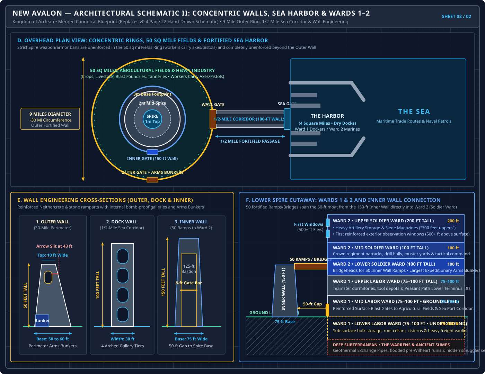
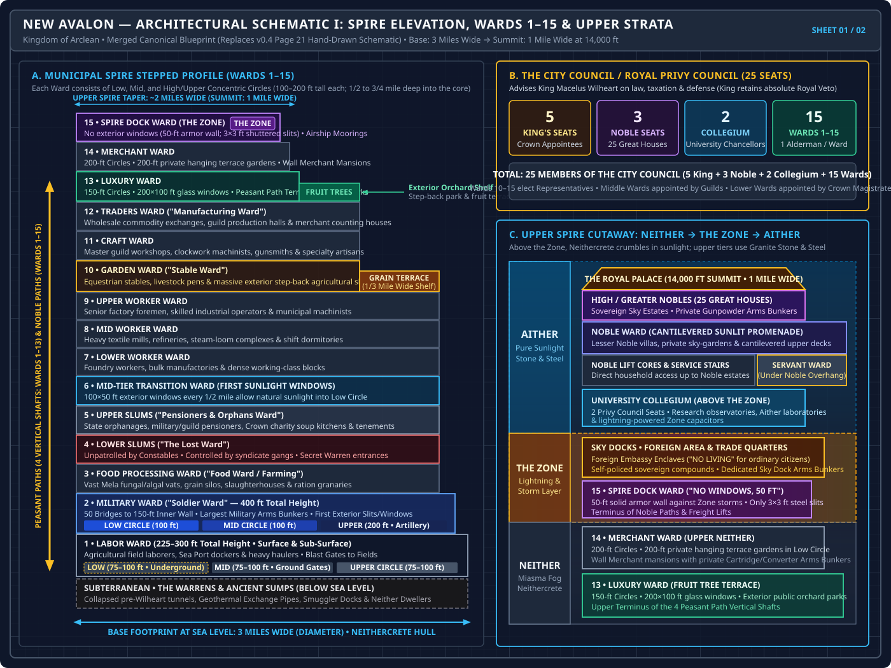

# New Avalon — Capital Spire of the Kingdom of Arclean

- **Topic:** Structural Engineering, Vertical Transit, Ward Breakdown, Districts, and Subterranean Warrens
- **Status:** **Authoritative Reference & Setting Lore**
- **Authoritative Reference:** `AISummary/WorldSummary.md` (Section 10: New Avalon), `ClockworkPathfinder/Rules/WorldAndLaw.md`, and architectural schematics in [`ClockworkPathfinder/Rules/images/SpireSchematics.html`](file:///c:/Users/mncoc/OneDrive/Documents/Git/ClockworkCities_Pathfinder/ClockworkPathfinder/Rules/images/SpireSchematics.html) (modernized vector replacement for legacy [`spire.pdf`](file:///c:/Users/mncoc/OneDrive/Documents/Git/ClockworkCities_Pathfinder/ClockworkPathfinder/Rules/images/spire.pdf): [`spire_page1_elevation.svg`](file:///c:/Users/mncoc/OneDrive/Documents/Git/ClockworkCities_Pathfinder/ClockworkPathfinder/Rules/images/spire_page1_elevation.svg) & [`spire_page2_walls_harbor.svg`](file:///c:/Users/mncoc/OneDrive/Documents/Git/ClockworkCities_Pathfinder/ClockworkPathfinder/Rules/images/spire_page2_walls_harbor.svg))

---

## 1. Structural Overview & Megalithic Engineering

**New Avalon** is the capital of the Kingdom of Arclean and one of the largest, most formidable megalithic cities in the known world:

- **Real-World Geographic Location (Mainland Scotland — Present-Day Edinburgh) & Strategic Trade Position:**
  - **Global Superpower Status:** The Kingdom of Arclean is **one of the dominant kingdoms in the world, ranking in the Top 5 globally in both technology and size**.
  - **New Avalon at Present-Day Edinburgh (Mainland Eastern Scotland):** **New Avalon is built on the eastern coast of mainland Scotland at present-day Edinburgh** (commanding the Firth of Forth and the North Sea). This location gives New Avalon both its **`1/2-mile` fortified corridor to a 4-square-mile Sea Port** on the North Sea *and* **direct overland gates opening into the mainland frontier**—allowing caravans, outriders, and adventuring parties to ride directly out of the Outer Wall into settled shires, Tombstone-style Highland mining towns, and the wild lands of roaming Orc warbands, while giving full strategic purpose to New Avalon's 30-mile Outer Wall and 150-foot Inner Wall.
  - **The Kingdom of Arclean's Footprint (9 Spires under the $\ge 50$-Mile Separation Rule — A Cohesive North Sea Empire):** Except for rare exceptions like the twin Dutch ports of **The Hague and Rotterdam** (~15 miles apart), **Spires are always separated by at least 50 miles** (see geopolitical map in [`ClockworkPathfinder/Rules/images/arclean_isles_map.svg`](file:///c:/Users/mncoc/OneDrive/Documents/Git/ClockworkCities_Pathfinder/ClockworkPathfinder/Rules/images/arclean_isles_map.svg)). From New Avalon, King Macelus Wilheart controls **9 Spires** and territories spanning:
    - **Eastern Scotland & Isles (3):** *New Avalon* (Edinburgh), *Aberdeen Spire* (~95 mi NE), and *Orkney Spire* (~130 mi N; ***not* including the Shetland Islands**),
    - **Eastern parts of Northern England down to East Anglia (4):** *Newcastle Spire* (~90 mi SE), *York Spire* (~80 mi S), *Lincoln Spire* (~60 mi SE), and *Norwich Spire* (~95 mi SE), and
    - **Two Continental Spires across the North Sea in the present-day Netherlands (2):** *The Hague* and *Rotterdam* (the rare $<50$-mile Twin-Spire exception).
  - **Neighboring Rival Kingdoms on the Isles (`Feydial` & `Derdore`):**
    - **Feydial (7 Spires):** Controls **Ireland** (*Dublin*, *Belfast*, *Galway*, *Cork*), **Wales** (*Caernarfon*, *Cardiff*), and the **Isle of Man** (7 massive Spires spaced 65–115 miles apart, comparable in scale to Arclean's).
    - **Derdore (11 Spires):** Controls **the rest of England** (*London*, *Mersey*, *Derby*, *Birmingham*, *Bristol*, *Plymouth*, *Portsmouth*, *Dover*) and the **northern coast of France (~50 miles inland: *Calais*, *Rouen*, *Cherbourg*)**; its **11 Spires** (spaced 55–100 miles apart) are much smaller and less populated than Arclean's or Feydial's (though still true mega-cities).
    - Both function socially nearly identically to Arclean; relations among the three powers are **tense**, marked by ongoing covert fighting, political intrigue, and recent border wars over territory.
  - **Premier Gateway to the Icelandic Elves:** Because of its eastern Scottish and North Sea maritime/aerial geography, Arclean is **one of the ideal locations in the world to trade with the Elves of Iceland**—giving the Crown, the 25 Great Houses, and top Wall Merchants privileged access to Elven gunpowder, steel, and high-Aither trade goods.
- **Material Architecture (Neithercrete vs. Stone & Steel):**
  - The massive body of the spire is constructed from **Neithercrete** (also known historically as *Natherium* or solidified Neither). Neithercrete is an extraordinarily tough, impact-resistant composite material that cures and thrives within the ambient miasma of the Neither.
  - However, Neithercrete **steadily deteriorates and crumbles under direct sunlight**. 
  - Consequently, as the spire rises above the sunless fog through the electrical storms of the Zone and emerges into the pristine, sunlit air of the **Aither**, the architecture transitions completely to **chiseled granite stone and high-tensile structural steel**.
- **The Spire’s Staggering Dimensions:**
  - **Base Footprint:** At sea level, the mountain-spire measures **3 miles across (diameter)**.
  - **Vertical Elevation:** It rises nearly **14,000 feet tall**, piercing completely through the Upper Neither and the violent lightning storms of the Zone to emerge high into the clean, pure atmosphere of the Aither.
  - **The Apex:** Even at its 14,000-foot summit, the spire remains a massive **1 mile across**, providing a colossal high-altitude plateau for King Macelus Wilheart’s royal castle, sovereign gardens, and the estates of the 25 Great Houses.

---

## 2. The Concentric Defense Ring: Outer Walls, Port & Fields

Surrounding the central Neithercrete spire is an immense, multi-layered defensive and agricultural complex:



```
[Outer Ocean Port] 
       │ (1/2-mile passage enclosed by 100-ft fortified walls)
[Outer Fortified Wall] ── (30 miles circumference, 50 ft tall/thick, artillery towers)
       │
[The Fields & Industrial Ring] ── (50 sq miles: livestock, grains, foundries, tanneries)
       │
[Inner Fortified Wall] ── (150 ft tall, 50 bridges connecting to Military Ward 2)
       │
[The Megalithic Spire] ── (3 miles wide at base, 14,000 ft tall to Aither summit)
```

- **The Outer Wall & Concentric Ring Dimensions (`[spire.pdf p.2]`):**
  - Nearly **30 miles long in circumference** (**9 miles in total diameter** across the outer ring), forming an imposing defensive perimeter that encloses approximately **50 square miles of territory** around the **3-mile-wide base** of the Spire (which tapers to **2 miles** mid-spire and **1 mile** at the summit).
  - Built of reinforced stone and Neithercrete, the Outer Wall stands **at least 50 feet tall** at its lowest point, with a **50-to-60-foot-thick base** tapering to a **10-foot-wide upper parapet**, internal vaulted defensive galleries, and **fortified arrow/firing slits positioned at the 43-foot elevation**.
  - It features integrated barracks for garrison armies, heavy mounted Zone-powered arc artillery on its parapets, bomb-proof internal galleries sheltered from Neither surges, and **small Arms Bunkers** along its interior face for travelers and patrols leaving and returning to the Spire.
- **The Sea Port & Secured Corridor (`[spire.pdf p.2]`):**
  - Located approximately **1/2 mile from the Outer Wall**, the seaport encompasses about **4 square miles** of ocean water, fortified jetties, deep-water dry docks, and cargo wharves.
  - Sea-going trade vessels dock here to unload raw materials, ores, and island goods, and reload manufactured spire wares. Dry docks allow new ships to be constructed and aging hulls repaired.
  - Connecting the **Wall Gate** at the Outer Wall directly to the **Sea Gate** at the Harbor is a **1/2-mile-long heavily secured transit corridor bordered on both sides by massive Dock Walls (100 feet tall and 30 feet thick, with multi-tier internal arched galleries)**, continuously patrolled by Crown military regiments and naval wall-guards.
  - The port district is administratively part of **Ward 1 (Labor Ward)** where sailors, shipwrights, and dockers reside, while marine barracks and artillery bastions fall under the jurisdiction of **Ward 2 (Military Ward)**.
- **The Agricultural Fields & Heavy Industry Ring (Weapons & Armor Unenforced):**
  - The 50 square miles of open land between the Outer Wall and Inner Wall are dedicated to feeding the city’s upper classes and housing heavy surface industry.
  - Grains, vegetables, and livestock (cattle, sheep, poultry) are raised here in natural sunlight to supply fresh meat, uncorrupted dairy, and clean flour for those who can afford food beyond processed Mela.
  - **Heavy Surface Industry:** Blacksmithing complexes, blast foundries, leather-tanning vat yards, and chemical rendering plants—anything that generates toxic fumes, heat, or does not function safely inside enclosed spire circles—operate out in these fields. Smaller specialty craft shops still operate within the spire.
  - **Practical Self-Defense Inside the Outer Walls:** Because real danger (burrowing Neither beasts, sump breaches, or raids) can strike even within the Outer Wall, the Spire's strict interior weapon and armor bans are **usually not enforced here**—most workers openly carry a **dual-purpose axe**, and those with money carry **pistols**.
- **The Inner Wall & Military Ramps (`[spire.pdf p.2]`):**
  - A colossal **150-foot-tall reinforced stone rampart** (`75-foot` base thickness) immediately surrounding the spire’s base, separated from the Spire hull by a **50-foot defensive moat/gap**.
  - Features heavily guarded, reinforced **Inner Gates** (`8-foot bar` / `125-foot` gatehouse bastions) allowing farm laborers and military outriders to pass into the fields.
  - The top parapet of the Inner Wall is physically joined directly to the **Low Circle of Ward 2 (Military / Soldier Ward) by 50 massive fortified suspension bridges and siege ramps**.

---

## 3. Spire Architecture: Concentric Circles & Strict Transit Laws

The lower and middle body of the spire is partitioned into **15 Municipal Wards**.

- **Concentric Circles:**
  - Every ward is partitioned vertically into three stacked concentric tiers known as the **Low Circle**, **Mid Circle**, and **High Circle**.
  - Circles vary between **100 and 200 feet in vertical height** (each ward totaling 300 to 600 feet tall) and burrow **1/2 to 3/4 mile deep** into the spire's mass toward the mountain core.
  - In some wards, moving between circles is as simple as walking along sloping pedestrian ramps or garden avenues; in others, vertical shear drops and secured transit checkpoints make travel between circles as difficult and restrictive as traveling between separate wards.
- **Sanctioned Transit Only (The Inviolable Rule):**
  - Moving between wards is strictly permitted **only through designated, engineered transit tunnels and lift networks**.
  - **Carving new tunnels or unauthorized paths through Neithercrete is a high treasonous civic crime and is culturally unthinkable.** 
  - This structural sanctity is so deeply ingrained into the cultural psyche of spire society that **player characters will not even contemplate or attempt actions that breach or disrupt the physical structural compartmentalization of the city**.
- **Neither-Tech Structural Scanning Grid (Constant Integrity Monitoring):**
  - Adding to the profound safety and security of the wards, sensitive **Neither-Tech resonance scanners** operate continuously throughout the spire, monitoring the density and structural integrity of the Neithercrete hull.
  - These devices can detect micro-fissures, density hollows, and unauthorized excavations **hundreds of feet away** through solid stone and Neithercrete.
  - **Every municipal section is scanned at least once weekly** by civic survey crews and stationary galvanic sensors; any detected stress, erosion, or physical modification is flagged and rapidly repaired by emergency Artisan engineering teams within hours.
- **Acoustic Jamming Technology & Illicit Bypass Tunnels (Underworld Rumors):**
  - In the shadows of the lower wards and Warrens, persistent rumors circulate that **prohibitively expensive Neither jamming technology** exists within the highest rings of organized smuggling syndicates.
  - These specialized harmonic dampeners and acoustic baffling devices can emit counter-resonance frequencies that fool or "blind" municipal scanners, disguising the existence of unauthorized passages cut through the internal structure.
  - **Severe Physical Limitations:** Even this ultra-rare, black-market technology is strictly limited—it can only mask **very narrow, cramped crawl-spaces and single-file corridors**, and an emitter network can only sustain a disguise over a very small number of modifications before harmonic bleed-through alerts the central surveyor grid.

---

## 4. The Transit Systems: Peasant Paths, Noble Paths & Dedicated Routes

Vertical movement through 14,000 feet of stacked rock and Neithercrete relies on four major engineered transit arteries:

### A. The Peasant Paths (Wards 1 through 13)
Four massive outer vertical tunnel shafts run along the perimeter of the spire, connecting the **Low Circle of Ward 1** all the way up to the **Low Circle of Ward 13**.
- **Simple Fare Collection ("Do You Have the Coin?"):** The Peasant Paths operate on a simple, indifferent transaction: **toll-takers only care if you have the coin for the trip**. As long as you drop the required Slivers or Labors into the fare box, nobody questions your business, your social standing, or your purpose. Accessible to any citizen, laborer, or traveler.
- **South Tunnel (Private Carriages):** Houses multiple sets of tracks carrying small private passenger carriages that hold **no more than 10 people** per car.
- **North Tunnel (Heavy Freight Gondolas):** Massive industrial counterweight haulers capable of moving **100 tons of bulk cargo** per lift trip.
- **East & West Tunnels (Mass Transit Commuters):** Mixed-use commuter gondolas capable of carrying **200 or more passengers** along with up to **10 tons of cargo** per run.

### B. The Noble Path (Interior High-Speed Transit & Asymmetrical Surveillance)
Located deeper inside the structural mass of the spire, the Noble Path provides rapid, luxurious, and highly guarded transit.
- **The Upward vs. Downward Surveillance Asymmetry:**
  - Unlike the indifferent toll-takers of the Peasant Path, **every single station and platform along the Noble Path is garrisoned by municipal Ward Constables and detachment squads of the King's Guard**.
  - **Going Upward (Intense Interrogation & Scrutiny):** Constables and King's Guards aggressively challenge and question **anyone who clearly does not have legitimate business at the level they are traveling up to**. A passenger's clothing, social class, posture, and credentials are scrutinized on sight. Without formal business contracts, university tokens, aristocratic livery, or verifiable proof of employment, commoners attempting to ride upward into higher wards are turned back, detained, or interrogated for subversive intent.
  - **Going Downward (Unquestioned Passage):** Conversely, **questions are never asked the same way to those traveling lower in the Spire**. The law and guards inherently assume that wealthy citizens, nobles, students, or authorized staff are entirely free to descend into the lower worker circles at will—whether for commerce, inspection, or slum entertainment. Downward mobility is effortless; upward mobility is strictly policed.
- **North Carriage (Public High-Fare Line):** Open to anyone who can afford the fare—which costs **10 times the price of the Peasant Path** for identical distance. In exchange, passengers experience plush, heated cars with virtually zero wait time. 
  - Carries passengers and cargo from Ward 1 all the way past Ward 13 to the **Merchant Ward (14)**, **Dock Ward (15)**, **Sky Docks**, and **University Collegium**.
  - **Stop Limitation:** This express line stops **exclusively at the Low Circle** of each serviced ward.
- **East Carriage (Noble Ward Dedicated Line):** Strictly reserved for verified residents of the **Noble District** and their authorized retainers. 
  - Moves private passenger carriages and freight of up to **50 tons** directly from the 1st Ward up to the Noble Quarters.
  - **Stop Limitation:** This line stops **exclusively at the High Circle** of each ward.
- **West Carriage (University Collegium Line):** Dedicated exclusively to the **University District**, its faculty, students, and licensed researchers.
  - Runs private passenger cars (holding 5 to 100 passengers) as well as academic freight cars carrying lab equipment, books, and specimens.
  - **Stop Limitation:** This line stops **exclusively at the Mid Circle** of each ward, serving as the direct transit pipeline to the **Lower University in Ward 11**.
- **South Route (The Royal Road):**
  - **Sovereignty Only:** Strictly reserved for the King, the Royal Family, the King's Guard, and high magistrates traveling on direct Crown business.
  - The entire surrounding shaft is hermetically sealed and fortified with high-security guardhouses and lethal automated arc-traps at every circle.

### C. Dedicated Freight & Pedestrian Links
- **The Trade Road:** Runs vertically in the north and south, creating an uninterrupted commercial link between the **Merchant Ward (14)**, down through the **Dock Ward (15)**, connecting across the **Sky Docks**, and terminating at the **University Collegium**.
- **Freight Elevators:** Heavy industrial freight elevators connect **Wards 7 & 8**, as well as **Wards 10 & 11**. Passenger transit on these lifts is strictly illegal.
- **Pedestrian Palace Walk:** A manicured stone causeway connects the upper terraces of the Noble Ward directly to the gates of the Royal Palace.
- **Ward 1 Surface Portals:** The Mid Circle of Ward 1 features massive reinforced blast doors opening out into the agricultural fields and outer wall grounds.
- **Ward 2 Military Bridges:** The Low Circle of Ward 2 features 50 fortified suspension bridges spanning across the moat-gap to the parapet of the 150-foot Inner Wall.
- **Arms Bunkers Across New Avalon:**
  - Heavily secured, blast-reinforced vaults (**Arms Bunkers**) store live Neither Cartridges, Radiant Converter Modules, and Constable duty weapons across the Spire:
    - **King's Guard & Constabulary:** Located in **all King's Guard offices** and **larger Ward Constable locations** (where constables also store duty weapons).
    - **Sky Docks & Outer Walls:** Dedicated Arms Bunkers sit **near the Sky Docks** for airship departures/arrivals, while **small Arms Bunkers line the inside of the Outer Walls** for travelers and workers leaving and returning to the Spire.
    - **Elite Private Estates:** **Wall Merchants** (Ward 14, storing cartridges/converters) and **Greater Nobles** (in the Aither summit, storing **gunpowder and ballistic ammunition** for the same security purpose) can maintain certified private Arms Bunkers **directly inside their living locations**.
    - **Ward 2 (Military Ward) Grand Bunkers:** The **largest Arms Bunkers** in New Avalon sit within the Military Ward, holding vast strategic stockpiles capable of equipping entire regiments for deep **expeditions into the Neither** and **extended siege defense of the Spire**.

---

## 5. Detailed Breakdown of the 15 Municipal Wards

*(Note: Each of the 15 Municipal Wards elects **1 Representative** to the **25-Member Privy / City Council**, alongside **5 King's Seats**, **3 Noble Seats**, and **2 University Collegium Seats** `[spire.pdf p.1]`).*

```
[Aither Summit: 14,000 ft] ── Royal District & King's Palace (1 mi wide summit)
                             Noble District (Estates & Manors; Servant Ward tucked beneath overhang)
                             University Collegium
─────────────────────────── [Sky Docks: ~800 ft past Zone — Enclaves ("No Living" for locals)]
═══════════════════════════ [The Zone Boundary: Lightning & Static]
Ward 15: Spire Dock Ward      (Bottom of Zone; 50-ft windowless storm hull; energy rods)
Ward 14: Merchant Ward        (Wall Merchants, private estates, inner serf circle)
Ward 13: Luxury Ward          (PC Base; master crafters, guild HQs, exterior Fruit Tree terraces/parks)
Ward 12: Traders Ward         (Middle merchants, warehousing, manufacturing/trade offices)
Ward 11: Craft Ward           (Industrial foundries, textile mills, mass goods)
Ward 10: Garden / Stable Ward (1/3-mile outer Grain & farm shelf, stables, Farmers Guild)
Wards 7, 8, 9: Worker Wards   (Lower, Mid, and Upper residential worker tenements)
Ward 6: Mid-Tier Transition   (First massive 100x50 ft exterior windows, sunlight)
Ward 5: Upper Slums           (Pensioners, widows, orphan workhouses)
Ward 4: Lower Slums           (The "Lost Ward"; deep poverty, constables spread thin)
Ward 3: Food Processing Ward  (Windowless silos, fungal vats, refrigerated vents)
Ward 2: Military/Soldier Ward (Garrisons, artillery storage, bridges to 150-ft Inner Wall)
Ward 1: Labor Ward            (Underground low circle, portals to surface fields)
[Ground Level / Surface Neither — 3 mi wide base, 150-ft Inner Wall, 50-ft Outer Wall]
```



### Ward 1: The Labor Ward (Ground / Sub-Surface)
- **Dimensions:** 3 circles (Lower, Mid, and Upper Labor Ward, each **75 to 100 feet tall** `[spire.pdf p.2]`). The Low Circle is built into the bedrock below the surface level.
- **Atmosphere & Living Conditions:** No exterior windows exist except for massive, heavily fortified iron blast doors in the Mid Circle that open to the outer fields and the 50-foot gap behind the Inner Wall. Despite the lack of spire views, residents enjoy a comparatively healthy life because they possess free daily access to the outdoor fields, working farm harvests, handling stables, and managing cargo warehouses. The lowest tiers of caravan merchants maintain city quarters here.

### Ward 2: The Military Ward ("Soldier Ward")
- **Dimensions:** Low and Mid Circles are **100 feet tall** and windowless, acting as impenetrable bastion blocks. The High Circle is **200 feet tall** (with **300 feet of upper bastion/artillery works** and dedicated **artillery storage** vaults `[spire.pdf p.2]`).
- **Defense Features & Arms Bunkers:** The Low Circle connects directly to the top of the 150-foot Inner Wall via 50 heavily guarded suspension bridges and ramps. Houses the **largest Arms Bunkers in the Spire**, capable of equipping entire regiments for expeditions into the Neither and extended siege defense.
- **The First Windows (500 Feet Up):** The High Circle features the spire's lowest exterior windows—measuring **50 feet wide by 10 feet tall**. Sitting over **500 feet above the ground**, these windows sit safely above the normal ceiling of dense Neither fog (though catastrophic Neither storms can force their heavy armored shutters closed). Filled with armories, garrison barracks, and military parade halls.

### Ward 3: The Food Processing Ward
- **Dimensions:** 3 circles, each **200 feet tall**.
- **Ventilation & Warehousing:** Solid, heavily reinforced architecture with no open viewports. Massive intake vents (**10 feet tall by 5 feet wide, spaced 10 feet apart**) pierce the outer hull to circulate air. The entire ward is packed with multi-story granaries, fungal curing vats, Mela flour processing mills, and sealed dry warehouses.
- **Economic Reality & Pin Usage:** The processing mills employ a massive underclass of threshers, vat-stirrers, and haulers. While supervisors and guild factors are paid in Slivers, the day-laborers and scullery workers rely heavily on **Pins** to buy bruised fungal cuttings, scorched mela crusts, or thin gutter broth from canteen stalls, and to settle daily debts with one another.

### Ward 4: The Lower Slums ("The Lost Ward" / "The Loser Ward")
- **Dimensions:** 3 circles, each **200 feet tall**.
- **Living Conditions:** The absolute lowest rung of civic life within the legal spire. Home to bankrupt debtor families, broken laborers, and the destitute. While conditions are grim, Ward 4 is significantly safer than the lawless Warrens behind it: municipal constables and King's Guard patrols—though spread thin—still actively patrol the streets and enforce Crown Law.
- **Micro-Economy & Scrap Markets:** Pins are the lifeblood of Ward 4's street barter. Residents buy patched secondhand rags, cast-off shoe leather, rusty nails, and day-old vat dregs strictly with Pins. The few better-off residents (tenement overseers, off-duty constables, or petty pawn brokers) conduct their business in Slivers.

### Ward 5: The Upper Slums ("Pensioners & Orphans Ward")
- **Dimensions:** 3 circles, each **200 feet tall**.
- **Living Conditions:** Marginally cleaner than Ward 4. Dedicated to municipal charities, elderly guild pensioners, war widows, and institutional orphanage workhouses. Inhabitants survive on small stipends, church charities, or second-hand scrap markets.
- **Pin Economy & Subsistence Debt:** Pensioners and orphanages trade in Pins for mended clothes, thimbles of lard, and boiled vegetable peelings. For the destitute, Pins serve as an informal ledger to track small community debts, barter household chores, or pay older orphans for protective escorts through dark stairwells. Those with steady guild stipends conduct formal purchases in Slivers.

### Ward 6: Mid-Tier Transition Ward
- **Dimensions:** 3 circles, each **200 feet tall**.
- **The Sunlight Breakthrough:** The definitive turning point in spire architecture. The Low and Mid Circles feature massive **100-foot-wide by 50-foot-tall openings** carved into the Neithercrete hull, separated by only 25 feet of load-bearing stone. Fresh mountain breezes and direct sunlight flood the interior.
- **Civic Prestige:** Back-wall terraces are planted with terraced farms, and public plazas feature real trees and manicured parks. From Ward 6 upward, social prestige increases with each ascending level.

### Wards 7, 8, & 9: The Worker Wards (Lower, Mid & Upper)
- **Dimensions:** 3 circles each, **200 feet tall**.
- **Characteristics:** Dense, bustling middle-class neighborhoods filled with residential tenements, municipal clerk offices, small taverns, and retail stalls. Connected to adjacent levels by heavy freight elevators (7↔8).
- **Economic Stratification (Slivers vs. Pins):**
  - **The Better-Off Majority:** Established shopkeepers, journeymen craftsmen, municipal clerks, and steady factory workers conduct nearly all transactions in **Slivers** (and Labors for weekly rent or wholesale trade).
  - **The Poorest Workers:** Janitors, night-soil haulers, apprentice urchins, and casual dock loaders live on the economic fringe of Wards 7–9. They rely on **Pins** to buy threadbare secondhand clothing from back-lane carts, purchase yesterday's stale mela loaves or scrap vegetable broth, and keep track of mutual debts between paydays.

### Spire-Wide Micro-Favors & Errand Runners (All Wards)
Across **all wards of the spire**—from the working districts down through the lower circles—**Pins see constant small-scale use among those who are not well off to hire children to run errands or perform favors**:
- Carrying messages between tenement blocks or workshop floors.
- Waiting in long communal water-spigot lines or carrying heavy buckets of wash-water.
- Watching delivery carts while an artisan is inside a building.
- Running hot mugs of tea or small meat-pie scraps from street vendors to shop assistants.
Paying a child a single Pin (or two Pins for a long flight of stairs) is the universally recognized custom among the working classes for minor tasks too small to justify spending a full Sliver.

- **Informal Pin Confiscation Limits (By Ward):**
  - **The 100-Pin Hoard Limit:** Regardless of ward, anyone caught with a stash or hoard of **more than 100 Pins** outside the Warrens will have the entire hoard confiscated by constables to prevent underground coin reserves from stabilizing.
  - **Slum Carry Limits (Wards 3–5):** Carrying **more than 20 Pins** on your person carries a direct risk of stop-and-frisk confiscation by ward constables.
  - **Upper & Luxury Wards (Ward 13 and Above):** Because high-circle society operates strictly on Slivers, Nobels, and credit, carrying **more than 10 Pins** on your person will result in them being immediately seized by constables as suspected underworld gutter scrip.
  - **Social Class Exemption (High Status Immunity from Constables):** Naturally, relative social class dictates enforcement. Ward constables **never stop, frisk, or confiscate Pins from high-status members of society** (Nobles, Wall Merchants, senior guild masters, or commissioned officers). Constables lack the legal standing or audacity to audit an aristocrat's pockets.
  - **The Social Penalty & Servant Honor (Peer Disdain & Status Loss):** 
    - While immune to constable confiscation, high-status individuals face a far more devastating punishment: **immediate loss of peer social standing**. Wall Merchants, Great Nobles, and high-circle elites look down with severe disgust on anyone crass or vulgar enough to carry copper Pins—or even to handle **Slivers** in any transaction.
    - **The Servant Proxy Dilemma:** Even delegating to personal staff has strict boundaries: a noble’s personal servants, when on duty, **embody the person and honor of their master**. For an on-duty valet, lady's maid, or liveried footman to handle Slivers or Pins in any official capacity or public transaction directly dishonors and humiliates their noble patron before high society. Formal household purchases are made on credit, guild accounts, or settled strictly in Nobels and Princes.
    - **Informal & Covert Pin Usage:** Pins exist within a noble estate only under strict secrecy: informally belowstairs among scullery servants trading debts with one another, or carried covertly by a noble's personal informants and spies venturing down into the lower wards and Warrens—never in any visible, official capacity.
  - **The Warrens Exemption:** None of these carry or hoard restrictions apply within the **Warrens**, where millions of Pins circulate freely beyond Crown oversight.

### Ward 10: The Garden Ward (Historically "Stable Ward")
- **Dimensions:** 3 circles, each **200 feet tall**.
- **Exterior Grain Shelf & Agricultural Ring (`[spire.pdf p.1]`):** Where the Spire steps inward above Ward 10, a spectacular **1/3-mile-wide exterior terrace shelf** circles the outer circumference of the spire. Open to direct sunlight, this broad step is heavily cultivated with **Grain** fields and vegetables, alongside interior livestock/draft stables (giving rise to its older working name, the *Stable Ward*).
- **The Farmers Guild:** Headquarters of the Farmers Guild are located here. While one of the least socially prestigious guilds in Arclean, many wealthy agrarian factors prefer living in Ward 10 over Ward 13 due to the abundant sunlight and open green space. Connected by freight lift (10↔11).

### Ward 11: The Craft Ward
- **Dimensions:** 3 circles, each **200 feet tall**.
- **Industrial Core:** The mass-manufacturing heart of New Avalon. Filled with blacksmithing forges, clockwork assembly shops, weaving mills, and joinery workshops. Goods produced here are high-quality but mass-produced, worked by artisans who sit one tier of prestige below the master craftsmen of Ward 13.
- **The Lower University & NeitherTeck Research Hub (Ward 11, Mid Circle):**
  - Located within the **Mid Circle of Ward 11** is the **Lower University**, the specialized practical campus of the University Collegium.
  - **Direct Transit Synergy (The West Carriage Station):** The Lower University sits directly adjacent to the **West Carriage transit station**. Because the University’s dedicated West Carriage line runs vertically down from the main University District and **stops exclusively at the Mid Circle of each ward**, students, professors, and academic freight (lab supplies, Neither specimens, and heavy prototypes) can step right off the private university cars directly onto the Lower University campus platforms without walking through industrial streets or mixing with general commuter traffic.
  - **Where Real NeitherTeck Happens:** Because NeitherTeck requires the ambient medium, reactive particles, and conductive fog of the Neither to function—and is completely dead up in the clean Aither of the main University Ward—**all applied research on NeitherTeck is conducted down here in the Craft Ward**.
  - **Academic Specialization:** Students specializing in NeitherTeck engineering, catalytic biochemistry, capacitive arc discharge, and apparatus fabrication study and train directly in the Lower University's heavy workshops, working shoulder-to-shoulder with master machinists and foundrymen.
  - **The Living Privilege Paradox:** Housing is always offered and guaranteed down here for both instructors and students attached to the Lower University. However, **only the most dedicated and fanatical students and professors willingly give up the immense social prestige, clean sunlit air, and status of living in the main University Ward** above the Zone. Thanks to the West Carriage line stopping right at their doorstep, most commute down daily from the Aither, while only the true hardline researchers choose to live full-time among the smoke, steam, and Neither fumes of Ward 11.

### Ward 12: The Traders Ward (Historically "Manufacturing Ward")
- **Dimensions:** 3 circles, each **200 feet tall**.
- **Mercantile & Commercial Hub:** Upper circles are occupied by successful merchants, trade factors, and shipping brokers who lack the astronomical wealth required to purchase private compounds in the Merchant Ward (14). Filled with brokerage firms, light commercial manufacturing/packaging houses, trading exchanges, and secure lockhouses.

### Ward 13: The Luxury Ward (The Great Social Nexus & Player Character Base)
- **Dimensions:** 3 circles, each **200 feet tall**. The population is only **one-quarter (~25%)** of lower worker wards due to vast private apartments, grand guild halls, and expansive estates.
- **Exterior Fruit Tree Terraces & Public Parks (`[spire.pdf p.1]`):** Where the Spire steps inward at the top of Ward 13, wide open-air exterior terraces support lush **Fruit Tree orchards** and manicured public parks—the only public exterior parks built outside the spire walls.
- **The Great Social Crossroads (Where the Classes Mingle):**
  - Ward 13 is the **single grand crossroads in the entire Spire where social strata converge, socialize, and negotiate**:
    - **Nobles & Greater Nobles:** It is the one place where a Lesser Noble, a High Noble, or even a scion of the **25 Great Houses** descends from the summit to dine in an exclusive public restaurant, enjoy fine theater, or take a private meal.
    - **Spoiled Greater Noble Heirs:** The younger, reckless sons and daughters of the ruling caste routinely slip down into Ward 13's fashionable taverns, wine lounges, and speakeasies to grab a drink, gamble away family gold, or seek illicit thrills outside the stuffy etiquette of the Aither court.
    - **Wall Merchants:** The magnates of Ward 14 are frequently seen here enjoying luxury services, consulting with master crafters, dining with high-society contacts, or slipping into the back-alleys to prepare for discreet business visits into the Warrens.
- **The Open Ceiling of Society (Highest Ward Without an Invitation):**
  - For the **well-off, educated, and successful who are not truly wealthy** (guild factors, successful scholars, senior constabulary captains, master artisans, and mid-tier merchants), **Ward 13 is the absolute highest ward in the Spire they can travel to without a formal personal invitation or Crown permit**.
  - Wards 14 (Merchant estates) and the summit Noble wards are closed, private enclaves requiring proof of caste, ownership deeds, or written aristocratic passes to enter.
  - *(Partial Functional Exceptions:)* Two specific facilities higher up have open-access exceptions because everyone—from the lowest laborer to the most powerful noble—has an operational reason to visit:
    - **The University Collegium:** Open to registered students, faculty, and those with university business.
    - **Ward 15 / The Sky Docks:** Open to industrial crews, freight porters, naval marines, and cargo handlers because the movement of airship freight and passengers demands universal access across all social levels.
- **Master Crafters & Guild World HQs:** The second terrace (Mid Circle), measuring **1/2 mile across**, is where the greatest artisan masters on the planet forge custom chronometers, tailored silk finery, precision clockwork devices, and art pieces. Nearly all **Guild Masters reside here**, and most trade guilds maintain their world headquarters in the Mid Circle.
- **Prestige Inversion (Low Circle Primacy):** In almost all other wards, the High Circle is the most prestigious address. In Ward 13, this is inverted: the **Low Circle is the most coveted location** because it connects directly to the only **public exterior parks and promenades** built outside the spire walls.
- **The Respectable Underworld (A Hands-Off "Las Vegas" Escape Valve):**
  - The Warrens behind Ward 13 do not resemble the horrific slums below; they function as a semi-legal, hands-off luxury vice district—an intentional **"Las Vegas" social escape valve** of high-stakes gambling salons, private clubs, and exclusive brothels serving wealthy elites.
  - **Rigid Criminal Class Structure & Red Lines:** The criminal element at this level knows *precisely* what lines it can and cannot cross. Syndicate bosses **Johnny Ralen** (North) and **Amanda Coren** (South) enforce a hierarchy with a **class structure, etiquette, and institutional expectations just as rigid as any upper ward**.
  - **The Citizenship Tether:** Furthermore, **only legal Citizens can leave the Warrens and maintain regular lives inside the Spire**, meaning Ward 13 syndicate operators and high-level fixers exist directly under—and must comply with—the exact same citizenship, status, and resource rules as the rest of Spire society.
  - **Covert & Overt Power Culling:** The **Crown Military, King's Guard, and Ward Constabulary** continuously monitor the Warrens and ensure that **no criminal boss or faction ever accumulates too much power**, pruning ambitious upstarts or dangerous stockpiles through both covert action (assassinations, stings, rival tip-offs) and overt force (garrison sweeps).

### Ward 14: The Merchant Ward
- **Dimensions:** 3 circles, each **200 feet tall**. The population is a mere **1/10th** of the lower wards.
- **The Wall Merchants:** Home to the richest non-noble commercial dynasties on the continent. The Low Circle is the most prestigious tier, featuring exclusive **200-foot-wide private terrace gardens** hanging off the outer spire walls. Families have committed assassinations and corporate espionage to acquire or keep these garden deeds.
- **The Currency of Prestige (Why Pins are Unthinkable):**
  - In a caste where status is liquid and competitive, **how would anyone respect the astronomical wealth of a Wall Merchant family if they were seen using Pins?** 
  - Wall Merchants trade in whole airship armadas, deep-vein mineral concessions, and imperial cargo lines valued in **Princes (`10 gp`) and Sovereigns (`100 gp`)**. For a Wall Merchant family—or even their liveried personal servants—to carry or handle common laborer Slivers, let alone gutter Pins, would be an instant social death sentence, signaling to rivals that the family's liquidity has collapsed and triggering bank runs on their credit.
- **The Inner Servants' Circle:** Instead of a lawless Warrens core, the center of Ward 14 houses an organized, comfortable servants' quarter (inhabited almost entirely by indentured serfs). Life here is clean and safe, creating fierce competition among lower-class citizens to secure domestic service positions.

### Ward 15: The Spire Dock Ward (The Zone Boundary)
- **Dimensions:** 3 circles, each **200 feet tall**.
- **The 50-Foot Windowless Storm Hull (`[spire.pdf p.1]`):** Situated at the bottom edge of the Zone. To withstand ferocious electrical squalls, **no open windows exist** (`"No Windows"` across its **50-foot-thick reinforced exterior storm wall**). The High Circle features only narrow, fortified **3-foot by 3-foot observation ports** fitted with blast-shutters.
- **Energy Rods:** Massive conductive copper and steel collector rods jut out from the Mid and High Circles into the cloud sea to harvest atmospheric lightning from the Zone.
- **Unique Social Order:** Cramped, noisy, and industrial (living standards mirror Ward 6). However, Ward 15 is the **only ward in the entire Kingdom of Arclean that legally makes no distinction between Serfs and Freemen**. Furthermore, **no toll is ever charged** to move between Ward 15 and the Sea Docks, as thousands of laborers make the journey daily.

---

## 6. Beyond the Wards: Warrens & The Tombs

```
[Spire Exterior Wards]  ──  [Solid Stone / Open Caverns]  ──  [The Warrens 1–13]  ──  [The Tombs 1–9]
 (Civilized / Policed)        (Sewage / Runoff Channels)       (Goblins / Lawless)     (Feral / Troglodytes)
```

### The Warrens (Levels 1 through 13)
Burrowed deep into the interior mountain mass (**1/2 to 1 mile behind the wards**) lie the Warrens. Separated from the civilized wards by thick bedrock or vast natural chasms bridged by waste conduits:
- **Sewage Agriculture:** Municipal runoff, industrial wash-water, and human sewage are drained across the divide into the Warrens. Using these supplies, underclass fungus farmers cultivate vast beds of **Mela** and raw mushrooms for survival.
- **The Toll Gate:** Moving between the civilized Wards and the Warrens requires crossing guarded checkpoints and paying a steep toll of **12 Pins to 1 Labor**—a fee so exorbitant that most Warrens dwellers are permanently trapped inside.
- **Goblinization (90% Population):** Saturated by constant ambient Neither, deprived of sunlight, and subsisting entirely on raw Neither fungi, **90% of the Warrens population has degenerated into Goblins (Type 3a/4c)**. Only the remaining 10% maintain enough fresh food or coin to preserve standard human physiology.
- **Wards 1–12 Warrens (Lawless Brink & What "Buying Out of the Warrens" Really Means):**
  - Utterly harsh and miserable places to live. Outside of targeted military extractions, treason sweeps, or power-culling operations, routine beat constables rarely enter.
  - **Everyone Who Gets Ahead Leaves Immediately:** Nobody stays in the lower Warrens by choice. Any fungus farmer, sweatshop worker, or scavenger who manages to scrape together even the modest wealth of a **common Ward laborer** immediately buys their way out into the regular Wards. Even **successful lower-Warrens criminals** who make real money do not stay to build underground empires—the moment they have the option to buy a small legitimate inn, tavern, or shop in the Wards, they pack up, legitimize, and leave the squalor behind.
  - **How "Buying Out of the Warrens" Actually Works:**
    1. **Dress the Part:** Accumulating enough coin to buy decent, clean clothes so you **dress like you don't belong in the Warrens**.
    2. **The "Lost Re-Entry Token" Gate Bribe:** Having enough coin to bribe a Warrens checkpoint guard to accept the polite fiction that you are a Ward resident who simply **"lost your re-entry token/papers—please don't ask too many questions."**
    3. **Surviving Until First Payday:** Having just enough pocket money left over to pay for food and a place to sleep until your first payday.
    4. **Entering Through the Slums or Food Ward (`Wards 3–5`) & "No-Questions-Asked" Hiring:** People buying their way out almost always cross over into the **Slums (`Wards 4–5`) or the Food Processing Ward (`Ward 3`)**. Employers there will **readily hire you with very few questions asked**—because everyone in the Spire assumes that **if you came from the Warrens and were resourceful, disciplined, or tough enough to gather the wealth needed to escape, you surely have the grit and skills to succeed at the job you are interviewing for** (and every incentive to work hard so you never get sent back into the Warrens).
    5. **Sovereign Sanction (Why It Is Legal & Why the Guard isn't Even Written Up):** **This is a completely valid and common PC origin or ancestry background.** By royal law, **the King considers all people living within the Spire (including the Warrens) to be citizens by default**. Consequently, **leaving the Warrens in this manner is not considered illegal**, and **a gate guard accepting the "lost re-entry token" bribe isn't even considered cause for an administrative write-up**. This unwritten royal policy functions as a deliberate meritocratic filter: it **ensures that the people leaving the Warrens are the resourceful, skilled workers the Spire actually needs**, while leaving the rest of the impoverished Warrens population in place to work the fungal beds that produce the bulk of the food (`Sycelium`/`Mela`) required to feed the city.
  - **The Tragic Reverse Flow (Slipping Into the Warrens Out of Desperation):**
    - Sadly, **just as many—or more—people actually flow the other way**: when life in the Spire becomes so hard that a person **can no longer afford to live even in the Slum Wards (`Wards 4–5`)**, or when they are **fleeing people and crushing debts that they truly *cannot* pay**, desperate citizens are constantly slipping into the Warrens.
    - **The "Cannot Pay" Reality:** The word *cannot* is absolute—**no one who can actually pay their debts or afford the barest existence in the Slums ever willingly enters life in the lower Warrens**. Entering the Warrens to live is the final refuge of the utterly destitute and the hunted.
  - **Active State Containment:** Between this constant out-migration of anyone with coin and the **Military, King's Guard, and Constabulary** using covert and overt means to crush anyone who tries to consolidate too much muscle or weaponry, the lower Warrens can never coalesce into a rival power base.
- **Ward 13 Warrens (The Gentleman's Underworld / "Las Vegas" Escape Valve):** Completely distinct from lower levels. Constables maintain a permanent year-round presence. Underworld syndicate bosses **Johnny Ralen** (North) and **Amanda Coren** (South) split territorial control, running a hands-off luxury vice district that serves as a societal escape valve. They enforce a rigid class structure, know exactly what lines never to cross, and charge a **1 Labor toll** to guard the iron gates descending into the lower Warrens. Moreover, because **only legal Citizens can leave the Warrens and lead regular lives in the Spire**, Ward 13's syndicate operators are bound by the same citizenship and institutional resource rules as the civilized wards.

### The Tombs (Levels 1 through 9, Deep Subterranean)
Lying deeper than the Warrens within the ancient, lightless mountain core:
- Ancient, pre-collapse ruins and colossal hollowed foundations where even Warrens outcasts fear to tread.
- The environment is so intensely Neither-corrupted that organic life mutates beyond recognition.
- **Troglodytes:** Home to permanently altered, sightless feral offshoots whose bodies can never be restored by sunlight or clean food.
- Rumors persist of ancient, hermetically sealed pre-collapse enclaves deep within the Tombs, but no explorer has ever returned to verify them.

---

## 7. The Upper Districts: Sky Docks, University, Noble & Royal

Above the 15 Municipal Wards and past the lightning-wracked Zone lie the pristine upper realms:

### The Sky Docks (~800 Feet Tall, Past the Zone)
- **High Circle (The Mooring Berths):** Towering ~300 feet tall, equipped with colossal Zone-powered winches, heavy cable rigs, and crane gantries that hoist airships straight up out of the Zone's cloud ceiling into dry berths for loading, unloading, and maintenance. Ringed by defensive military arc cannon batteries and dedicated **Arms Bunkers**.
- **Mid Circle (Grid Control):** The nerve center of New Avalon’s municipal infrastructure. Houses the master catalytic dynamos and switching stations that route Zone-harvested energy into the wireless radiant grid and transit lifts.
- **Low Circle (The Foreign Area / Trade Quarters / Embassy Enclaves — "No Living" for Citizens `[spire.pdf p.1]`):** 
  - A cosmopolitan buffer district of foreign diplomatic embassies, trading quarters, sovereign guild compounds, and transient airship berths situated directly between Ward 15 and the University Collegium.
  - **"No Living" Residential Restriction:** Marked `"No Living"` on Spire structural plans—ordinary Arclean citizens are **prohibited from establishing permanent domestic residence here**; the enclave quarters are strictly zoned for foreign delegations, embassies, and transient skyship crews.
  - **Extra-Territorial Sovereignty & Inter-Enclave Relations:** Enclaves operate under legally chartered **extra-territorial sovereignty**, where foreign airship captains, merchants, and sovereign delegations—from immediate neighboring powers like **Feydial** (Ireland/Wales) and **Derdore** (Southern England/Northern France), continental European kingdoms like **High Bremen**, **Malichor**, **Relocore**, and the **Free Cities**, as well as **Half-Elf factors representing the Elves of Iceland and Norway**—conduct business and resolve internal disputes under their home nations' laws and traditions.
  - When enclaves interact, trade, or feud with one another, they rely on private consular arbitration, merchant prize courts, or traditional dueling protocols rather than city magistrates.
  - **The Crown's Hands-Off Enforcement Doctrine:** While Arclean Spire and Crown law technically remain the supreme law of the land, **as long as the enclaves cause no external problems or spill violence into the public transit arteries, the Crown and Municipal Constabulary deliberately ignore internal infractions, vices, and private vendettas**. Only when unrest threatens the master dynamos, spills past the enclave perimeter gates, or harms an Arclean citizen in good standing will the King's Guard intervene with lethal force.
- **Storm Ceilings:** Extreme Zone super-storms periodically push the cloud boundary upward past the Sky Docks, temporarily halting all air traffic.

### The University District (The Collegium)
- **Higher Learning & Science:** The intellectual capital of Arclean, training physicians, architects, clockwork engineers, legal barristers, and academic scholars. Holds **2 seats** on the 25-member Privy Council.
- **Architecture & Living:** Emerging into the clean **Aither** above the Zone (`[spire.pdf p.1]`), neighborhoods are quiet, manicured, and exceptionally prestigious, with residences rivaling the Merchant Ward in luxury.
- **Storm History:** Zone storms rarely reach this altitude; the worst super-storm in recorded history reached the Mid Circle 275 years ago. On average, storm lightning touches the Low Circle only once per year.

### The Noble District (The High Estates & Under-Hung Servant Ward)
- **Grand Estates:** Dwarfs the Merchant Ward in both land area and architectural splendor; holds **3 seats** on the 25-member Privy Council (while Greater Nobles sit on the Kingdom-wide Royal Council).
- **The Exterior Terraces:** **Two-thirds (2/3) of the High Circle is built entirely outside the spire hull**, sprawling across spectacular open-air mountain terraces bathed in pristine Aither breezes.
- **The Under-Hung Servant Ward (`[spire.pdf p.1]`):** Tucked directly beneath the structural overhang of the cantilevered Noble Ward terraces (between the Collegium and the Noble estates) lies the **Servant Ward**. **Only verified Freemen** are permitted to live in this Servant Ward (enjoying a lifestyle comparable to Ward 11 craftsmen), while indentured serfs employed by noble houses are restricted to small, windowless quarters inside their masters' mansions.

### The Royal District & King's Palace (The 14,000-Foot Summit)
- **The Crown Plateau:** Occupies the uppermost three circles and the flat, 1-mile-wide mountain summit.
- **Inhabitants:** The seat of power for the **25 Great Houses**, the Privy Council, the Supreme Royal Court, and **King Macelus Wilheart**.
- **The Royal Gardens:** The palace grounds feature vast high-altitude greenhouses and sunlit open-air farms dedicated to cultivating 100% pure Strata 1 crops and livestock for the royal dining tables.

---

## 8. Municipal Utilities: Radiant Power vs. Mushroom Oil

Lighting in New Avalon illustrates the stark divide between atmospheric layers:

- **The Radiant Grid (Neither-Medium Wireless Power):**
  - Inside all 15 Municipal Wards and the Warrens, municipal power operates wirelessly via the **Neither medium**. Energy harvested by collector rods in the Zone is broadcast through the air to illuminate thousands of street fixtures and home bulbs (typically ~60W equivalent, though commercial foundries receive far brighter loads) without physical wiring.
  - **Photosensitive Harvest Lights:** In the agricultural vats where Sycelium and edible fungi are grown, radiant street lamps are strictly forbidden: Neither fungi rot rapidly under electric or solar light. These chambers use specialized dim, photosensitive illumination during harvest cycles.
- **The Aither Divide & The Great Lighting Irony (Noble Estates vs. Common Wards):**
  - **The Spire's Great Lighting Irony:** One of the supreme cultural ironies of the Spire is that **the average commoner and factory laborer enjoys brighter, far more reliable lighting than any of the 25 Great Noble Houses**. While the lower wards bathe in constant, wireless radiant electrical light, high aristocracy above the Zone lives in comparatively dim, flickering warmth.
  - **Why Radiant Power Fails in Aither:** Above the Zone in the pure, uncorrupted air of the High Noble and Royal Districts, **the wireless radiant grid completely collapses**—wireless power fundamentally requires the reactive conductive medium of the Neither.
  - **Mushroom Oil, Candles & Hearths:** Consequently, noble estates, manors, drawing rooms, and high streets are illuminated primarily by burning **refined mushroom oil** and other flammables in ornate brass and crystal lanterns, supplemented by tallow/wax candles and roaring open fireplaces.
  - **Elven Battery Lanterns (The Prestigious Luxury):** In the most important salons, state dining halls, and private studies, nobles rely on imported **Elven Lanterns**. These high-end fixtures run on massive, heavy rechargeable chemical batteries. Because of their continuous draw, **noble servants must haul these bulky batteries as often as twice a day (under heavy usage) down to the University District to be recharged**. Even after all that aristocratic labor, expense, and battery hauling, an Elven Lantern produces light that is **only about two-thirds (2/3) as bright as the effortless wireless radiant bulb humming in an ordinary peasant’s tenement**.
- **The University District (The Collegium):**
  - **The Aither Lighting Reality:** Situated in the clean Aither above the Zone, the University District lacks wireless radiant power (which requires the Neither medium). Residential dormitories, faculty cloisters, and general hallways rely on refined mushroom oil lamps, candles, and hearths, while using far fewer battery lanterns than the wealthy noble estates.
  - **The University Battery Charging Monopoly (Institutional Funding Engine):** One of the primary commercial services the University uses to fund its academic existence and research endowments is **controlling the Spire's high-altitude battery charging depots**. Because the University controls the wired high-voltage feed tapped directly from the Zone dynamos, **the Great Noble Houses pay substantial recurring fees to the University to recharge their heavy Elven batteries**. Noble liveried servants arrive around the clock with battery crates, providing the Collegium with a massive, steady revenue stream extracted straight from aristocratic pockets.
  - **The Wired Electric Exception (Libraries, Reading Rooms & Research Labs):** Slowing down higher education, technical research, and training due to poor winter lighting would be disastrously inefficient for the Spire's economy—the Crown and guilds need students educated and into productive work as fast as possible. Consequently, **by sovereign decree of the King, the great academic libraries, connected reading rooms, and advanced research cleanrooms are connected to real, wired electric lighting**.
  - **Endless Wired Current from the Zone:** Because the storm energy captured by dynamos anchored at the Zone boundary is effectively bottomless, insulated copper cables run the short distance up from the boundary directly into the university's academic core. In the libraries and reading rooms, students and scholars study around the clock beneath brilliant, steady electric lamps—completely immune to winter gloom or smoke strain. In the certified research laboratories, this same wired current provides endless power for high-voltage diagnostic arrays, electric microscopes, and delicate arc apparatuses.
- **The Palace Mystery:** Privileged visitors to King Macelus's inner palace suites report seeing brilliant electric lamps powered by **physical insulated copper wires** connected directly to deep mechanical dynamos—a marvel of high pre-collapse technology virtually unseen anywhere else in the spire.
