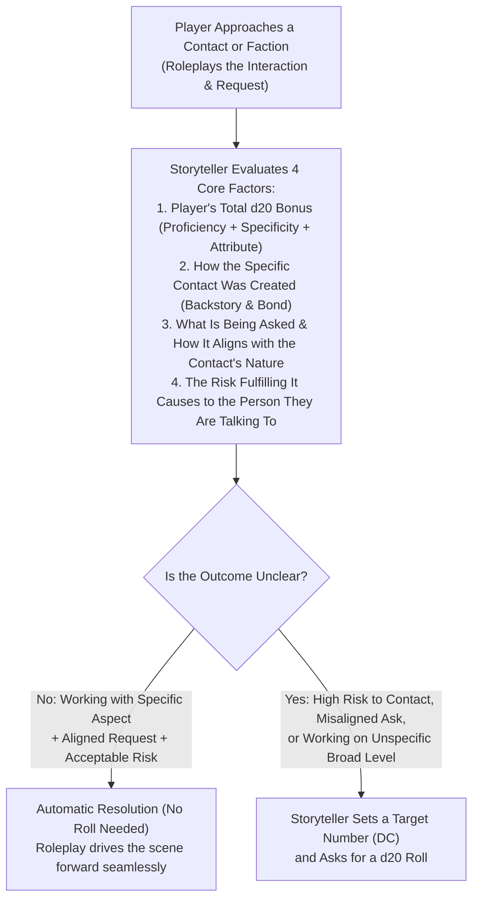
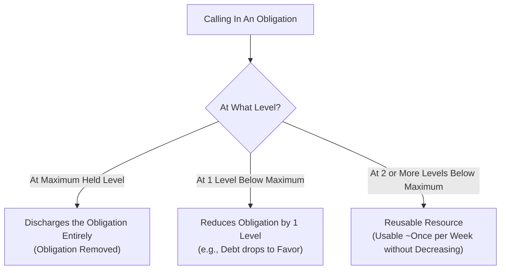

# Skills — Clockwork Cities Rules

## Overview
Skills in the Clockwork Cities setting represent training, technical disciplines, and physical competencies adapted to an environment without supernatural magic, governed by steampunk technologies, class hierarchies, and environmental boundaries (Aither, Neither, Zone).

## Summary: Real-World Plausibility & Non-Supernatural Limits
Because true supernatural magic and extraordinary planar feats do not exist in the Clockwork Cities setting, **the scope and impact of mundane skills are strictly bounded by real-world physical and psychological plausibility**. 

High proficiency rank (Master or Legendary) represents elite real-world competence, professional precision, and Olympic-caliber human capability—**not magical physics-defying powers**. Whenever a player declares an action or a Storyteller adjudicates an attempt, the foundational test is always: **"Is this physically possible in the real world?"** If an action is physically impossible without specialized tools or external mechanics, rolling a high skill check or natural 20 does not make it succeed.

### Core Grounding Principles & Examples

1. **Athletics & Physical Obstacles (Climbing, Jumping, Swimming):**
   - **Climbing Smooth Surfaces:** Scaling a sheer, glass-smooth vertical surface, polished glazed brick, or smooth sheet metal is **impossible without specialized equipment** (pneumatic suction grapples, pitons, climbing harnesses, or mechanical claws), regardless of an Athletics bonus. Skill determines speed, grip endurance, and handling under pressure, but it cannot create friction where none exists.
   - **Leaps & Vaults:** Characters cannot jump across 40-foot building gaps or leap to three-story rooftops through pure muscle alone without pneumatic jump-packs or kinetic harness assists.

2. **Stealth & Concealment (Hiding in Shadows & Infiltration):**
   - **Reasonable Cover Required:** A character cannot simply "hide in plain sight" in a fully illuminated room. To slip past four watchful constables guarding a doorway in a well-lit counting house, a character **must possess actual visual obstruction or orchestrate a major distraction** (such as cutting the arc-lights, discharging a smoke canister, or triggering a chemical fire). Stealth determines how quietly and quickly one moves between cover, not invisibility.

3. **Deception & Disguise (Impersonation Limits):**
   - **Archetype vs. Specific Identity:** Disguise and costuming can make you convincingly look like a Spire Constable, and Deception can persuade passersby and patrolmen that you hold the rank of officer. However, **you cannot convince people who personally know him that you are Constable John Stephenson**. Close acquaintances, partners, and sergeants will recognize facial incongruities, voice timber, and familiar mannerisms immediately.
   - **Physical Anatomic Constraints:** No amount of cosmetics or makeup can change gross anatomical reality. If the target being impersonated is described as a tall, lanky man of 6-foot-3, a burly, broad-shouldered 5-foot-6 character cannot pull off the impersonation in person, no matter how high their Disguise check. At best, such a check allows an impersonation at long range, in deep fog, or behind heavy foul-weather coats and respirators.

## Skill Adjustments & Removals
- **Arcana / Religion / Nature / Occultism:** Removed as magical disciplines. In their place:
  - Technical engineering and physical Neither-phenomena are governed by **Crafting** and specialized **Lore** skills.
  - Medical, biological, and surgical practices are governed by **Medicine** and physiological **Lore**.
  - Survival in Neither fog, squall tracking, and environmental navigation are governed by **Survival**.
- **Lore Sub-disciplines:**
  - *Neither-Tech Lore:* Mechanical, electrical, and pneumatic machinery, Spire power broadcasting, and capacitor limits.
  - *Forensic / Legal Lore:* Criminality, evidence examination, and Spire municipal code.
  - *Commercial / Trade Lore:* Financial markets, contract enforcement, and ward tariff laws.
  - *Subterranean / Mining Lore:* Structural stress, gas pockets, Neithercrete excavation, and seismic reading.

## Base Skill Modifications & Adjudication
- Skill feats that grant pseudo-magical or physics-breaking effects (e.g., feather-falling from any height onto cobblestones without gear, swimming up waterfalls, or walking across tissue paper without breaking it) are removed or strictly rewritten as mechanical devices.
- Extraordinary successes represent flawless execution within human anatomy and environmental physics.

---

## New System: Understanding & Social Skills

**Understanding** is a specialized competency that exists outside the standard skill system. Rather than measuring a generic action (such as jumping, crafting, or lying), Understanding represents **actionable institutional intelligence, member networks, and operational framework**—supplying deep knowledge about groups, subcultures, and organizations, specifically **what they are commonly willing to do (both legally and illegally)**.

This information is designed to give players the concrete groundwork to **define what they want to do and how to execute it**. Knowing an organization's boundaries, tolerances, and typical practices lets players craft viable, informed plans without guessing blindly.

> **Understanding (Social Skills) vs. Obligations — Two Distinct Pillars:**
> - **Understanding (Actionable Institutional Intelligence & Member Framework):** Supplies deep practical knowledge about groups and organizations, including **who their members are, what tasks they are commonly willing to do (both legal and illegal), and how to approach them safely**.
>   - *The Inquisitive Ripple (Pushing Contacts & Rolls):* When operating on an aligned, acceptable-risk level, Understanding functions smoothly without rolls. However, **an Inquisitive Ripple only occurs when the information or task being sought pushes boundaries and requires a d20 roll**. Whenever a roll is required, the Storyteller gives the player a clear, explicit warning: **they are pushing their contacts or probing too deeply, and people within the organization or rival factions might notice someone is asking questions**. The player can then make a conscious choice to back off or risk the roll and the attention it draws.
>   - *Example (Social Skill — `Understanding: Law Enforcement [13th Ward Constables]`):* Because you know the 13th Ward precinct, you know that **Constable Johnathan Treible** is the night-shift officer willing to look the other way for Warrens transit, and you know the exact protocol to approach him: slip the coin framed as a *"charitable donation to the Constable Fire-Rescue Team."*
> - **Obligation (Compelled Behavior via Societal Leverage — Limited-Use Debts):** A binding marker of sworn debt or societal leverage held over a **specific person or group**. Unlike voluntary contacts, an NPC bound by an Obligation **does not need to like you and may deeply resent what you force them to do**. Within the defined tier of the debt, **they must execute the task or face severe, catastrophic Social Standing loss to themselves and their organization**.
>   - *Example (Obligation — `Johnathan Treible`):* When carrying hot military contraband where no bribe will work, the player calls in a sworn debt: *"Johnathan Treible owes me big—he will smuggle us through off-book, and it won't cost a single coin."* Treible hates the risk, but defaults on a sworn debt mean personal and family ruin.

### Inverse Scope & Power Principle
The effectiveness and mechanical weight of Understanding scale **inversely with the size of the target group**:
- **Smaller, Tightly Defined Groups:** Grant the **most potent benefits**. When dealing with a specific local precinct, a distinct gang crew, a single guild workshop, or a particular corporate board, the character knows personal grudges, shift rotations, bribe thresholds, telltale nervous ticks, and exact behavioral habits.
- **Larger, Broad Ensembles:** Grant **generalized, modest benefits**. When applied to broad institutions across an entire Spire or city, the knowledge is diluted into general bureaucracy, institutional culture, and broad operational norms.

### Dual Structure & The 4-Tier Specificity Spectrum
Every entry of **Understanding** is selected at the **Broad Level** (from the 7 Victorian/Steampunk Institutional Groups below), after which the player chooses **how narrow to make the aspect** (**Broad Only**, **Singular Sub-Group**, **Specific Place**, or **Specific Person**) and defines **how they created that contact or connection**:
- **The Specificity Trade-Off:** The **more specific** the choice, the **greater the impact** (higher bonus, deeper narrative alignment, and **often no d20 roll required at all** when making reasonable, low-to-moderate risk requests within that specific contact's sphere). The **less specific** the choice, the **weaker the direct impact**, but the **wider the range of activities, locations, and people** the character can call on (though working at the unspecific Broad level with strangers more often involves uncertain outcomes that require a Storyteller Target Number and a d20 roll).

| Specificity Tier | Player Choice Format | Scope of Activities & Reach | Mechanical & Storyteller Impact | Example Entry |
|---|---|---|---|---|
| **1. Broad Only** *(Widest Reach)* | `Understanding: [Broad Category]` | Covers the entire institutional category across the Spire/Kingdom. Widest variety of activities, offices, and personnel you can interact with. | **+0 Specificity Bonus:** Yields general institutional habits and price ranges (e.g., *4–8 gp bribe range*). Because you are dealing with unfamiliar personnel rather than a personal contact, outcomes are more often unclear—requiring **Sense Motive vs. Deception** to read strangers and a **d20 roll against a Storyteller Target Number**. | `Understanding: Law Enforcement` *(or `Ward Constabulary`)* |
| **2. Singular Sub-Group** *(Focused Branch)* | `Understanding: [Broad] — [Sub-Group / Profession]` | Covers one specific trade guild, union branch, military regiment, syndicate crew, or steampunk profession regardless of ward. | **+1 Specificity Bonus:** You know that sub-group's internal slang, rank politics, standard fees, and professional rivalries across the city. Routine professional inquiries or low-risk trade favors aligned with your history in that sub-group often succeed **without rolling**. | `Understanding: Trade Guilds (Clockwork Machinists & Gearwrights)` |
| **3. Specific Place** *(Localized Hub)* | `Understanding: [Broad] — [Specific Ward / Precinct / Facility]` | Covers everyone and everything operating within one defined precinct, ward circle, dockyard, college, or airship. | **+2 Specificity Bonus:** You know the exact shift rotations, physical layout, customary bribe rates (e.g., *3 gp on 3rd shift*), and which sergeants or foremen are corrupt or clean at that site. Aligned requests that carry low risk to your regulars at this location usually require **no roll**. | `Understanding: Law Enforcement (13th Ward Constable Precinct)` |
| **4. Specific Person** *(Maximum Impact)* | `Understanding: [Broad] — [Named Individual & Immediate Office]` | Covers a single named power-broker, official, guild master, or fixer and their immediate desk/retinue. Narrowest scope, useless outside their sphere. | **+3 Specificity Bonus & Roll-Free Aligned Favors:** You know their schedule, vices, personal history with you, and exact price. Whenever you ask for something aligned with their nature that poses acceptable risk to them, **no roll is needed—it succeeds through roleplay**. A roll is only called for if the Storyteller judges the request pushes into high personal risk or uncertain territory. | `Understanding: Law Enforcement (Watch-Sergeant Thomas McMillion)` |

---

### The 7 Victorian & Steampunk Social Skill Groups (Broad Categories)

Modeled on **circa-1860 Victorian London inside the Great Spires** and the **American Wild West / Savage Frontier across the surface world outside**, starting social skills (`Understanding` entries) are organized into **seven Broad Institutional Groups**, incorporating steampunk-specific professions as well as frontier boomtown, outrider, and savage-lands contact networks.

> **Open-Ended Player Proposals (Never Limited by Preconceived Lists):**
> **Social skills are intentionally open-ended.** The professions, sub-groups, and contacts listed below are examples and starting inspiration—**not a closed list**. Players are always free to **propose new social skills, sub-groups, or contacts and explain why they think they fit within a given category**. Storytellers should never limit players' contacts based on preconceived notions of what is on the page, so long as the proposed group **could reasonably exist in the world and the character could plausibly have interacted with them in the game's setting**.

#### 1. Bureaucracy & University Connections
*The administrative ministries, courts of assize, Collegium ivory towers, and technical survey boards that govern Spire life.*
- **Broad Skill Options & Steampunk Professions:**
  - **Municipal & Crown Bureaucracy:** Tax assessors, Ward lease & census registrars, Privy Council clerks, Ministry of Finance & Domestic Trade officials.
  - **Courts, Barristers & Assizes:** Inns of Court solicitors, Crown magistrates, debtor-prison wardens, patent & contract clerks, bailiffs.
  - **University Collegium & Natural Philosophy:** Collegium chancellors, Aither observatory fellows, stoichiometric chemists, archivists, academic lecturers.
  - **Zone & Radiant Grid Authorities *(Steampunk Specific)*:** Zone lightning-capacitor engineers, Spire weekly resonance-scanner survey crews, municipal radiant-frequency technicians.
  - **Sanatoriums, Chirurgery & Public Health *(Steampunk Specific)*:** Hyperbaric Aither sanatorium directors, Mela-cleanse clinic physicians, quarantine inspectors, anatomical theatre prosectors.

#### 2. Labor Organizations
*The working-class muscle, unions, shift-crews, and belowstairs servants who keep the 14,000-foot Spire running.*
- **Broad Skill Options & Steampunk Professions:**
  - **Dockers, Stevedores & Sea-Corridor Unions:** 4-sq-mile Harbor longshoremen, dry-dock shipbuilders, Sea-Gate cargo handlers, warehouse teamsters.
  - **Spire Transit & Lift Riggers *(Steampunk Specific)*:** Peasant Path & Noble Path winchmen, giant counterweight engineers, vertical cable-car brakemen, freight-shaft operators.
  - **Agricultural Combines & Mela Vat Workers *(Steampunk Specific)*:** 50-sq-mile Field hands, Ward 10 Grain-terrace teamsters, Ward 3 Sycelium/Mela fungal-vat tenders, livestock drovers.
  - **Foundrymen, Millhands & Boilermakers:** Ward 7–9 shift laborers, surface blast-foundry stokers, steam-loom textile workers, chemical tanning-vat crews.
  - **Subterranean Miners, Dwarven Deep-Citadels & Frontier Boomtowns *(Steampunk / Wild West)*:** Deep-shaft ore diggers, **Scottish Highland & subterranean Dwarven mining guilds**, Geothermal Heat-Exchange Pipe maintenance crews, Neithercrete quarrymen, sump flushers, and **"Tombstone"-style frontier mining-town** prospectors, assay-office clerks, and saloon regulars.
  - **Domestic Servants, Footmen & Belowstairs Staff:** Cantilevered Servant Ward networks, noble household valets, ladies' maids, coachmen, estate kitchen & stable hands.

#### 3. Trade Guilds & Commercial Houses
*Chartered craft guilds, steampunk industrialists, banking houses, and wholesale commodity exchanges.*
- **Broad Skill Options & Steampunk Professions:**
  - **Clockwork Machinists & Gearwrights Guild *(Steampunk Specific)*:** Precision spring-winders, powered-exoskeleton smiths, pneumatic valve makers, mechanical prosthetic artificers.
  - **Neither-Tech & Cartridge Factors *(Steampunk Specific)*:** Civilian power-cell charging depots, cleanroom biochemical-catalyst technicians, wireless arc-lamp makers, respirator outfitters.
  - **Gunsmiths, Armorers & Ballistic Guilds:** *Niracrest* & *Mitheral* metallurgists, *Ebon* & *Gildrod* leather tanners, firearm/crossbow smiths, munitions factors.
  - **Alchemists, Apothecaries & Deep Spore-Brewers *(Steampunk Specific)*:** Pharmaceutical guilds, industrial acid/solvent distillers, **Dwarven & Deep One resilient fungal-strain (*Sycelium*/*Mela*) importers and subterranean factors**, antitoxin compounders.
  - **Sky-Shipwrights, Aeronauts & Zone Riggers *(Steampunk Specific)*:** Ward 15 & Sky-Dock hull builders, buoyancy-trim engineers, radiant-sail weavers, sky-crane operators.
  - **Merchant Houses, Counting Houses, Elven & Caravan Factors:** Ward 12/14 wholesale factors, marine/sky insurance underwriters, hard-alloy coin assayers, **Half-Elf trade factors & Icelandic/Norwegian Elven import brokers (gunpowder, steel, Aither goods)**, **Wild West overland stage/caravan & frontier trading-post brokers**, and **exotic Far-Eastern curio/relic traders**.
  - **Artisans, Builders & Neithercrete Masons *(Steampunk Specific)*:** Spire structural masons, 200×100-ft armored-glass windowwrights, Victorian tailors (concealed *Niracrest Weave* linings), mushroom-oil lampwrights.

#### 4. Military
*The Crown's standing regiments, aerial armadas, siege batteries, intelligence networks, and frontier cavalry/rangers.*
- **Broad Skill Options & Steampunk Professions:**
  - **Crown Army Regiments & Garrison Infantry:** Ward 2 Soldier Ward barracks, 150-ft Inner Wall ramp guards, line infantry, outland expeditionary columns.
  - **Royal Sky Navy, Sea Navies & Privateer Admiralty *(Steampunk / Golden Age of Piracy)*:** Crown war-dirigible officers, 1860s trade-lane patrol cutters, cloud-sea broadside gunners, marine grapple-boarding parties, and **Admiralty Prize-Court officials who issue *Letters of Marque* to Crown-funded privateers operating among legitimate merchants**.
  - **Siege Artillery & Great Arc Cannon Batteries *(Steampunk Specific)*:** Upper Soldier Ward artillery-storage crews, Outer Wall Zone-powered arc-cannon engineers, siege sappers (vital when Orc warbands and bandit coalitions lay siege to smaller Spires).
  - **Arms Bunker Quartermasters & Ordnance Depots *(Steampunk Specific)*:** Custodians of the heavily secured **Arms Bunkers** (Ward 2 Military bunkers, Sky-Dock depots, and Outer Wall perimeter bunkers) who control Cartridge and Radiant Converter checkouts.
  - **Outland Rangers, Frontier Forts & Warband Parley Scouts *(Wild West / Frontier)*:** 50-sq-mile Field outriders, Tombstone mining-town garrison scouts, Zone-tunnel sentries, and **deep-wilds trackers & tribal intermediaries who know the territories, war-chiefs, and parley customs of roaming Orc warbands and savage frontier civilizations**.
  - **Crown Military Intelligence & Cross-Border Operatives (`Feydial` & `Derdore`):** Covert border-war scouts, military attachés, counter-espionage officers, and deniable agents operating across the tense frontiers with **Feydial** (Ireland/Wales) and **Derdore** (Southern England/Northern France).

#### 5. Law Enforcement
*Ward policing, customs checkpoints, frontier marshals, private security details, and the incorruptible royal inquisitors.*
- **Broad Skill Options & Steampunk Professions:**
  - **Ward Constabulary & Precinct Watch:** Beat constables, ward sergeants, plainclothes detective-inspectors, night-watch whistle patrols across Wards 1–15.
  - **The King's Guard:** Elite sovereign protectors, inter-ward high-justice investigators, zero-tolerance anti-corruption & treason inquisitors.
  - **Customs, Gate & Transit Checkpoints *(Steampunk Specific)*:** Peasant Path/Noble Path toll inspectors, Sky-Dock customs officers, contraband cartridge/converter & volatile-solution sniffers.
  - **Private House Guards, Pinkertons & Frontier Marshals *(Steampunk / Wild West)*:** Security details operating under *King's Rite* or *Ward-Level Rite*, merchant vault watchmen, private inquiry agents, **mining-town circuit marshals, bounty hunters, and caravan guard-captains**.

#### 6. Criminal Underworld
*Victorian rookeries, sanctioned vice syndicates, blockade runners, frontier outlaws, and black-market techno-forgers.*
- **Broad Skill Options & Steampunk Professions:**
  - **Ward 13 Vice Syndicates ("Las Vegas" Underworld):** Johnny Ralen & Amanda Coren's North/South gambling halls, luxury brothels, bare-knuckle prize-fighting pits, pleasure dens.
  - **Warrens Rookeries, Street Gangs & Footpads:** Ward 4 ("Lost Ward") crews, cutpurses, second-story burglar rings, Pin-scrip moneychangers, goblin tunnel-runners.
  - **Smugglers, Blockade Runners, Pirates & Privateers *(Steampunk / Wild West / 1650–1730 Golden Age of Piracy)*:** Subterranean sea-cave runners, airship contraband drop-crews, **open-water and deep-Zone freebooters, pirate-haven brokers, foreign-funded privateer captains hiding among merchant fleets**, and **frontier stage/caravan bushwhackers, claim-jumpers, and renegade Orc/bandit raiders**.
  - **Bootleg Tech, Jammer & Converter Forgers *(Steampunk Specific)*:** Black-market workshops fabricating illegal ambient-bleed radiant converters, acoustic resonance-scanner jammers, and unlicenced volatile ordnance.
  - **Fences, Pawnshops, Legitimate Fronts & Relic Brokers:** Ward tavern/inn criminal fronts, stolen clockwork-part brokers, forged-permit scriveners, back-alley stitchers, and **black-market brokers of smuggled Far-Eastern or unacknowledged American curios and Era-1 relics**.

#### 7. Nobility & High Society
*The landed peerage, high-altitude Aither estates, salon intrigues, Elven delegations, and sovereign foreign enclaves.*
- **Broad Skill Options & Steampunk Professions:**
  - **The 25 Great Houses & Royal Court:** 14,000-ft Summit politics, royal courtiers, High Aither estate protocols, private Gunpowder Arms Bunker stewards, dynastic marriage brokers.
  - **Lesser & Middle Noble Houses:** Cantilevered Noble Ward landlords, shire/hamlet estate holders, aristocratic dueling clubs, hereditary officers.
  - **Wall Merchant Dynasties & Nouveau Riche:** Ward 14 hanging-garden mansions, merchant-noble marriage alliances, high-finance industrial patrons.
  - **High-Society Salons, Gentlemen's Clubs & Patronage:** Ward 13 opera boxes, exclusive dining clubs, courtly fencing academies, theatre/art patrons, high-stakes parlor games.
  - **Foreign Embassies, Sky-Dock Enclaves & Elven Delegations *(Steampunk / Cold-War Diplomacy)*:** Sovereign self-policed compounds in the Sky Docks (**Feydial** [Ireland/Wales], **Derdore** [Southern England/Northern France], continental European kingdoms such as **High Bremen**, **Malichor**, **Relocore**, and the **Free Cities**, **Half-Elf diplomats & Icelandic/Norwegian Elven trade delegations**, foreign naval attachés, **cold-war spy rings**, and **rival-kingdom envoys who covertly bankroll privateers and issue *Letters of Marque* against competing merchant fleets**).

### How Social Skills (`Understanding`) Work in Spire Play

**Spire play is intended to be predominantly social—it is the arena where roleplay-centric players shine.** Because of this, Social Skills (`Understanding`) intentionally operate differently from standard mechanical or combat tests in the game. Rather than treating every conversation or inquiry as a mandatory dice check, social resolution is **roleplay-first and context-driven**.

#### 1. The Storyteller's Four Evaluation Factors
Whenever a player calls upon an **Understanding** skill in the Spire, the Storyteller evaluates four factors holistically before deciding whether dice ever need to hit the table:

1. **The Player's Bonus on a d20 Roll:**
   - What is the character's total modifier ($\text{Proficiency Tier } [\text{Trained } +2 \text{ to Legendary } +8] + \text{Specificity Bonus } [+0 \text{ to } +3] + \text{Attribute Modifier}$)? A high standing bonus represents deep institutional fluency, established credibility, and weight in that sphere.
2. **How the Player Created the Specific Contact:**
   - What is the narrative history behind this connection? Did the player establish that this contact is a former regiment brother-in-arms, a childhood friend from the Warrens, a corrupt clerk on their family's payroll, or an academic rival who respects their work? The origin story of the contact shapes how much trust and goodwill exists at the start of the conversation.
3. **What They Are Asking & How It Aligns with the Contact's Nature:**
   - Does the request naturally fit who the contact is, what office they hold, and what they do every day? Asking a *13th Ward Watch-Sergeant* about patrol schedules or paying a customary 3-gold gate bribe is completely aligned with their nature; asking that same sergeant to forge a Privy Council royal warrant or betray their own family is not.
4. **The Risk It Will Cause to the Person They Are Talking To:**
   - What happens to the NPC if they say yes? Passing along rumor, fast-tracking routine paperwork, or looking the other way on a minor shift infraction carries low risk. Smuggling prohibited military-grade Radiant Converters past the King's Guard, destroying evidence in a high-justice inquiry, or risking dismissal, ruin, or the gallows imposes severe risk on the person across the table.

---

#### 2. Often No Roll Is Needed (Working with the Specific Aspect)
When a player is working with the **specific part** of their skill (**Specific Person**, **Specific Place**, or **Singular Sub-Group**) and makes a request that:
- **Aligns** with the nature and capabilities of that contact,
- **Fits** the backstory of how the contact was created, and
- **Poses low or reasonable risk** to the person they are talking to (especially relative to the PC's high standing d20 bonus and any customary payment or reciprocity),

**no dice roll is needed at all.** The player roleplays the scene, and the contact provides the actionable intelligence, arrangement, or favor automatically. This ensures that players who invest in social skills and engage with the fiction of the Spire are rewarded with reliable competence rather than arbitrary dice failures on routine network play.

---

#### 3. When the Storyteller Sets a Target Number & Calls for a Roll
**Only when the Storyteller feels the outcome is genuinely unclear** will they set a **Target Number (DC)** and ask the player for a d20 roll. An outcome typically becomes unclear in three situations:

1. **Elevated Risk to the Contact:** The player is asking a specific contact to stick their neck out—risking their livelihood, station, physical safety, or exposure to the King's Guard or syndicate retaliation.
2. **Stretching Beyond the Contact's Normal Alignment:** The player is asking a contact for something at the edge of their authority, against their personal temperament, or slightly outside how their relationship was defined.
3. **Operating at the Unspecific Broad Level:** The player is relying on a **Broad Only** skill (or working outside their specific contact's sphere) and approaching unfamiliar personnel whose habits, loyalties, and corruptibility they do not personally know.

##### Resolving Unclear Outcomes (Information vs. Social Execution)
When the Storyteller determines that the outcome is unclear and calls for a roll, the test uses whichever attribute fits the uncertain phase of the action:

- **Unclear Information & Operational Insight (Mental Attribute + Understanding Bonus vs. Storyteller Target Number):**
  - *When Rolled:* Used when trying to uncover hidden vulnerabilities, secret schedules, or sensitive institutional intelligence that your contact wouldn't automatically hand over, or when piecing together going rates and habits at the **Broad** level.
  - *Focus vs. Broad Precision:*
    - **Specific/Focus Inquiry (Often Automatic; Rolled Only for Deep Secrets):** Reveals concrete specifics: *"Thomas McMillion, who works 3rd shift Monday through Friday at the canal gate, is the best person to approach. For contraband of that grade, he usually expects around 3 gold pieces."*
    - **Broad Inquiry (General, Variable Estimates):** Yields broad institutional habits and price ranges: *"To smuggle metal into the 3rd Ward, you can expect the going bribe rate for a checkpoint guard to run between 4 to 8 gold pieces depending on the guard's temperament."*
  - *Degrees of Success (When Rolled):*
    - **Critical Success:** Detailed, actionable intelligence: exact contact names, shift schedules, personal vulnerabilities or leverage (gambling debts, family ties), and customary bribe amounts.
    - **Success:** Reliable general intelligence: a specific contact name or shift, and approximate costs or behavioral expectations.
    - **Failure:** Vague rumors: the character knows the precinct or faction is on high alert or generally suspicious, but learns no actionable names or shift openings.
    - **Critical Failure:** Active misinformation: the character is led to believe an incorruptible officer is open to bribes, given false patrol schedules, or misjudges a trap/sting.

- **Unclear Social Leverage & High-Risk Execution (Charisma + Understanding Bonus vs. Storyteller Target Number):**
  - *When Rolled:* Used when persuading a specific contact to accept **significant personal risk** or step outside their normal comfort zone, OR when executing a deal at the **Broad** level with an unfamiliar member of the institution.
  - *Executing with a Specific Contact (Low vs. High Risk):*
    - If the request aligns with your contact (e.g., Thomas McMillion) and carries his customary risk/payoff, **no roll is required**. If you ask him to let a fugitive wanted by the King's Guard slip through his gate, the Storyteller weighs his loyalty to you against the noose and sets a **Target Number** for your Charisma + Understanding roll (with your `+3` Specific Person bonus and proficiency helping considerably, and a mild failure usually meaning he refuses or demands a steeper guarantee rather than immediately blowing his whistle).
  - *Executing on a Broad Level with Strangers (Sense Motive vs. Deception $\rightarrow$ Charisma Roll):*
    - When you only have **Broad** understanding and approach a guard or clerk you do not personally know, the outcome is inherently unclear:
      1. **Reading the Target (Sense Motive / Perception vs. Deception DC):** You first gauge how likely this unfamiliar individual is to accept a bribe or bend the rules, opposed by their Deception DC (e.g., a guard hiding their greed behind a stern face, or pretending to be corrupt to sting an amateur).
      2. **The Pitch (Charisma + Understanding vs. Storyteller Target Number):** You then roll against the Storyteller's Target Number (paying the higher 4–8 gold Broad rate). A failure with a stranger risks suspicion, alarm whistles, or detainment.

#### Team Handoffs & Disparate Knowledge
Information gathered through a contact or Understanding entry can be shared with party members, but execution carries nuance:
- **Sharing Intel:** A character with Understanding (such as a Scholar or Soldier who knows constabulary shift patterns or has a contact at the gate) can brief a high-Charisma party member (such as a Dandy or Merchant) to make the physical approach.
- **Target Number Adjustment:** However, if the contact was created by the first character—or relies on subcultural codes, slang, hand gestures, and unspoken trust specific to that group—an unfamiliar party face will **more likely have to roll (and face a higher Target Number)** than the character who actually holds the bond and the Understanding.

#### Unfamiliar Factions & Indirect Chaining
Players should never be blocked simply because they lack an Understanding entry for a newly encountered group. Instead of narrative shortcuts, players are encouraged to use **indirect network chaining**:
- *Example:* If the party needs to access the sky-dock cranes but nobody has *Understanding: Sky-Dock Crane Operators*, a character with *Understanding: Law Enforcement (13th Ward Constable Precinct)* might visit their friendly constable contact (often **without needing a roll**) to ask who runs the cranes, which operators take payoffs, or who owes a debt.
- This creates an organic, player-driven chain of favors and introductions—less direct and slightly slower than having the focus outright, but grounded entirely in the PCs' existing network.

- **Storyteller Note on Environmental Scope:**
  If an adventure or campaign arc unexpectedly shifts into wards, cities, or wild frontier outposts outside of what the players could reasonably have anticipated during character creation, **Storytellers should freely allow appropriate retrofits or adjustments** to player Understanding entries to ensure every PC remains connected to the active environment.

#### Using Social Skills in Neighboring Kingdoms (`Feydial` & `Derdore`) & Beyond
Because neighboring kingdoms like **Feydial** (Ireland and Wales) and **Derdore** (Southern England and Northern France)—as well as the kingdoms of mainland Europe—share the same general Spire social structure as **Arclean**:
- **Broad Skills Still Function Across Borders (With Distance Penalties):**
  - **International / Cross-Border Networks (Nearly Unaffected):** Certain Broad skills that naturally operate across borders—such as **Merchant trade routes, international shipping/skyship brokers, and cross-border commercial houses**—are **nearly unaffected (`0` to `-2` penalty)** when operating in neighboring kingdoms.
  - **Standard Broad Skills in Neighboring Kingdoms (`-4` to `-8` Penalty):** Most other Broad skills (such as local *Bureaucracy*, *Law Enforcement*, *Military*, *Labor Organizations*, or *Nobility*) still apply when visiting **Feydial** or **Derdore**, but suffer a **`-4` to `-8` penalty** reflecting unfamiliar local statutes, different noble houses, and foreign institutional quirks.
  - **Farther European Kingdoms (`-4` to `-12` Penalty — Future Expansion Scope):** As travel moves farther away into mainland European kingdoms, the adjustment shifts to **`-4` to `-12`** depending on distance and cultural divergence *(detailed regional breakdowns are reserved for future supplements beyond the immediate neighboring kingdoms)*.
- **Acquiring Local Social Skills Through Leveling:**
  - If a campaign expands to spend significant time in **Feydial**, **Derdore**, or another European kingdom, players may use their **Social Advancements (or level-up swaps)** as they level up to **acquire new social skills—or establish new Specific Contacts/Places—anchored directly in that new kingdom**, operating there at full strength with no foreign penalty.

> **Summary of Specific vs. Broad Resolution in Spire Play:**
> | Aspect Used | How the Storyteller Evaluates It | When Is a d20 Roll Needed? |
> |---|---|---|
> | **Specific Aspect** *(Person, Place, or Sub-Group)* | Storyteller weighs **(1)** PC's d20 bonus, **(2)** how the contact was created, **(3)** alignment with the contact's nature, and **(4)** risk to the contact. | **Often NO roll is needed** when the request aligns with the contact and carries acceptable risk. Roll against a **Storyteller Target Number** *only* when the outcome is unclear (e.g., high risk to the contact or an out-of-character ask). |
> | **Broad Aspect** *(General Institution)* | You know institutional norms and going rates (e.g., *4–8 gp*), but lack a pre-built personal bond with the individual in front of you. | **Roll is normally required** because the stranger's reaction is unclear: read the target (**Sense Motive vs. Deception**) and roll against the **Storyteller's Target Number**. |

---

### Class Acquisition, Allocation & Starting Broad Group Assignments

Every character gains a number of **Understanding** entries at 1st level derived from their class baseline and social presence:

$$\text{Total Understanding Entries} = \text{Automatic Base (2)} + \text{Class Base} + \text{Charisma Modifier} \quad (\text{Minimum } 1 \text{ chosen})$$

1. **Automatic Baseline (2 Entries):** Every class grants **2 automatic Broad Understanding entries** selected from their core institutional sphere (reflecting their immediate trade guild, home ward precinct, military branch, or social upbringing).
2. **Class Base Entries:** In addition to the 2 automatic entries, classes receive a base number of selectable Broad Understanding entries according to their social scope, network reliance, and institutional mobility:
   - **4 Entries (The Influence Trio):** **Merchant**, **Noble**, and **Black Marketeer** (under the **70/30 Rule**, ~70% of their network anchors in their primary sphere while ~30% branches across other spheres).
   - **3 Entries (Institutional & Maritime Leaders):** **Sky Captain**, **Artisan**, and **Scholar**.
   - **2 Entries (Investigative, Technical & Courtly Specialists):** **Inspector**, **Officer**, **Clockwork Engineer**, **Dandy**, and **Chirurgeon**.
   - **1 Entry (Frontline Martials & Field Operatives):** **Soldier**, **Pugilist**, **Survivor**, **Mad Bomber**, **Clockwork Rifleman**, and **Scout** *(including Subterranean Miner)*.
3. **Charisma Modifier:** Characters add their **Charisma modifier** to their total pool of selectable Understanding entries (minimum 1 selectable entry regardless of negative Charisma).
4. **Choosing the Narrow Aspect:** After selecting each Broad Skill from their class's allowed groups below, the player chooses its **Specificity Tier** (**1. Broad Only**, **2. Singular Sub-Group**, **3. Specific Place**, or **4. Specific Person**), trading scope of activity for direct mechanical impact (`+0` to `+3`).

#### Master Class Starting Social Skill (`Understanding`) Table

| Class | Base Pool | 2 Automatic Broad Entries (Pick 2 from Core Sphere) | Selectable Starting Broad Groups (`Class Base + CHA Mod`) |
|---|:---:|---|---|
| **Merchant** | **4** | **Trade Guilds & Commercial Houses** *(Merchant Houses, Counting Houses, Cartridge Factors, or Sky-Shipwrights)* | **Primary (70%):** Trade Guilds & Commercial Houses, Bureaucracy & University (Customs/Finance), Labor Organizations (Dockers/Transit) **Cross-Sphere (30%):** Nobility (Wall Merchants/Embassy Enclaves) or Criminal Underworld (Smugglers/Fences) |
| **Noble** | **4** | **Nobility & High Society** *(25 Great Houses, Lesser/Middle Nobles, or High-Society Salons)* | **Primary (70%):** Nobility & High Society, Bureaucracy & University (Privy Council/Courts/Collegium), Military (Officer Corps/Sky Navy) **Cross-Sphere (30%):** Law Enforcement (King's Guard/House Guards) or Trade Guilds (Wall Merchants) |
| **Black Marketeer** | **4** | **Criminal Underworld** *(Ward 13 Vice Syndicates, Warrens Rookeries, Smugglers, or Fences/Fronts)* | **Primary (70%):** Criminal Underworld, Labor Organizations (Dockers/Transit/Sump Crews) **Cross-Sphere (30%):** Law Enforcement (Corrupt Precinct Watch/Checkpoints) or Trade Guilds (Bootleg Tech/Pawn Brokers) |
| **Sky Captain** | **3** | **Military** *(Royal Sky Navy)* OR **Trade Guilds** *(Sky-Shipwrights, Aeronauts & Zone Riggers)* | **Choose from:** Trade Guilds & Commercial Houses, Military (Sky Navy/Arms Bunkers), Labor Organizations (Dockers/Transit Riggers), Bureaucracy (Zone & Grid Authorities / Sky-Dock Customs), Nobility (Foreign Embassies & Sky-Dock Enclaves), Criminal Underworld (Blockade Runners) |
| **Artisan** | **3** | **Trade Guilds & Commercial Houses** *(Artisans/Masons, Gunsmiths/Armorers, or Clockwork Machinists)* | **Choose from:** Trade Guilds & Commercial Houses, Labor Organizations (Foundrymen/Millhands/Miners), Bureaucracy & University (Patent Clerks/Grid Authorities), Nobility (High-Society Patrons) |
| **Scholar** | **3** | **Bureaucracy & University Connections** *(University Collegium, Municipal Bureaucracy, Courts, or Zone/Grid Authorities)* | **Choose from:** Bureaucracy & University Connections, Trade Guilds & Commercial Houses (Neither-Tech Factors/Alchemists), Nobility & High Society (Collegium Patrons/Embassy Enclaves), Law Enforcement (Forensic/Magistrates) |
| **Inspector** | **2** | **Law Enforcement** *(Ward Constabulary, King's Guard, or Private Inquiry)* OR **Bureaucracy** *(Courts & Assizes)* | **Choose from:** Law Enforcement, Bureaucracy & University (Courts/Sanatoriums/Coroners), Criminal Underworld (Rookeries/Fences/Vice Syndicates), Labor Organizations (Dockers/Servants) |
| **Officer** | **2** | **Military** *(Crown Army Regiments / Sky Navy)* OR **Law Enforcement** *(Ward Constabulary / King's Guard)* | **Choose from:** Military, Law Enforcement, Bureaucracy & University (Crown Ministries/Courts), Nobility & High Society (Lesser/Middle Noble Officer Corps) |
| **Clockwork Engineer** | **2** | **Trade Guilds** *(Clockwork Machinists & Gearwrights or Neither-Tech & Cartridge Factors)* | **Choose from:** Trade Guilds & Commercial Houses, Bureaucracy & University (Zone & Radiant Grid Authorities / Collegium), Labor Organizations (Spire Transit Riggers / Foundrymen), Military (Siege Artillery / Arms Bunkers), Criminal Underworld (Bootleg Tech & Converter Forgers) |
| **Dandy** | **2** | **Nobility & High Society** *(High-Society Salons, Gentlemen's Clubs, or Lesser/Middle Nobles)* | **Choose from:** Nobility & High Society, Criminal Underworld (Ward 13 "Las Vegas" Vice Syndicates), Trade Guilds (Luxury Tailors/Artisans), Bureaucracy & University (Collegium/Court Circuits), Labor Organizations (Domestic Servants & Belowstairs Gossip) |
| **Chirurgeon** | **2** | **Bureaucracy & University** *(Sanatoriums, Chirurgery & Public Health)* OR **Trade Guilds** *(Alchemists, Apothecaries & Spore-Brewers)* | **Choose from:** Bureaucracy & University (Public Health/Collegium), Trade Guilds (Apothecaries/Spore-Brewers), Military (Field Hospitals/Regiments), Labor Organizations (Mela Vat Workers/Miners), Criminal Underworld (Back-Alley Stitchers & Rookeries) |
| **Soldier** | **1** | **Military** *(Crown Army Regiments, Siege Artillery, or Arms Bunker Quartermasters)* | **Choose from:** Military, Law Enforcement (Ward Constabulary / Private House Guards), Labor Organizations (Foundrymen/Dockers), Criminal Underworld (Prize-Fighting Pits / Mercenary Muscle) |
| **Pugilist** | **1** | **Labor Organizations** *(Dockers, Foundrymen, or Transit Riggers)* OR **Criminal Underworld** *(Ward 13 Prize-Fighting Pits / Street Gangs)* | **Choose from:** Labor Organizations, Criminal Underworld, Law Enforcement (Beat Constables), Nobility & High Society (Sporting Patrons & Gentlemen's Boxing Clubs) |
| **Survivor** | **1** | **Criminal Underworld** *(Warrens Rookeries, Street Gangs, or Fences)* OR **Labor Organizations** *(Sump Crews / Servants)* | **Choose from:** Criminal Underworld, Labor Organizations, Law Enforcement (Precinct Watch / Gate Checkpoints), Trade Guilds (Scrap & Pawn Factors) |
| **Mad Bomber** | **1** | **Trade Guilds** *(Alchemists & Industrial Distillers)* OR **Criminal Underworld** *(Bootleg Tech & Ordnance Forgers)* | **Choose from:** Trade Guilds & Commercial Houses, Military (Siege Artillery / Sappers), Labor Organizations (Subterranean Miners / Foundrymen), Criminal Underworld |
| **Clockwork Rifleman** | **1** | **Military** *(Arms Bunker Quartermasters / Regiments)* OR **Trade Guilds** *(Gunsmiths, Armorers & Cartridge Factors)* | **Choose from:** Military, Trade Guilds & Commercial Houses (Gunsmiths/Cartridge Factors), Law Enforcement (Private Bodyguards / Checkpoints), Criminal Underworld (Smugglers) |
| **Scout** | **1** | **Military** *(Outland Rangers & Frontier Forts)* OR **Labor Organizations** *(Subterranean Miners, Sappers & Sump Crews)* | **Choose from:** Military (Outland Rangers), Labor Organizations (Miners/Agricultural Combines/Caravan Teamsters), Trade Guilds (Caravan & Shipping Brokers), Criminal Underworld (Blockade & Tunnel Runners) |

---

### Independent Social Advancement Track: Expanding vs. Deepening Contacts

Growing and deepening your contact network is a core pillar of progression in the Spires. **Social Advancement operates on its own dedicated track—completely separate from standard Pathfinder Skill Increases, Skill Feats, and Class Feats.**

Every starting **Understanding** entry begins at **Trained** proficiency ($\text{Level} + 2$). As characters level up, they earn **Social Advancements** at a rate determined by their **Class Social Tier** (heavily favoring social and institutional classes in both how often they advance and how deeply they can master a network).

#### 1. How to Spend a Social Advancement (Player Choice)
Whenever you gain a **Social Advancement**, choose one of two options:
- **Option A — Expand Your Network (Add a New Social Skill at Trained):**
  - Gain **1 new Broad Understanding entry** at **Trained** proficiency ($\text{Level} + 2$) and choose its **Narrow Aspect** (*1. Broad Only*, *2. Singular Sub-Group*, *3. Specific Place*, or *4. Specific Person*).
  - *(Note: Influence classes continue to maintain their ~70/30 primary-to-cross-sphere balance across their total pool).*
- **Option B — Deepen an Existing Connection (Advance Proficiency Tier):**
  - Increase the proficiency rank of one existing **Understanding** entry by one step (**Trained [+2] $\rightarrow$ Expert [+4] $\rightarrow$ Master [+6] $\rightarrow$ Legendary [+8]**), subject to your class's **Minimum Level Gate** and **Maximum Proficiency Cap** below.
  - When you deepen an entry's proficiency rank, you may also freely adjust its **Narrow Aspect** (either narrowing it for higher bonus or broadening it now that your higher proficiency rank compensates for the wider reach).

#### 2. What Proficiency Tiers Unlock (`Trained` $\rightarrow$ `Legendary`)
Your proficiency bonus ($\text{Level} + 2 / 4 / 6 / 8$) increases your standing d20 bonus (raising the threshold of requests the Storyteller resolves **automatically without a roll**) and applies whenever the Storyteller does call for a d20 roll against an uncertain Target Number:

| Proficiency Tier | Bonus | Network Standing | Storyteller Evaluation & Mechanical Privileges Unlocked |
|---|:---:|---|---|
| **Trained** | $\text{Lv} + 2$ | **Acquaintance / Initiate** | **• Aligned Specific Requests:** Low-risk requests aligned with how you created your specific contact succeed without a roll; make standard rolls without outsider penalties when the Storyteller deems the outcome unclear. |
| **Expert** | $\text{Lv} + 4$ | **Trusted Insider** | **• Higher Roll-Free Threshold:** Your deeper relationship allows moderate-risk aligned requests with your specific contact to resolve without rolling. **• Critical Failure Cushion:** When a roll *is* called for (high risk or Broad strangers), any Critical Failure becomes a regular **Failure** (avoiding stings, burned contacts, or immediate arrest). **• Fast Chaining:** Indirect network chaining through this group takes **half the normal time**. |
| **Master** | $\text{Lv} + 6$ | **Inner-Circle Broker** | **• Automatic Institutional Intel:** Even at the **Broad** or **Sub-Group** level, routine operational intel (shift schedules, key-holders, customary bribe rates) never requires a roll. **• Instant Subcultural Read:** Even when operating at the **Broad** level with strangers, you no longer need a preliminary *Sense Motive vs. Deception* check to tell if an unfamiliar member is corrupt or clean. |
| **Legendary** | $\text{Lv} + 8$ | **Institutional Apex / Kingpin** | **• Apex Standing & Success Upgrade:** Only extreme-risk or institution-shaking asks require a roll with your specific contact, and whenever you roll a regular **Success** on an uncertain check with this group, it becomes a **Critical Success**. **• Weekly Standing Courtesy (Free Tier 1–2 Favor):** Once per week within this network, you can call in a **Trivial (Tier 1)** or **Favor (Tier 2)** request (fast-tracking paperwork, securing a private audience, borrowing guild facilities, or having a patrol look away from a minor infraction) **automatically and without spending an Obligation**. |

#### 3. Class-Tiered Social Advancement Schedule & Proficiency Gates
Both the **frequency of Social Advancements**, the **rate of network re-training on level-up**, and the **level gates for Expert, Master, and Legendary** favor social characters:

| Social Tier & Classes | Starting Class Base | Social Advancement Levels *(Separate from Skill Increases)* | Total Advancements (Lv 1–20) | Proficiency Level Gates & Max Cap | Level-Up Swap / Re-Training Rate |
|---|:---:|---|:---:|---|:---:|
| **Tier 1: The Influence Trio** *(Merchant, Noble, Black Marketeer)* | **4** | **Every Even Level** (`2, 4, 6, 8, 10, 12, 14, 16, 18, 20`) **+ Bonus at Levels `5, 11, 17`** | **13** | • **Expert:** Level **2+** • **Master:** Level **6+** • **Legendary:** Level **12+** *(Uncapped Legendary entries)* | Swap up to **4** entries per level |
| **Tier 2: Social, Maritime & Guild Leaders** *(Dandy, Sky Captain, Artisan, Scholar)* | **3** *(Dandy 2)* | **Every Even Level** (`2, 4, 6, 8, 10, 12, 14, 16, 18, 20`) | **10** | • **Expert:** Level **3+** • **Master:** Level **7+** • **Legendary:** Level **15+** *(Max **2** Legendary entries)* | Swap up to **3** entries per level |
| **Tier 3: Investigative, Command & Tech Specialists** *(Inspector, Officer, Clockwork Engineer, Chirurgeon)* | **2** | **Every 3 Levels** (`3, 6, 9, 12, 15, 18`) | **6** | • **Expert:** Level **5+** • **Master:** Level **11+** • **Legendary:** Level **18+** *(Max **1** Legendary entry in core sphere)* | Swap up to **2** entries per level |
| **Tier 4: Frontline Martials & Field Operatives** *(Soldier, Pugilist, Survivor, Mad Bomber, Clockwork Rifleman, Scout)* | **1** | **Every 4 Levels** (`4, 8, 12, 16, 20`) | **5** | • **Expert:** Level **5+** • **Master:** Level **13+** • **Max Cap:** **Master** *(Cannot reach Legendary without a social archetype)* | Swap up to **1** entry per level |

#### 4. Re-Allocating / Swapping Contacts on Level-Up
- Every time a PC gains a level, in addition to spending any new Social Advancement gained at that level, they may **re-train / swap up to their Swap Rate (`4 / 3 / 2 / 1`)** of existing Understanding entries (or shift an entry's Narrow Aspect between Person, Place, Sub-Group, and Broad).
- If a character swaps out an entry they had previously deepened to **Expert** or higher, the replacement entry comes in at **one proficiency tier lower** (minimum **Trained**), reflecting the time needed to rebuild deep insider trust in a brand-new network (though **Tier 1 Influence Classes** can transfer their full proficiency rank when swapping within their 70% Primary Sphere!).

---

## New System: Obligation (Compelled Behavior via Societal Leverage)

While **Understanding** provides the actionable intelligence, member networks, and operational framework regarding what groups are commonly willing to do, **Obligation** is the **limited-use mechanism for compelling behavior from a specific person or group through societal leverage**:

- **No Affection Required (They May Dislike or Resent You):** Unlike a friendly or receptive contact from your Understanding skills, an NPC or organization who owes you an Obligation **does not need to like you—and may actively resent you and what you force them to do**. They comply because in a society where *"Worth = who you represent"*, publicly defaulting on a recognized debt or obligation destroys their personal honor, their guild credit, and their family's standing.
- **Compelled Task or Social Standing Loss:** Within the bounds of the obligation held, **the target must perform the task or suffer severe, catastrophic Social Standing loss to themselves and their organization**.
- **No Roll Needed to Compel:** So long as the demand falls within the tier of the Obligation held (and does not violate a competing supreme oath like high treason against the King), **no dice roll is required**—calling in the Obligation compels the behavior automatically and burns down the Obligation tier as detailed below. (Because no roll is required, calling in an Obligation never triggers an Inquisitive Ripple).

### Acquisition & Narrative Distribution
Obligations are **narrative and roleplay rewards**, earned through player decisions, completed missions, saved lives, or strategic downtime deals rather than character creation point-buy.

- **Storyteller Defined:** The Storyteller adjudicates when an NPC commits to an Obligation and at what tier, based on the magnitude of the favor done for them.
- **Individual vs. Party-Wide Ownership:**
  - *Individual Obligations:* Tied to a single PC who established the personal bond (e.g., an officer who saved an old war comrade, or a surgeon who cured an orphan).
  - *Party-Wide Obligations:* Held collectively by the adventuring group (e.g., a grateful district magistrate whose ward the party protected from a Neither surge). Any party member may call upon a party Obligation with the group's consent.
- **Starting Character Baseline (No Starting Degradable Resources):**
  - **No class starts with inherent Obligations at 1st level.** Because Obligation is a consumable, degrading resource, classes should not have their base power budget tied to burning down a finite starting pool. (This design choice may be revisited later if specific social classes like the Merchant or Dandy prove to need additional non-combat leverage).

### Obligation Tiers

Obligations with an individual are tracked across five defined tiers (from highest to lowest):

| Tier | Level Name | What It Represents | Example In Play |
|:---:|---|---|---|
| **5** | **Life Debt** | The NPC owes you their life, the life of their child, or salvation from utter ruin. | The NPC will **willingly risk death**, face criminal treason, or throw themselves into active danger to repay the debt. |
| **4** | **Risk** | The NPC owes you a major debt that warrants substantial personal or professional danger. | Smuggling you past an armed checkpoint, forging official Spire transit passes, or looking away while an alarm sounds, risking their job or jail time. |
| **3** | **Debt** | A substantial, serious debt (financial, legal, or moral) requiring real effort or expenditure. | Loaning significant funds without collateral, sheltering the party in a private hideout for several days, or providing restricted tools. |
| **2** | **Favor** | A notable professional or personal courtesy. | Pulling strings to fast-track an application, providing non-public records, or arranging a private introduction with a peer. |
| **1** | **Trivial** | Minor social courtesies, small tips, or entry-level introductions. | Setting up a meeting with a merchant's junior clerk so you can attempt to convince them you are worth the merchant's personal time. |

---

### Expenditure & Decay Mechanics

Calling upon an Obligation draws down the social capital binding the individual to you. How the tier changes depends on how heavily you lean on the relationship:

1. **Calling In at Maximum Level (Full Discharge):**
   - If you demand a favor matching the highest tier you hold (e.g., demanding a Life Debt sacrifice, or calling in a Risk-level border breach when Risk is the maximum tier held), **the Obligation is completely removed** once fulfilled. The moral slate is wiped clean.
2. **Calling In at One Level Below Maximum (Step-Down):**
   - If you call in a favor **one level below** your maximum held tier, the relationship is strained or partially paid off: the Obligation **decreases by one tier**.
   - *Example:* If you hold a **Debt (Tier 3)** with an arms factor and ask them for a **Favor (Tier 2)** (such as arranging an immediate private introduction with their guild master), your standing with them steps down to **Favor (Tier 2)** afterward.
3. **Calling In at Two or More Levels Below Maximum (Sustained Courtesy):**
   - If you call in a request **two or more levels below** your maximum held tier, the NPC handles it as a standard, ongoing courtesy that does **not decrease** the Obligation.
   - *Frequency Limit:* To prevent abuse, this can be done approximately **once per week** (or per downtime interval).
   - *Example:* If an NPC owes you a **Life Debt (Tier 5)** or **Risk (Tier 4)**, asking them for a **Trivial (Tier 1)** favor (like setting up a meeting with a junior clerk) or a **Favor (Tier 2)** is done willingly as minor upkeep; your overall Life Debt or Risk remains intact.

---

### Limits, Loyalty & Social Consequences of Default

Obligations exist within the complex web of human psychology, ideology, and social standing. They are **not mind control**:

1. **Competing Loyalties & Unreasonable Demands:**
   - Individuals respond differently based on their convictions, rank, and personal morality.
   - *Example:* It is nice that the Crown Prince owes you a **Life Debt**, but **no, he will not smuggle you and an armed party into the throne room** to commit treason. If an individual is fiercely devoted to a higher cause, their crown, or their religion, they may choose death, severe penance, or dishonor rather than repay you with an act that violates their core oath.
2. **Dishonorable Actors & Enforcement:**
   - Not everyone in the world is honorable. A ruthless Warrens gang boss may openly acknowledge that he owes you a Life Debt or a heavy Debt, but actually getting him to pay is an entirely different matter—he may stall, look for loopholes, try to settle in cheap coin, or calculate whether it's simpler to have you quietly eliminated if you push too hard.
3. **The Weight of Family Honor & The Cost of Default:**
   - With that said, the vast majority of citizens across the Spires live and die by **the honor of their family and house**, which is built entirely on the integrity of those who bear its name.
   - In a setting where *"Worth = who you represent"*, publicly reneging on a recognized debt or failing to fulfill an acknowledged Obligation carries devastating consequences:
     - **Loss of Family Standing:** The debtor brings public shame upon their house or trade guild, frequently resulting in being demoted within their family hierarchy, stripped of allowances, or formally cast out.
     - **Social & Legal Ruin:** News travels quickly through salons, trade offices, and guild halls. A family or individual known to default on debts suffers massive status penalties, lost business credit, and social ostracization.

