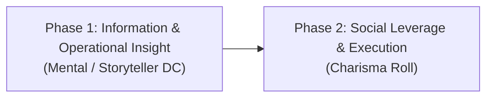
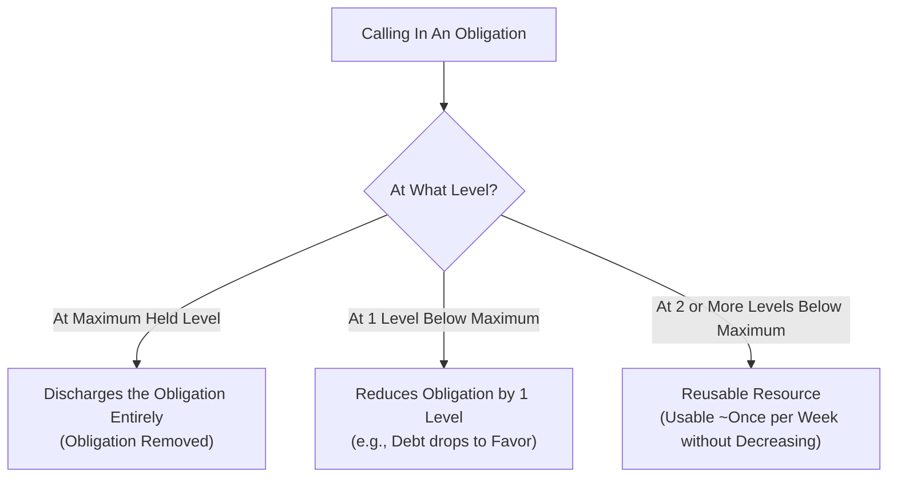

# Skills — Clockwork Cities Rules

## Overview
Skills in the Clockwork Cities setting represent training, technical disciplines, and physical competencies adapted to an environment without supernatural magic, governed by steampunk technologies, class hierarchies, and environmental boundaries (Aither, Neither, Zone).

## Summary: Real-World Plausibility & Non-Supernatural Limits
Because true supernatural magic and extraordinary planar feats do not exist in the Clockwork Cities setting, **the scope and impact of mundane skills are strictly bounded by real-world physical and psychological plausibility**. 

High proficiency rank (Master or Legendary) represents elite real-world competence, professional precision, and Olympic-caliber human capability—**not magical physics-defying powers**. Whenever a player declares an action or a Storyteller adjudicates an attempt, the foundational test is always: **"Is this physically possible in the real world?"** If an action is physically impossible without specialized tools or external mechanics, rolling a high skill check or natural 20 does not make it succeed.

### Core Grounding Principles & Examples

1. **Athletics & Physical Obstacles (Climbing, Jumping, Swimming):**
   - **Climbing Smooth Surfaces:** Scaling a sheer, glass-smooth vertical surface, polished glazed brick, or smooth sheet metal is **impossible without specialized equipment** (pneumatic suction grapples, pitons, climbing harnesses, or mechanical claws), regardless of an Athletics bonus. Skill determines speed, grip endurance, and handling under pressure, but it cannot create friction where none exists.
   - **Leaps & Vaults:** Characters cannot jump across 40-foot building gaps or leap to three-story rooftops through pure muscle alone without pneumatic jump-packs or kinetic harness assists.

2. **Stealth & Concealment (Hiding in Shadows & Infiltration):**
   - **Reasonable Cover Required:** A character cannot simply "hide in plain sight" in a fully illuminated room. To slip past four watchful constables guarding a doorway in a well-lit counting house, a character **must possess actual visual obstruction or orchestrate a major distraction** (such as cutting the arc-lights, discharging a smoke canister, or triggering a chemical fire). Stealth determines how quietly and quickly one moves between cover, not invisibility.

3. **Deception & Disguise (Impersonation Limits):**
   - **Archetype vs. Specific Identity:** Disguise and costuming can make you convincingly look like a Spire Constable, and Deception can persuade passersby and patrolmen that you hold the rank of officer. However, **you cannot convince people who personally know him that you are Constable John Stephenson**. Close acquaintances, partners, and sergeants will recognize facial incongruities, voice timber, and familiar mannerisms immediately.
   - **Physical Anatomic Constraints:** No amount of cosmetics or makeup can change gross anatomical reality. If the target being impersonated is described as a tall, lanky man of 6-foot-3, a burly, broad-shouldered 5-foot-6 character cannot pull off the impersonation in person, no matter how high their Disguise check. At best, such a check allows an impersonation at long range, in deep fog, or behind heavy foul-weather coats and respirators.

## Skill Adjustments & Removals
- **Arcana / Religion / Nature / Occultism:** Removed as magical disciplines. In their place:
  - Technical engineering and physical Neither-phenomena are governed by **Crafting** and specialized **Lore** skills.
  - Medical, biological, and surgical practices are governed by **Medicine** and physiological **Lore**.
  - Survival in Neither fog, squall tracking, and environmental navigation are governed by **Survival**.
- **Lore Sub-disciplines:**
  - *Neither-Tech Lore:* Mechanical, electrical, and pneumatic machinery, Spire power broadcasting, and capacitor limits.
  - *Forensic / Legal Lore:* Criminality, evidence examination, and Spire municipal code.
  - *Commercial / Trade Lore:* Financial markets, contract enforcement, and ward tariff laws.
  - *Subterranean / Mining Lore:* Structural stress, gas pockets, Neithercrete excavation, and seismic reading.

## Base Skill Modifications & Adjudication
- Skill feats that grant pseudo-magical or physics-breaking effects (e.g., feather-falling from any height onto cobblestones without gear, swimming up waterfalls, or walking across tissue paper without breaking it) are removed or strictly rewritten as mechanical devices.
- Extraordinary successes represent flawless execution within human anatomy and environmental physics.

---

## New System: Understanding

**Understanding** is a specialized competency that exists outside the standard skill system. Rather than measuring a generic action (such as jumping, crafting, or lying), Understanding measures an individual's deep, practical insight into the operational patterns, internal cultures, unspoken protocols, vulnerabilities, and psychology of specific factions, institutions, subcultures, and groups within the world.

### Inverse Scope & Power Principle
The effectiveness and mechanical weight of Understanding scale **inversely with the size of the target group**:
- **Smaller, Tightly Defined Groups:** Grant the **most potent benefits**. When dealing with a specific local precinct, a distinct gang crew, a single guild workshop, or a particular corporate board, the character knows personal grudges, shift rotations, bribe thresholds, telltale nervous ticks, and exact behavioral habits.
- **Larger, Broad Ensembles:** Grant **generalized, modest benefits**. When applied to broad institutions across an entire Spire or city, the knowledge is diluted into general bureaucracy, institutional culture, and broad operational norms.

### Dual Structure: Broad Level & Focus
Every entry of Understanding consists of two interconnected parts:
1. **Broad Category:** The overarching organization, social caste, or institutional tradition.
2. **Focus:** The specific division, localized precinct, sub-branch, or named cell where the character's direct experience lies.

> **Example Format:**
> `Understanding: Constables (13th Ward Precinct)`
> - **Broad Level (*Constables*):** General awareness of city-wide constabulary jurisdiction, standard radio/whistle codes, chain of command protocols, and official court paperwork.
> - **Focus (*13th Ward Precinct*):** Granular insight into the 13th Ward's corrupt sergeant, which patrol routes avoid the fog vents after twilight, which officers take payoffs from the local dockworkers' union, and who panics under live gunfire.

### Dual-Attribute Mechanism: How Understanding Works

Unlike standard Pathfinder skills that tie to a single fixed attribute (like Athletics to Strength or Medicine to Wisdom), **Understanding operates in two distinct operational phases driven by two different attributes**:

#### Phase 1: Information & Operational Insight (Mental / Storyteller DC)
The player rolls to extract concrete operational intelligence, institutional layout, shifts, or specific vulnerabilities regarding the group. The precision of the information scales dramatically between **Broad** and **Focus**:

- **Focus Inquiry (Granular, High Precision):**
  - *Example (13th Ward Focus):* The roll reveals actionable specifics: *"Thomas McMillion, who works 3rd shift Monday through Friday at the canal gate, is the best person to approach. For contraband of that grade, he usually expects around 3 gold pieces."*
  - *Advantage:* You know the person, their schedule, and what they usually demand. There is far less guesswork.
- **Broad Inquiry (General, Variable Estimates):**
  - *Example (General Constabulary / Ward Scope):* The roll yields broad institutional habits and price ranges: *"To smuggle metal into the 3rd Ward, you can expect the going bribe rate for a checkpoint guard to run between 4 to 8 gold pieces depending on the guard's temperament."*
  - *Drawback:* You do not know who is clean and who is corrupt; you will need to feel out an unfamiliar guard on the scene.

##### Degrees of Success (Phase 1 Information Roll)
- **Critical Success:** Detailed, actionable intelligence: exact contact names, shift schedules, personal vulnerabilities or leverage (gambling debts, family ties), and customary bribe amounts.
- **Success:** Reliable general intelligence: a specific contact name or shift, and approximate costs or behavioral expectations.
- **Failure:** Vague rumors: the character knows the precinct or faction is on high alert or generally suspicious, but learns no actionable names or shift openings.
- **Critical Failure:** Active misinformation: the character is led to believe an incorruptible officer is open to bribes, given false patrol schedules, or misjudges a trap/sting.

#### Phase 2: Social Leverage & Execution (Charisma Roll)
Once the player has information (or approaches a target in the field), they make a **Charisma check** to leverage that understanding to achieve active results, acquire sensitive details, extract favors, or successfully execute a bribe.

- **Executing with a Specific Focus:**
  - Because you approach someone whose habits, shift patterns, and typical expectations you already know (e.g., Thomas McMillion), the transaction is direct and carries low risk. The Charisma DC is low, and failure usually just means haggling or returning on another shift rather than sounding an alarm.
- **Executing on a Broad Level (Sense Motive vs. Deception):**
  - When you only have broad understanding and approach a guard you do not personally know, you cannot simply hand over coin blindly. You must first read the person:
    - **Reading the Target (Sense Motive / Perception):** You make a Sense Motive check to gauge how likely this individual guard is to accept a bribe and whether they are receptive or rigidly incorruptible.
    - **Opposed by Deception:** The guard's true loyalties or wariness may be actively masked, opposing your read with their Deception DC (e.g., a guard pretending to be open to a bribe to sting an amateur smuggler, or hiding their greed behind a stern face).
    - **The Pitch:** Only after reading them (or risking a blind offer) do you make the Charisma check to pitch the bribe (at the higher 4–8 gold rate). A failure risks raising suspicion, alarm whistles, or immediate detainment.

#### Team Handoffs & Disparate Knowledge
Information gathered in Phase 1 can be shared with party members, but execution carries nuance:
- **Sharing Intel:** A character with Understanding (such as a Scholar or Soldier who knows constabulary shift patterns) can brief a high-Charisma party member (such as a Dandy or Merchant) to make the physical approach.
- **Target Number / DC Adjustment:** However, the **DC will often be different (higher)** for the charismatic face. The character who actually possesses the Understanding knows the subtle subcultural codes, slang, hand gestures, and telltale signs of fear or hesitation specific to that group. A high-Charisma face lacking that Understanding may speak elegantly, but lacks the subcultural fluency to read subtle signals, causing the guard or bureaucrat to remain slightly on edge.

#### Unfamiliar Factions & Indirect Chaining
Players should never be blocked simply because they lack an Understanding entry for a newly encountered group. Instead of narrative shortcuts, players are encouraged to use **indirect network chaining**:
- *Example:* If the party needs to access the sky-dock cranes but nobody has *Understanding: Sky-Dock Crane Operators*, a character with *Understanding: Constables (13th Ward)* might approach a friendly constable contact to ask who runs the cranes, which operators take payoffs, or who owes a debt.
- This creates an organic, player-driven chain of favors and introductions—less direct and slightly slower than having the focus outright, but grounded entirely in the PCs' existing network.

> **Storyteller Note on Environmental Scope:**
> If an adventure or campaign arc unexpectedly shifts into wards, cities, or wild frontier outposts outside of what the players could reasonably have anticipated during character creation, **Storytellers should freely allow appropriate retrofits or adjustments** to player Understanding entries to ensure every PC remains connected to the active environment.

> **Summary of the Two Tiers in Practice:**
> | Tier | Information Gained (Phase 1) | Execution & Risk (Phase 2) |
> |---|---|---|
> | **Focus** | Specific contact, shift times, customary rate (e.g., *Thomas McMillion, 3rd shift, usually 3 gold*). | Direct, low DC, virtually no risk of alarm on minor failure. |
> | **Broad** | General estimate and going rates (e.g., *4 to 8 gold across the 3rd Ward*). | Requires **Sense Motive vs. Deception** to identify target receptiveness; higher DC and risk of arrest. |

---

### Class Acquisition & Allocation

Every character gains a number of Understanding entries at 1st level derived from their class baseline and social presence:

$$\text{Total Understanding Entries} = \text{Automatic Base (2)} + \text{Class Base} + \text{Charisma Modifier} \quad (\text{Minimum } 1 \text{ chosen})$$

1. **Automatic Baseline (2 Entries):** Most classes grant **2 automatic Understanding entries** reflecting the character's background, social upbringing, or institutional starting point (e.g., their immediate trade guild, home ward precinct, military branch, or local community).
2. **Class Base Entries:** In addition to the 2 automatic entries, classes receive a base number of selectable Understanding entries according to their social scope, network reliance, and institutional mobility:
   - **4 Entries:** **Merchant** (broadest commercial syndicates, black markets, supply chains, and municipal customs).
   - **3 Entries:** **Sky Captain**, **Artisan**, and **Scholar** (trade guilds, academic colleges, port authorities, and aircrews).
   - **2 Entries:** Most other investigative, technical, or social classes (e.g., **Inspector**, **Officer**, **Clockwork Engineer**, **Dandy**, **Chirurgeon**).
   - **1 Entry:** The most physical, insular, or frontline martial classes (e.g., **Soldier**, **Brute**, **Pugilist**, **Survivor**, **Miner**, **Mad Bomber**, **Clockwork Rifleman**, **Scout**).
3. **Charisma Modifier:** Characters add their **Charisma modifier** to their total pool of selectable Understanding entries.
4. **Minimum Pool:** Regardless of negative Charisma modifiers, a character always receives a **minimum of 1** selectable Understanding entry (in addition to any automatic entries provided by their class/background).

---

### Progression & Growth

As characters travel across different city wards, interact with new factions, and rise in prominence, their network of Understanding evolves through two distinct mechanisms:

1. **Re-allocating / Swapping on Level-Up:**
   - Every time a PC gains a level, they may **replace up to their class base number** of Understanding entries (e.g., a Merchant can swap up to 4 entries, an Artisan up to 3, an Inspector up to 2, and a Soldier up to 1).
   - This represents letting old, stale contacts and localized knowledge fade in favor of studying and embedding themselves into new wards, gangs, corporate syndicates, or precincts encountered during recent adventures.

2. **Gaining Additional Understanding Entries:**
   - In addition to retuning existing entries, characters expand their overall capacity over time.
   - Every character gains **1 additional permanent Understanding entry every 3 levels**, starting at 3rd level:
     - **Levels 3, 6, 9, 12, 15, and 18.**

---

## New System: Obligation

While **Understanding** reflects a character's institutional and structural knowledge of factions and groups, **Obligation** measures personal leverage, sworn debts, and social credit held with **specific individuals**. 

### Acquisition & Narrative Distribution
Obligations are **narrative and roleplay rewards**, earned through player decisions, completed missions, saved lives, or strategic downtime deals rather than character creation point-buy.

- **Storyteller Defined:** The Storyteller adjudicates when an NPC commits to an Obligation and at what tier, based on the magnitude of the favor done for them.
- **Individual vs. Party-Wide Ownership:**
  - *Individual Obligations:* Tied to a single PC who established the personal bond (e.g., an officer who saved an old war comrade, or a surgeon who cured an orphan).
  - *Party-Wide Obligations:* Held collectively by the adventuring group (e.g., a grateful district magistrate whose ward the party protected from a Neither surge). Any party member may call upon a party Obligation with the group's consent.
- **Starting Character Baseline (No Starting Degradable Resources):**
  - **No class starts with inherent Obligations at 1st level.** Because Obligation is a consumable, degrading resource, classes should not have their base power budget tied to burning down a finite starting pool. (This design choice may be revisited later if specific social classes like the Merchant or Dandy prove to need additional non-combat leverage).

### Obligation Tiers

Obligations with an individual are tracked across five defined tiers (from highest to lowest):

| Tier | Level Name | What It Represents | Example In Play |
|:---:|---|---|---|
| **5** | **Life Debt** | The NPC owes you their life, the life of their child, or salvation from utter ruin. | The NPC will **willingly risk death**, face criminal treason, or throw themselves into active danger to repay the debt. |
| **4** | **Risk** | The NPC owes you a major debt that warrants substantial personal or professional danger. | Smuggling you past an armed checkpoint, forging official Spire transit passes, or looking away while an alarm sounds, risking their job or jail time. |
| **3** | **Debt** | A substantial, serious debt (financial, legal, or moral) requiring real effort or expenditure. | Loaning significant funds without collateral, sheltering the party in a private hideout for several days, or providing restricted tools. |
| **2** | **Favor** | A notable professional or personal courtesy. | Pulling strings to fast-track an application, providing non-public records, or arranging a private introduction with a peer. |
| **1** | **Trivial** | Minor social courtesies, small tips, or entry-level introductions. | Setting up a meeting with a merchant's junior clerk so you can attempt to convince them you are worth the merchant's personal time. |

---

### Expenditure & Decay Mechanics

Calling upon an Obligation draws down the social capital binding the individual to you. How the tier changes depends on how heavily you lean on the relationship:

1. **Calling In at Maximum Level (Full Discharge):**
   - If you demand a favor matching the highest tier you hold (e.g., demanding a Life Debt sacrifice, or calling in a Risk-level border breach when Risk is the maximum tier held), **the Obligation is completely removed** once fulfilled. The moral slate is wiped clean.
2. **Calling In at One Level Below Maximum (Step-Down):**
   - If you call in a favor **one level below** your maximum held tier, the relationship is strained or partially paid off: the Obligation **decreases by one tier**.
   - *Example:* If you hold a **Debt (Tier 3)** with an arms factor and ask them for a **Favor (Tier 2)** (such as arranging an immediate private introduction with their guild master), your standing with them steps down to **Favor (Tier 2)** afterward.
3. **Calling In at Two or More Levels Below Maximum (Sustained Courtesy):**
   - If you call in a request **two or more levels below** your maximum held tier, the NPC handles it as a standard, ongoing courtesy that does **not decrease** the Obligation.
   - *Frequency Limit:* To prevent abuse, this can be done approximately **once per week** (or per downtime interval).
   - *Example:* If an NPC owes you a **Life Debt (Tier 5)** or **Risk (Tier 4)**, asking them for a **Trivial (Tier 1)** favor (like setting up a meeting with a junior clerk) or a **Favor (Tier 2)** is done willingly as minor upkeep; your overall Life Debt or Risk remains intact.

