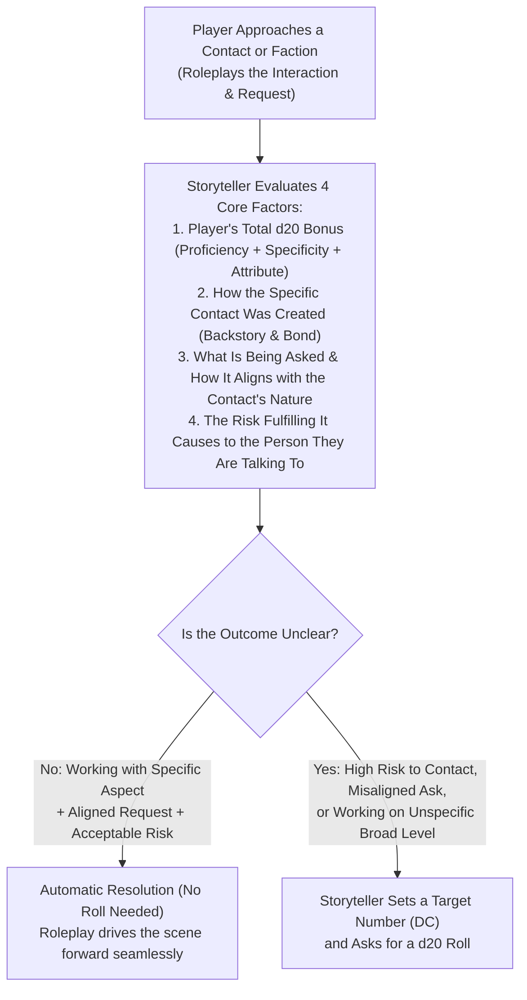
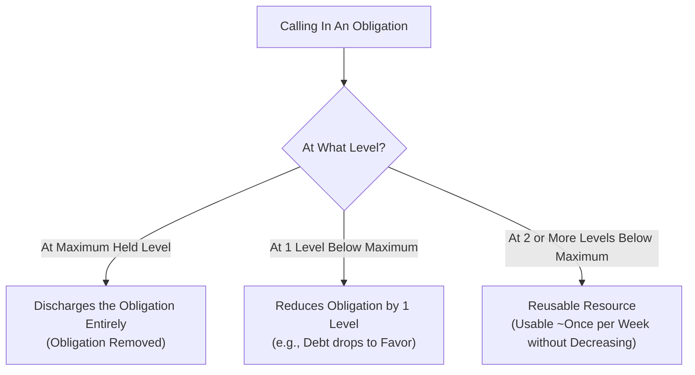

# Skills — Clockwork Cities Rules

## Overview
Skills in the Clockwork Cities setting represent training, technical disciplines, and physical competencies adapted to an environment without supernatural magic, governed by steampunk technologies, class hierarchies, and environmental boundaries (Aither, Neither, Zone).

## Summary: Real-World Plausibility & Non-Supernatural Limits
Because true supernatural magic and extraordinary planar feats do not exist in the Clockwork Cities setting, **the scope and impact of mundane skills are strictly bounded by real-world physical and psychological plausibility**. 

High proficiency rank (Master or Legendary) represents elite real-world competence, professional precision, and Olympic-caliber human capability—**not magical physics-defying powers**. Whenever a player declares an action or a Storyteller adjudicates an attempt, the foundational test is always: **"Is this physically possible in the real world?"** If an action is physically impossible without specialized tools or external mechanics, rolling a high skill check or natural 20 does not make it succeed.

### Core Grounding Principles & Examples

1. **Athletics & Physical Obstacles (Climbing, Jumping, Swimming):**
   - **Climbing Smooth Surfaces:** Scaling a sheer, glass-smooth vertical surface, polished glazed brick, or smooth sheet metal is **impossible without specialized equipment** (pneumatic suction grapples, pitons, climbing harnesses, or mechanical claws), regardless of an Athletics bonus. Skill determines speed, grip endurance, and handling under pressure, but it cannot create friction where none exists.
   - **Leaps & Vaults:** Characters cannot jump across 40-foot building gaps or leap to three-story rooftops through pure muscle alone without pneumatic jump-packs or kinetic harness assists.

2. **Stealth & Concealment (Hiding in Shadows & Infiltration):**
   - **Reasonable Cover Required:** A character cannot simply "hide in plain sight" in a fully illuminated room. To slip past four watchful constables guarding a doorway in a well-lit counting house, a character **must possess actual visual obstruction or orchestrate a major distraction** (such as cutting the arc-lights, discharging a smoke canister, or triggering a chemical fire). Stealth determines how quietly and quickly one moves between cover, not invisibility.

3. **Deception & Disguise (Impersonation Limits):**
   - **Archetype vs. Specific Identity:** Disguise and costuming can make you convincingly look like a Spire Constable, and Deception can persuade passersby and patrolmen that you hold the rank of officer. However, **you cannot convince people who personally know him that you are Constable John Stephenson**. Close acquaintances, partners, and sergeants will recognize facial incongruities, voice timber, and familiar mannerisms immediately.
   - **Physical Anatomic Constraints:** No amount of cosmetics or makeup can change gross anatomical reality. If the target being impersonated is described as a tall, lanky man of 6-foot-3, a burly, broad-shouldered 5-foot-6 character cannot pull off the impersonation in person, no matter how high their Disguise check. At best, such a check allows an impersonation at long range, in deep fog, or behind heavy foul-weather coats and respirators.

## Master Skills Roster

The standard skills in Clockwork Cities represent secular sciences, environmental disciplines, craft specializations, and physical conditioning:

| Skill | Key Stat | Core Setting Scope & Practical Application |
| :--- | :---: | :--- |
| **Acrobatics** | **DEX** | Balance across narrow iron gantries, swinging from airship rigging, diving under falling gears, and agile evasive movement. |
| **Aither Nature** | **WIS** | Upper atmospheric ecology, pristine clean-air flora and fauna, high-altitude barometric patterns, avian migration, and uncorrupted biological life. |
| **Arclean History** | **INT** | Knowledge of human history across two distinct eras: • **Recent History:** The reign of King Macelus Wilheart, continental bridgehead wars in Normandy (Cherbourg & Rouen), Spire treaties, and cold war politics. • **Pre-Storms History:** Ancient pre-industrial civilizations before the Neither cataclysm, lost megaliths, and forgotten sciences. |
| **Athletics** | **STR** | Scaling sheer Neithercrete structures (with pitons/rigs), forced entry, hauling boiler coal, grappling, shoving, and high-exertion swimming. |
| **Bombardier** | **INT** | Tactical combat skill: calibrating, stabilizing, and launching **Reaction Manifold** chemical/grenade payloads; governs save DCs and payload efficacy. |
| **Clockwork Technology** | **INT** | Mechanical design, gear ratios, spring tensioning, escapement valves, pneumatic circuitry, wireless induction resonance, and advanced clockwork engineering. |
| **Crafting** | **INT** | Physical manufacturing, metal forging, carpentry, tailoring, gunsmithing, armor repair, industrial chemistry, and routine mechanical maintenance. |
| **Deception** | **CHA** | Con artistry, forged cargo manifests, impersonating municipal inspectors, misleading adversaries in combat, and verbal subterfuge. |
| **Diplomacy** | **CHA** | Contract arbitration, guild negotiation, salon decorum, diplomatic mediation, and smoothing tensions between syndicates and the constabulary. |
| **Intimidation** | **CHA** | Strong-arming dock toughs, coercing informants, enforcing municipal Spire tolls, and Demoralize actions during combat. |
| **Medicine** | **WIS** | Clinical surgery, battlefield triage, suturing, treating Neither-lung necrosis, bone setting, chemical burn care, and field resuscitation. |
| **Mycology** | **INT / WIS** | The science, cultivation, and harvesting of fungi, mold colonies, and spore biology. Critical to Spire survival for *Mela* food vat cultivation, commercial yeast brewing, medicinal penicillin/mold extracts, subterranean fungal farming, and identifying lethal toxic spore clouds in the lower Neither sumps. *(Note: Fungi follow their own unique taxonomy and ecological behaviors, separate from general Neither Adaptations).* |
| **Neither Adaptations** | **INT** | How the Neither medium mutates and alters physical, biological, and thermodynamic realities: cellular drift, dietary shift degradation, combustion surge cycles, Neithercrete synthesis, and mutated beasts/abominations. *(Excludes fungi and spore colonies, which are governed exclusively by Mycology).* |
| **Performance** | **CHA** | High-society entertainment, oratorical public agitation, street theater distractions, courtly recitations, and salon music. |
| **Society** | **INT** | Municipal ward jurisdictions, Spire laws, aristocracy, underworld etiquette, trade tariffs, civic bureaucracy, and municipal codes. |
| **Stealth** | **DEX** | Infiltration, moving quietly between shadows/steam vents, and evading Ward Constabulary curfew patrols. Requires reasonable physical cover. |
| **Survival: Aither** | **WIS** | High-summit thin-air survival, solar glare navigation, pristine clean-air survival, avoiding extreme exposure, and mountain-top bird tracking. |
| **Survival: The Zone** | **WIS** | Static storm reading, lightning ground path avoidance, high-altitude thermal updrafts, and airship rigger survival in turbulent gales. |
| **Survival: Upper Neither** | **WIS** | Spire exterior traversal, flue exhaust navigation, Peasant Path cable-climbing, cantilevered ledge trekking, and Spire vermin tracking. |
| **Survival: Lower Neither** | **WIS** | Surface wastelands navigation, tracking Neither-mutated predators, finding sealed shelters, and avoiding toxic mist depressions. |
| **Survival: Subterranean** | **WIS** | Deep-shaft mine navigation, acoustic cave orientation, toxic gas pocket detection, rockfall prediction, and lightless tracking. |
| **Survival: The Deep** | **WIS** | Abyssal trench survival, boiling mist navigation, thermal vent pathfinding, acid pool detection, and abyssal predator tracking. |
| **Theology & Philosophy** | **WIS** | Ecclesiastical history, church dogmas, Spire chapel politics, monastic vows, and moral philosophy (strictly secular/humanist; non-magical). |
| **Thievery** | **DEX** | Picking complex cylinder locks, disabling pneumatic security traps, filching documents, pocket-slitting, and disarming unprimed ordnance. |
| **Understanding** | **WIS / INT / CHA** | Actionable institutional intelligence & personal contacts across 7 Victorian/Steampunk sectors (see Section 4). |

---

## Specialized Professional Lores

Beyond the core skills, characters can acquire specialized **Lore** skills reflecting specific trades and localized environments:
- *Airship & Sailing Lore:* Vessel handling, aerodynamic trim, hull strain, docking protocols.
- *Forensic & Legal Lore:* Spire criminal code, evidence collection, court precedents.
- *Commercial & Financial Lore:* Market fluctuations, commodity speculation, tariff loopholes.
- *Subterranean & Mining Lore:* Structural stress in lower shafts, gas pockets, sump drainage.

## Base Skill Modifications & Adjudication
- Skill feats that grant pseudo-magical or physics-breaking effects (e.g., feather-falling from any height onto cobblestones without gear, swimming up waterfalls, or walking across tissue paper without breaking it) are removed or strictly rewritten as mechanical devices.
- Extraordinary successes represent flawless execution within human anatomy and environmental physics.

---

## New Tactical Skill: Bombardier

**Bombardier** is a specialized combat and engineering skill that governs the tactical operation, calibration, and delivery of **Reaction Manifolds**—extraordinarily expensive, restricted clockwork-pneumatic systems that synthesize, stabilize, and launch chemical/explosive payloads.

- **Non-Magical Spell Equivalent:** In the magic-less Clockwork Cities setting, Bombardier functions as the primary tactical area-of-effect and status-inflicting system for Influence and Technical classes, mirroring Wizard spellcasting progression (DC = $10 + \text{Level} + \text{Proficiency Bonus} + \text{Key Attribute Mod}$).
- **Restricted Access:** Because dispensers are state-monitored, exorbitantly priced military hardware, training in Bombardier is strictly restricted. Any character who earns training in Bombardier automatically receives an authorized **Reaction Manifold** fitted to their harness for free.
- **Proficiency Tracks:**
  - **Influence Classes (Noble, Merchant, Grey Marketeer):** Full primary progression matching Wizard spellcasting (Trained at Lv 1, Expert at Lv 7, Master at Lv 15, Legendary at Lv 19).
  - **Technical / Scholar Classes (Scholar, Clockwork Engineer):** Delayed progression (Trained at Lv 3, Expert at Lv 9, Master at Lv 17).
  - **Influence Multiclass Archetypes:** E.g., taking an Influence Archetype allows scaling up to Expert rank.
- **Operational Mechanics:** Operating a dispenser requires a 2-action sequence (`[one-action]` Prime + `[one-action]` Toss in the same turn) directed at a target square against a flat **DC 10** unskilled toss check. **Friendly fire is very real.**
- **Detailed Master Document:** Full rules for dispenser maintenance, payload stabilization, saving throw triads (Reflex/Fortitude/Will), and spell-equivalent payload tables are detailed in [`ClockworkPathfinder/Rules/Bombardier.md`](file:///c:/Users/mncoc/OneDrive/Documents/Git/ClockworkCities_Pathfinder/ClockworkPathfinder/Rules/Bombardier.md).

## 4. Social Skills & Understanding

Social skills represent a player's **accumulated real-world knowledge, their ability to navigate society, and their means to collect the information that allows them to solve problems**. 

Rather than abstract diplomacy dice pools, Social Skills serve as **key story touchstones**: they allow players to clearly define **what they are experts at**, how their personal background shaped them, and **how their friends and contacts can actively help them navigate this world**.

> [!TIP]
> **Open-Ended Player Freedom (Create Your Own Social Skills):**
> Players are **welcome and encouraged to define their own Social Skills and Understandings**, and should **never feel bound strictly to the examples in the table below**. 
> So long as the Storyteller agrees that the contact and group plausibly fit the game world and match your chosen category, **you can add it directly to your character sheet**.

> [!IMPORTANT]
> **Influence Classes (Nobles, Merchants & Grey Marketeers) — Defining Your Enterprise & Role:**
> For **Merchants, Nobles, and Grey Marketeers**, your Social Skills directly **define what your family house, commercial charter, or syndicate actually does—and specifically what your personal role within it is**.
> - In Clockwork Cities, you are not merely a generic "trader" or "aristocrat"; your social skill selections establish your operational sphere and market mastery.
> - *Example:* If you play a Merchant who wants to be an expert in importing and selling arms, **you must invest in the corresponding Social Skill** (e.g., *Trade Guilds: Blacksmiths & Armorers* or *Military: Arms Bunker Quartermasters*). That social skill represents your practical business knowledge: knowing who manufactures the barrels, which customs officers inspect the shipments, the wholesale price of *Niracrest* alloys, and the exact ins and outs of the weapons trade.

Whenever you acquire a social skill, you choose **either a Broad or Narrow focus**, along with an **Understanding** (a specific group of people you know):

1. **Broad Focus (Continental / Kingdom Scope):**
   - **What it tells you:** How that group operates across the kingdom and wider continent.
   - **Knowledge provided:** Famous figures, kingdom-wide leaders, local rules on conducting business, and proper etiquette for interacting with that organization.

2. **Narrow Focus (Local / Branch Scope):**
   - **What it tells you:** Deep familiarity with the local organization and getting to know the people within it.
   - **Knowledge provided:** Local expertise and a clear, practical understanding of **who does what** in your specific area (who is corrupt, who holds real power, shift routines, and local workshop/precinct habits).

3. **Understanding (The People You Know):**
   - Defines the **small circle of people you personally know, talk to, and relate to** (e.g., *a specific watch sergeant and his squad, the apprentices at Rasuan Silk, or a clerk in the tax office*).
   - **How conversations run:** Talking with your Understanding group runs like any standard NPC roleplay conversation, with one major advantage: **they treat you favorably and want to help you**.

4. **When Rolls Are Required, Difficulties & Social Costs (The 13th Ward Constabulary Benchmark):**
   - **Routine / No Roll (Standard Knowledge):**
     - *Scope:* Things any regular beat officer or civilian clerk in the precinct would openly know or comfortably share with a friend.
     - *Examples:* *"Who was patrolling around Acrens Inn last night?"* or *"DM, I'm looking to bribe the checkpoint constables to slip into the Warrens; what is the customary rate so I don't insult them?"*
     - *Cost:* Free; basic friendly rapport.
   - **Moderate / Common Favor (Minor Roll or Established Procedure):**
     - *Scope:* Connecting you with a corruptible contact or arranging routine off-book logistical help.
     - *Example:* *"Who can I pay off to have my Neither-pistol charged and waiting for me inside the Warrens gate?"*
     - *Cost:* The standard bribe fee to the third party; simple cordial standing with your contact.
   - **Hard / Personal Inquiry (DC Roll Required + Incurs a Favor Debt):**
     - *Scope:* Asking for sensitive, dangerous, or personally compromising information that puts your contact under scrutiny.
     - *Examples:* *"Which constable suddenly seems to have a lot more money than his paycheck allows?"* or *"Who is assigned to guard the evidence locker tonight?"*
     - *Cost:* **DC Roll Required.** If successful, your contact shares what they know, but **incurs an informal debt**: you now owe them a return favor when they face trouble.
   - **Very Hard / High-Peril Actions (High DC Roll + Heavy Motivation + Major Debt):**
     - *Scope:* Asking a contact to actively cross the line, destroy evidence, or risk their badge, career, or freedom.
     - *Example:* *"I need you to pull my confiscated pistol out of the precinct evidence cage tonight before the King's Guard inspects it and traces it back to me."*
     - *Cost:* **High DC Check.** Requires **additional motivation** (substantial cash, blackmail leverage, or urgent moral imperative). If they do it, **you owe them a massive, high-priority debt**.
   - **Catastrophic Consequence (Harm to the Group or Members):**
     - *Rule:* If information or access you obtain **results in physical harm, imprisonment, or ruin to a member of their organization**, the social cost skyrockets:
     - *Impact:* The contact cuts you off completely, word spreads through the precinct network that you are toxic, your Standing with that group collapses, and you will be hunted or forced into severe restitution to ever enter that precinct safely again.

| Broad (General Group) | Narrow (Localized / Specialized Branch) | Example Understanding (Insider Network / Contact) |
| :--- | :--- | :--- |
| **CATEGORY 1: TRADE GUILDS & CRAFT COMPANIES** | | |
| **Blacksmiths & Armorers** | Ward 2 Military Foundry Bladesmiths | Royal Armory Master Johnathan Vance |
| **Masons & Builders** | Ward 8 Neithercrete Structural Quarrymen | Master Mason Guild of New Avalon |
| **Tailors & Drapers** | 13th Ward Tailors & Clothiers | Rasuan Silk Guild & Loom Factors |
| **Weavers & Leatherworkers** | Lower-Ward Tanners & Hide-Curers | Guild of Master Fullers & Cordwainers |
| **Brewers & Bakers** | Middle Spire Commercial Bakeries | Bread-Grain & Yeast Combine of Ward 11 |
| **Vintners & Distillers** | High-Altitude Aither Cellars & Distillers | Royal Vintners Fellowship |
| **Goldsmiths & Moneyers** | Summit Assayers & Mint-Masters | Old Spire Goldsmiths & Bullion Vaults |
| **Clockwork Machinists** | Ward 9 Escapement & Gearwright Guild | Chief Gearwright Sterling's Workshop |
| **Pneumatic Engineers** | Spire Pressure-Pipe & Valve Fabricators | High-Pressure Steam & Line Syndicate |
| **Neither-Tech & Cartridge Factors** | Outer Wall Battery & Cartridge Depots | Crown Ordnance & Power-Cell Factors |
| **Sky-Shipwrights & Aeronauts** | Sky-Dock Hull-Framers & Rigger Yard | Ward 15 Aeronaut Union Chapter 4 |
| **Alchemists & Chemists** | Lower Spire Chemical Refiners | Guild of Industrial Distillers & Acid-Makers |
| **Spore-Brewers & Mycologists** | Sump Fungal Cultivation Combines | Deep Sycelium Yeast & Mold Exchange |
| **CATEGORY 2: BUREAUCRACY & UNIVERSITY** | | |
| **Municipal Administration** | Ward 5 Lease, Registry & Census Bureau | Head Registrar of Tenement Titles |
| **Crown Tax Assessors** | Spire Internal Revenue & Toll Assizers | Chief Tax Proctor of the Solent Gates |
| **Courts & Barristers** | Inns of Court Crown Magistrates & Advocates | Barristers' Fellowship of the High Court |
| **University Collegium** | Natural Philosophy & Mechanical Chairs | Chancellor's Circle of New Avalon Collegium |
| **Zone & Radiant Grid Authorities** | Municipal Grid & Dynamo Survey Crews | Master Dynamo Resonator Engineer |
| **Sanatoriums & Public Health** | Hyperbaric Aither Clinic Directors | Quarantine Board & Clinical Infirmary Staff |
| **Patent & Invention Inquisitors** | Crown Mechanism Registry Office | Senior Clerk of Mechanized Patents |
| **CATEGORY 3: LABOR ORGANIZATIONS & GUILDS** | | |
| **Dockers & Stevedores** | Sea-Corridor Harbor Longshoremen | Dockers' Mutual Defense Fellowship |
| **Spire Lift Riggers** | Peasant Path & Noble Path Winchmen | Vertical Transit Cable-Car Brotherhood |
| **Agricultural Workers** | 50-Sq-Mile Outer Field Tenant Combine | Harvest Drovers & Grain Handlers Union |
| **Mela Vat Workers** | Ward 3 Industrial Fermentation Vats | Mela Vat Stirrers & Scum-Skimmers Crew |
| **Foundrymen & Boilermakers** | Surface Blast-Furnace Stokers | Boilermakers & Sheet-Plate Union |
| **Subterranean Miners** | Deep-Shaft Neithercrete Excavation Sump | Scottish Highland & Dwarven Sapper Guild |
| **Domestic Servants** | Great House Butler & Footman Retinues | Belowstairs Chambermaids & Valet Network |
| **CATEGORY 4: LAW ENFORCEMENT & WATCH** | | |
| **Ward Constabulary** | 13th Ward Beat Constables & Precinct | Watch-Sergeant Thomas McMillion's Squad |
| **The King's Guard** | Sovereign Citadel High-Justice Detachment | Royal High-Bailiff & Citadel Inquisitors |
| **Customs & Transit Inspectors** | Sea-Gate & Sky-Dock Contraband Sniffers | Chief Customs Officer of North Lift |
| **Private House Guards** | Wall Merchant Vault Security & Retainers | High-Standing Pinkerton Security Agency |
| **Frontier Marshals** | Outland Mining-Camp Circuit Enforcers | Solent Outpost Ranger Marshals |
| **CATEGORY 5: MILITARY & CROWN DEFENSE** | | |
| **Crown Army Regiments** | 3rd Royal Line Infantry Regiment | Company Quartermaster & Arms Sergeant |
| **Spire Artillery & Battery** | Great Spire Inductive Cannon Batteries | Sovereign Siege Battery 12 Gunners |
| **Airship Marine Corps** | Sky-Dock Fleet Airborne Boarding Crews | Royal Aeronaut Marine 5th Wing |
| **Arms Bunker Quartermasters** | Ward 2 Sovereign Gunpowder Arsenal | Senior Arsenal Keeper of New Avalon |
| **Outland Rangers & Outriders** | 50-Sq-Mile Perimeter Outrider Scouts | Frontier Border-Fort Ranger Captain |
| **CATEGORY 6: CRIMINAL UNDERWORLD & VICE** | | |
| **Warrens Gangs & Footpads** | Ward 4 ("Lost Ward") Rookery Crews | Alley-Cat Cutpurse Ring of the Drains |
| **Vice Syndicates** | Ward 13 Gambling Salons & Brothels | Amanda Coren's Northern Sump Syndicate |
| **Prize-Fighting Pits** | Sump Bare-Knuckle Boxing Rings | Red Brawler Boxing Association |
| **Smugglers & Blockade Runners** | Sea-Corridor Subterranean Cave Runners | Channel Salt-Runners & Night Freighters |
| **Black-Market Tech Forgers** | Clandestine Resonance-Jammer Dens | Bootleg Cartridge & Valve Forgers |
| **Fences & Pawn-Brokers** | Lower-Ward Pawn Shops & Scrap Merchants | Counterfeit Permiteers & Stolen Gear Fences |
| **CATEGORY 7: NOBILITY, GREAT HOUSES & SALONS** | | |
| **The 25 Great Houses** | Summit Peerage Estates & Court Retainers | Great House Chamberlains & Hereditary Lords |
| **Lesser & Middle Nobles** | Cantilevered Noble Ward Landlords | Aristocratic Dueling Academies |
| **Wall Merchant Dynasties** | Ward 14 Hanging-Garden Merchant Houses | Solent Maritime Trading Company Partners |
| **High-Society Salons** | Ward 13 Opera Boxes & Gentlemen's Clubs | High-Aither Literary & Whist Salon |
| **Foreign Sovereign Enclaves** | Sky-Dock Sovereign Diplomatic Legations | Feydial & Derdore Cold-War Embassy Attachés |

---
### How Social Skills (`Understanding`) Work in Spire Play

**Spire play is intended to be predominantly social—it is the arena where roleplay-centric players shine.** Because of this, Social Skills (`Understanding`) intentionally operate differently from standard mechanical or combat tests in the game. Rather than treating every conversation or inquiry as a mandatory dice check, social resolution is **roleplay-first and context-driven**.

#### 1. The Storyteller's Four Evaluation Factors
Whenever a player calls upon an **Understanding** skill in the Spire, the Storyteller evaluates four factors holistically before deciding whether dice ever need to hit the table:

1. **The Player's Bonus on a d20 Roll:**
   - What is the character's total modifier ($\text{Proficiency Tier } [\text{Trained } +2 \text{ to Legendary } +8] + \text{Specificity Bonus } [+0 \text{ to } +3] + \text{Attribute Modifier}$)? A high standing bonus represents deep institutional fluency, established credibility, and weight in that sphere.
2. **How the Player Created the Specific Contact:**
   - What is the narrative history behind this connection? Did the player establish that this contact is a former regiment brother-in-arms, a childhood friend from the Warrens, a corrupt clerk on their family's payroll, or an academic rival who respects their work? The origin story of the contact shapes how much trust and goodwill exists at the start of the conversation.
3. **What They Are Asking & How It Aligns with the Contact's Nature:**
   - Does the request naturally fit who the contact is, what office they hold, and what they do every day? Asking a *13th Ward Watch-Sergeant* about patrol schedules or paying a customary 3-gold gate bribe is completely aligned with their nature; asking that same sergeant to forge a Privy Council royal warrant or betray their own family is not.
4. **The Risk It Will Cause to the Person They Are Talking To:**
   - What happens to the NPC if they say yes? Passing along rumor, fast-tracking routine paperwork, or looking the other way on a minor shift infraction carries low risk. Smuggling prohibited military-grade Radiant Converters past the King's Guard, destroying evidence in a high-justice inquiry, or risking dismissal, ruin, or the gallows imposes severe risk on the person across the table.

---

#### 2. Often No Roll Is Needed (Working with the Specific Aspect)
When a player is working with the **specific part** of their skill (**Specific Person**, **Specific Place**, or **Singular Sub-Group**) and makes a request that:
- **Aligns** with the nature and capabilities of that contact,
- **Fits** the backstory of how the contact was created, and
- **Poses low or reasonable risk** to the person they are talking to (especially relative to the PC's high standing d20 bonus and any customary payment or reciprocity),

**no dice roll is needed at all.** The player roleplays the scene, and the contact provides the actionable intelligence, arrangement, or favor automatically. This ensures that players who invest in social skills and engage with the fiction of the Spire are rewarded with reliable competence rather than arbitrary dice failures on routine network play.

---

#### 3. When the Storyteller Sets a Target Number & Calls for a Roll
**Only when the Storyteller feels the outcome is genuinely unclear** will they set a **Target Number (DC)** and ask the player for a d20 roll. An outcome typically becomes unclear in three situations:

1. **Elevated Risk to the Contact:** The player is asking a specific contact to stick their neck out—risking their livelihood, station, physical safety, or exposure to the King's Guard or syndicate retaliation.
2. **Stretching Beyond the Contact's Normal Alignment:** The player is asking a contact for something at the edge of their authority, against their personal temperament, or slightly outside how their relationship was defined.
3. **Operating at the Unspecific Broad Level:** The player is relying on a **Broad Only** skill (or working outside their specific contact's sphere) and approaching unfamiliar personnel whose habits, loyalties, and corruptibility they do not personally know.

##### Resolving Unclear Outcomes (Information vs. Social Execution)
When the Storyteller determines that the outcome is unclear and calls for a roll, the test uses whichever attribute fits the uncertain phase of the action:

- **Unclear Information & Operational Insight (Mental Attribute + Understanding Bonus vs. Storyteller Target Number):**
  - *When Rolled:* Used when trying to uncover hidden vulnerabilities, secret schedules, or sensitive institutional intelligence that your contact wouldn't automatically hand over, or when piecing together going rates and habits at the **Broad** level.
  - *Focus vs. Broad Precision:*
    - **Specific/Focus Inquiry (Often Automatic; Rolled Only for Deep Secrets):** Reveals concrete specifics: *"Thomas McMillion, who works 3rd shift Monday through Friday at the canal gate, is the best person to approach. For contraband of that grade, he usually expects around 3 gold pieces."*
    - **Broad Inquiry (General, Variable Estimates):** Yields broad institutional habits and price ranges: *"To smuggle metal into the 3rd Ward, you can expect the going bribe rate for a checkpoint guard to run between 4 to 8 gold pieces depending on the guard's temperament."*
  - *Degrees of Success (When Rolled):*
    - **Critical Success:** Detailed, actionable intelligence: exact contact names, shift schedules, personal vulnerabilities or leverage (gambling debts, family ties), and customary bribe amounts.
    - **Success:** Reliable general intelligence: a specific contact name or shift, and approximate costs or behavioral expectations.
    - **Failure:** Vague rumors: the character knows the precinct or faction is on high alert or generally suspicious, but learns no actionable names or shift openings.
    - **Critical Failure:** Active misinformation: the character is led to believe an incorruptible officer is open to bribes, given false patrol schedules, or misjudges a trap/sting.

- **Unclear Social Leverage & High-Risk Execution (Charisma + Understanding Bonus vs. Storyteller Target Number):**
  - *When Rolled:* Used when persuading a specific contact to accept **significant personal risk** or step outside their normal comfort zone, OR when executing a deal at the **Broad** level with an unfamiliar member of the institution.
  - *Executing with a Specific Contact (Low vs. High Risk):*
    - If the request aligns with your contact (e.g., Thomas McMillion) and carries his customary risk/payoff, **no roll is required**. If you ask him to let a fugitive wanted by the King's Guard slip through his gate, the Storyteller weighs his loyalty to you against the noose and sets a **Target Number** for your Charisma + Understanding roll (with your `+3` Specific Person bonus and proficiency helping considerably, and a mild failure usually meaning he refuses or demands a steeper guarantee rather than immediately blowing his whistle).
  - *Executing on a Broad Level with Strangers (Sense Motive vs. Deception $\rightarrow$ Charisma Roll):*
    - When you only have **Broad** understanding and approach a guard or clerk you do not personally know, the outcome is inherently unclear:
      1. **Reading the Target (Sense Motive / Perception vs. Deception DC):** You first gauge how likely this unfamiliar individual is to accept a bribe or bend the rules, opposed by their Deception DC (e.g., a guard hiding their greed behind a stern face, or pretending to be corrupt to sting an amateur).
      2. **The Pitch (Charisma + Understanding vs. Storyteller Target Number):** You then roll against the Storyteller's Target Number (paying the higher 4–8 gold Broad rate). A failure with a stranger risks suspicion, alarm whistles, or detainment.

#### Team Handoffs & Disparate Knowledge
Information gathered through a contact or Understanding entry can be shared with party members, but execution carries nuance:
- **Sharing Intel:** A character with Understanding (such as a Scholar or Soldier who knows constabulary shift patterns or has a contact at the gate) can brief a high-Charisma party member (such as a Dandy or Merchant) to make the physical approach.
- **Target Number Adjustment:** However, if the contact was created by the first character—or relies on subcultural codes, slang, hand gestures, and unspoken trust specific to that group—an unfamiliar party face will **more likely have to roll (and face a higher Target Number)** than the character who actually holds the bond and the Understanding.

#### Unfamiliar Factions & Indirect Chaining
Players should never be blocked simply because they lack an Understanding entry for a newly encountered group. Instead of narrative shortcuts, players are encouraged to use **indirect network chaining**:
- *Example:* If the party needs to access the sky-dock cranes but nobody has *Understanding: Sky-Dock Crane Operators*, a character with *Understanding: Law Enforcement (13th Ward Constable Precinct)* might visit their friendly constable contact (often **without needing a roll**) to ask who runs the cranes, which operators take payoffs, or who owes a debt.
- This creates an organic, player-driven chain of favors and introductions—less direct and slightly slower than having the focus outright, but grounded entirely in the PCs' existing network.

- **Storyteller Note on Environmental Scope:**
  If an adventure or campaign arc unexpectedly shifts into wards, cities, or wild frontier outposts outside of what the players could reasonably have anticipated during character creation, **Storytellers should freely allow appropriate retrofits or adjustments** to player Understanding entries to ensure every PC remains connected to the active environment.

#### Using Social Skills in Neighboring Kingdoms (`Feydial` & `Derdore`) & Beyond
Because neighboring kingdoms like **Feydial** (Ireland and Wales) and **Derdore** (Southern England and Northern France)—as well as the kingdoms of mainland Europe—share the same general Spire social structure as **Arclean**:
- **Broad Skills Still Function Across Borders (With Distance Penalties):**
  - **International / Cross-Border Networks (Nearly Unaffected):** Certain Broad skills that naturally operate across borders—such as **Merchant trade routes, international shipping/skyship brokers, and cross-border commercial houses**—are **nearly unaffected (`0` to `-2` penalty)** when operating in neighboring kingdoms.
  - **Standard Broad Skills in Neighboring Kingdoms (`-4` to `-8` Penalty):** Most other Broad skills (such as local *Bureaucracy*, *Law Enforcement*, *Military*, *Labor Organizations*, or *Nobility*) still apply when visiting **Feydial** or **Derdore**, but suffer a **`-4` to `-8` penalty** reflecting unfamiliar local statutes, different noble houses, and foreign institutional quirks.
  - **Farther European Kingdoms (`-4` to `-12` Penalty — Future Expansion Scope):** As travel moves farther away into mainland European kingdoms, the adjustment shifts to **`-4` to `-12`** depending on distance and cultural divergence *(detailed regional breakdowns are reserved for future supplements beyond the immediate neighboring kingdoms)*.
- **Acquiring Local Social Skills Through Leveling:**
  - If a campaign expands to spend significant time in **Feydial**, **Derdore**, or another European kingdom, players may use their **Social Advancements (or level-up swaps)** as they level up to **acquire new social skills—or establish new Specific Contacts/Places—anchored directly in that new kingdom**, operating there at full strength with no foreign penalty.

> **Summary of Specific vs. Broad Resolution in Spire Play:**
> | Aspect Used | How the Storyteller Evaluates It | When Is a d20 Roll Needed? |
> |---|---|---|
> | **Specific Aspect** *(Person, Place, or Sub-Group)* | Storyteller weighs **(1)** PC's d20 bonus, **(2)** how the contact was created, **(3)** alignment with the contact's nature, and **(4)** risk to the contact. | **Often NO roll is needed** when the request aligns with the contact and carries acceptable risk. Roll against a **Storyteller Target Number** *only* when the outcome is unclear (e.g., high risk to the contact or an out-of-character ask). |
> | **Broad Aspect** *(General Institution)* | You know institutional norms and going rates (e.g., *4–8 gp*), but lack a pre-built personal bond with the individual in front of you. | **Roll is normally required** because the stranger's reaction is unclear: read the target (**Sense Motive vs. Deception**) and roll against the **Storyteller's Target Number**. |

---

### Class Acquisition, Allocation & Starting Broad Group Assignments

Every character gains a number of **Understanding** entries at 1st level derived from their class baseline and social presence:

$$\text{Total Understanding Entries} = \text{Automatic Base (2)} + \text{Class Base} + \text{Charisma Modifier} \quad (\text{Minimum } 1 \text{ chosen})$$

1. **Automatic Baseline (2 Entries):** Every class grants **2 automatic Broad Understanding entries** selected from their core institutional sphere (reflecting their immediate trade guild, home ward precinct, military branch, or social upbringing).
2. **Class Base Entries:** In addition to the 2 automatic entries, classes receive a base number of selectable Broad Understanding entries according to their social scope, network reliance, and institutional mobility:
   - **4 Entries (The Influence Trio):** **Merchant**, **Noble**, and **Grey Marketeer** (under the **70/30 Rule**, ~70% of their network anchors in their primary sphere while ~30% branches across other spheres).
   - **3 Entries (Institutional & Maritime Leaders):** **Scholar**, and NPC **Sailor (Air & Sea)**.
   - **2 Entries (Investigative, Technical & Courtly Specialists):** **Officer**, **Clockwork Engineer**, **Rake / Dandy**, and **Chirurgeon**.
   - **1 Entry (Frontline Martials & Field Operatives):** **Soldier**, **Pugilist**, **Survivor**, **Clockwork Rifleman**, and **Scout**.
3. **Charisma Modifier:** Characters add their **Charisma modifier** to their total pool of selectable Understanding entries (minimum 1 selectable entry regardless of negative Charisma).
4. **Choosing the Narrow Aspect:** After selecting each Broad Skill from their class's allowed groups below, the player chooses its **Specificity Tier** (**1. Broad Only**, **2. Singular Sub-Group**, **3. Specific Place**, or **4. Specific Person**), trading scope of activity for direct mechanical impact (`+0` to `+3`).

#### Master Class Starting Social Skill (`Understanding`) Table

| Class | Base Pool | 2 Automatic Broad Entries (Pick 2 from Core Sphere) | Selectable Starting Broad Groups (`Class Base + CHA Mod`) |
|---|:---:|---|---|
| **Merchant** | **4** | **Trade Guilds & Commercial Houses** *(Merchant Houses, Counting Houses, Cartridge Factors, or Sky-Shipwrights)* | **Primary (70%):** Trade Guilds & Commercial Houses, Bureaucracy & University (Customs/Finance), Labor Organizations (Dockers/Transit) **Cross-Sphere (30%):** Nobility (Wall Merchants/Embassy Enclaves) or Criminal Underworld (Smugglers/Fences) |
| **Noble** | **4** | **Nobility & High Society** *(25 Great Houses, Lesser/Middle Nobles, or High-Society Salons)* | **Primary (70%):** Nobility & High Society, Bureaucracy & University (Privy Council/Courts/Collegium), Military (Officer Corps/Sky Navy) **Cross-Sphere (30%):** Law Enforcement (King's Guard/House Guards) or Trade Guilds (Wall Merchants) |
| **Grey Marketeer** | **4** | **Criminal Underworld** *(Ward 13 Vice Syndicates, Warrens Rookeries, Smugglers, or Fences/Fronts)* | **Primary (70%):** Criminal Underworld, Labor Organizations (Dockers/Transit/Sump Crews) **Cross-Sphere (30%):** Law Enforcement (Corrupt Precinct Watch/Checkpoints) or Trade Guilds (Bootleg Tech/Pawn Brokers) |
| **Sailor (Air & Sea)** | **3** | **Military** *(Royal Sky Navy)* OR **Trade Guilds** *(Sky-Shipwrights, Aeronauts & Zone Riggers)* | **Choose from:** Trade Guilds & Commercial Houses, Military (Sky Navy/Arms Bunkers), Labor Organizations (Dockers/Transit Riggers), Bureaucracy (Zone & Grid Authorities / Sky-Dock Customs), Nobility (Foreign Embassies & Sky-Dock Enclaves), Criminal Underworld (Blockade Runners) |
| **Clockwork Engineer** | **2** | **Trade Guilds & Commercial Houses** *(Engineers/Masons, Gunsmiths/Armorers, or Energy Foundries)* |
| **Scholar** | **3** | **Bureaucracy & University Connections** *(University Collegium, Municipal Bureaucracy, Courts, or Zone/Grid Authorities)* | **Choose from:** Bureaucracy & University Connections, Trade Guilds & Commercial Houses (Neither-Tech Factors/Alchemists), Nobility & High Society (Collegium Patrons/Embassy Enclaves), Law Enforcement (Forensic/Magistrates) |
| **Scholar (Inquisitor)** | **2** | **Law Enforcement** *(Ward Constabulary, King's Guard, or Private Inquiry)* |
| **Officer** | **2** | **Military** *(Crown Army Regiments / Sky Navy)* OR **Law Enforcement** *(Ward Constabulary / King's Guard)* | **Choose from:** Military, Law Enforcement, Bureaucracy & University (Crown Ministries/Courts), Nobility & High Society (Lesser/Middle Noble Officer Corps) |
| **Rake / Dandy** | **2** | **Nobility & High Society** *(High-Society Salons, Gentlemen's Clubs, or Lesser/Middle Nobles)* | **Choose from:** Nobility & High Society, Criminal Underworld (Ward 13 "Las Vegas" Vice Syndicates), Trade Guilds (Luxury Tailors/Artisans), Bureaucracy & University (Collegium/Court Circuits), Labor Organizations (Domestic Servants & Belowstairs Gossip) |
| **Chirurgeon** | **2** | **Bureaucracy & University** *(Sanatoriums, Chirurgery & Public Health)* OR **Trade Guilds** *(Alchemists, Apothecaries & Spore-Brewers)* | **Choose from:** Bureaucracy & University (Public Health/Collegium), Trade Guilds (Apothecaries/Spore-Brewers), Military (Field Hospitals/Regiments), Labor Organizations (Mela Vat Workers/Miners), Criminal Underworld (Back-Alley Stitchers & Rookeries) |
| **Soldier** | **1** | **Military** *(Crown Army Regiments, Siege Artillery, or Arms Bunker Quartermasters)* | **Choose from:** Military, Law Enforcement (Ward Constabulary / Private House Guards), Labor Organizations (Foundrymen/Dockers), Criminal Underworld (Prize-Fighting Pits / Mercenary Muscle) |
| **Pugilist** | **1** | **Labor Organizations** *(Dockers, Foundrymen, or Transit Riggers)* OR **Criminal Underworld** *(Ward 13 Prize-Fighting Pits / Street Gangs)* | **Choose from:** Labor Organizations, Criminal Underworld, Law Enforcement (Beat Constables), Nobility & High Society (Sporting Patrons & Gentlemen's Boxing Clubs) |
| **Survivor** | **1** | **Criminal Underworld** *(Warrens Rookeries, Street Gangs, or Fences)* OR **Labor Organizations** *(Sump Crews / Servants)* | **Choose from:** Criminal Underworld, Labor Organizations, Law Enforcement (Precinct Watch / Gate Checkpoints), Trade Guilds (Scrap & Pawn Factors) |
| **Clockwork Rifleman** | **1** | **Military** *(Arms Bunker Quartermasters / Regiments)* OR **Trade Guilds** *(Gunsmiths, Armorers & Cartridge Factors)* | **Choose from:** Military, Trade Guilds & Commercial Houses (Gunsmiths/Cartridge Factors), Law Enforcement (Private Bodyguards / Checkpoints), Criminal Underworld (Smugglers) |
| **Scout** | **1** | **Military** *(Outland Rangers & Frontier Forts)* OR **Labor Organizations** *(Subterranean Miners, Sappers & Sump Crews)* | **Choose from:** Military (Outland Rangers), Labor Organizations (Miners/Agricultural Combines/Caravan Teamsters), Trade Guilds (Caravan & Shipping Brokers), Criminal Underworld (Blockade & Tunnel Runners) |

---

### Independent Social Advancement Track: Expanding vs. Deepening Contacts

Growing and deepening your contact network is a core pillar of progression in the Spires. **Social Advancement operates on its own dedicated track—completely separate from standard Pathfinder Skill Increases, Skill Feats, and Class Feats.**

Every starting **Understanding** entry begins at **Trained** proficiency ($\text{Level} + 2$). As characters level up, they earn **Social Advancements** at a rate determined by their **Class Social Tier** (heavily favoring social and institutional classes in both how often they advance and how deeply they can master a network).

#### 1. How to Spend a Social Advancement (Player Choice)
Whenever you gain a **Social Advancement**, choose one of two options:
- **Option A — Expand Your Network (Add a New Social Skill at Trained):**
  - Gain **1 new Broad Understanding entry** at **Trained** proficiency ($\text{Level} + 2$) and choose its **Narrow Aspect** (*1. Broad Only*, *2. Singular Sub-Group*, *3. Specific Place*, or *4. Specific Person*).
  - *(Note: Influence classes continue to maintain their ~70/30 primary-to-cross-sphere balance across their total pool).*
- **Option B — Deepen an Existing Connection (Advance Proficiency Tier):**
  - Increase the proficiency rank of one existing **Understanding** entry by one step (**Trained [+2] $\rightarrow$ Expert [+4] $\rightarrow$ Master [+6] $\rightarrow$ Legendary [+8]**), subject to your class's **Minimum Level Gate** and **Maximum Proficiency Cap** below.
  - When you deepen an entry's proficiency rank, you may also freely adjust its **Narrow Aspect** (either narrowing it for higher bonus or broadening it now that your higher proficiency rank compensates for the wider reach).

#### 2. What Proficiency Tiers Unlock (`Trained` $\rightarrow$ `Legendary`)
Your proficiency bonus ($\text{Level} + 2 / 4 / 6 / 8$) increases your standing d20 bonus (raising the threshold of requests the Storyteller resolves **automatically without a roll**) and applies whenever the Storyteller does call for a d20 roll against an uncertain Target Number:

| Proficiency Tier | Bonus | Network Standing | Storyteller Evaluation & Mechanical Privileges Unlocked |
|---|:---:|---|---|
| **Trained** | $\text{Lv} + 2$ | **Acquaintance / Initiate** | **• Aligned Specific Requests:** Low-risk requests aligned with how you created your specific contact succeed without a roll; make standard rolls without outsider penalties when the Storyteller deems the outcome unclear. |
| **Expert** | $\text{Lv} + 4$ | **Trusted Insider** | **• Higher Roll-Free Threshold:** Your deeper relationship allows moderate-risk aligned requests with your specific contact to resolve without rolling. **• Critical Failure Cushion:** When a roll *is* called for (high risk or Broad strangers), any Critical Failure becomes a regular **Failure** (avoiding stings, burned contacts, or immediate arrest). **• Fast Chaining:** Indirect network chaining through this group takes **half the normal time**. |
| **Master** | $\text{Lv} + 6$ | **Inner-Circle Broker** | **• Automatic Institutional Intel:** Even at the **Broad** or **Sub-Group** level, routine operational intel (shift schedules, key-holders, customary bribe rates) never requires a roll. **• Instant Subcultural Read:** Even when operating at the **Broad** level with strangers, you no longer need a preliminary *Sense Motive vs. Deception* check to tell if an unfamiliar member is corrupt or clean. |
| **Legendary** | $\text{Lv} + 8$ | **Institutional Apex / Kingpin** | **• Apex Standing & Success Upgrade:** Only extreme-risk or institution-shaking asks require a roll with your specific contact, and whenever you roll a regular **Success** on an uncertain check with this group, it becomes a **Critical Success**. **• Weekly Standing Courtesy (Free Tier 1–2 Favor):** Once per week within this network, you can call in a **Trivial (Tier 1)** or **Favor (Tier 2)** request (fast-tracking paperwork, securing a private audience, borrowing guild facilities, or having a patrol look away from a minor infraction) **automatically and without spending an Obligation**. |

#### 3. Class-Tiered Social Advancement Schedule & Proficiency Gates
Both the **frequency of Social Advancements**, the **rate of network re-training on level-up**, and the **level gates for Expert, Master, and Legendary** favor social characters:

| Social Tier & Classes | Starting Class Base | Social Advancement Levels *(Separate from Skill Increases)* | Total Advancements (Lv 1–20) | Proficiency Level Gates & Max Cap | Level-Up Swap / Re-Training Rate |
|---|:---:|---|:---:|---|:---:|
| **Tier 1: The Influence Trio** *(Merchant, Noble, Grey Marketeer)* | **4** | **Every Even Level** (`2, 4, 6, 8, 10, 12, 14, 16, 18, 20`) **+ Bonus at Levels `5, 11, 17`** | **13** | • **Expert:** Level **2+** • **Master:** Level **6+** • **Legendary:** Level **12+** *(Uncapped Legendary entries)* | Swap up to **4** entries per level |
| **Tier 2: Social, Maritime & Guild Leaders** *(Rake, Scholar, NPC Sailor (Air & Sea))* | **3** *(Dandy 2)* | **Every Even Level** (`2, 4, 6, 8, 10, 12, 14, 16, 18, 20`) | **10** | • **Expert:** Level **3+** • **Master:** Level **7+** • **Legendary:** Level **15+** *(Max **2** Legendary entries)* | Swap up to **3** entries per level |
| **Tier 3: Investigative, Command & Tech Specialists** *(Officer, Clockwork Engineer, Chirurgeon)* | **2** | **Every 3 Levels** (`3, 6, 9, 12, 15, 18`) | **6** | • **Expert:** Level **5+** • **Master:** Level **11+** • **Legendary:** Level **18+** *(Max **1** Legendary entry in core sphere)* | Swap up to **2** entries per level |
| **Tier 4: Frontline Martials & Field Operatives** *(Soldier, Pugilist, Survivor, Clockwork Rifleman, Scout)* | **1** | **Every 4 Levels** (`4, 8, 12, 16, 20`) | **5** | • **Expert:** Level **5+** • **Master:** Level **13+** • **Max Cap:** **Master** *(Cannot reach Legendary without a social archetype)* | Swap up to **1** entry per level |

#### 4. Re-Allocating / Swapping Contacts on Level-Up
- Every time a PC gains a level, in addition to spending any new Social Advancement gained at that level, they may **re-train / swap up to their Swap Rate (`4 / 3 / 2 / 1`)** of existing Understanding entries (or shift an entry's Narrow Aspect between Person, Place, Sub-Group, and Broad).
- If a character swaps out an entry they had previously deepened to **Expert** or higher, the replacement entry comes in at **one proficiency tier lower** (minimum **Trained**), reflecting the time needed to rebuild deep insider trust in a brand-new network (though **Tier 1 Influence Classes** can transfer their full proficiency rank when swapping within their 70% Primary Sphere!).

---

## New System: Obligation (Compelled Behavior via Societal Leverage)

While **Understanding** provides the actionable intelligence, member networks, and operational framework regarding what groups are commonly willing to do, **Obligation** is the **limited-use mechanism for compelling behavior from a specific person or group through societal leverage**:

- **No Affection Required (They May Dislike or Resent You):** Unlike a friendly or receptive contact from your Understanding skills, an NPC or organization who owes you an Obligation **does not need to like you—and may actively resent you and what you force them to do**. They comply because in a society where *"Worth = who you represent"*, publicly defaulting on a recognized debt or obligation destroys their personal honor, their guild credit, and their family's standing.
- **Compelled Task or Social Standing Loss:** Within the bounds of the obligation held, **the target must perform the task or suffer severe, catastrophic Social Standing loss to themselves and their organization**.
- **No Roll Needed to Compel:** So long as the demand falls within the tier of the Obligation held (and does not violate a competing supreme oath like high treason against the King), **no dice roll is required**—calling in the Obligation compels the behavior automatically and burns down the Obligation tier as detailed below. (Because no roll is required, calling in an Obligation never triggers an Inquisitive Ripple).

### Acquisition & Narrative Distribution
Obligations are **narrative and roleplay rewards**, earned through player decisions, completed missions, saved lives, or strategic downtime deals rather than character creation point-buy.

- **Storyteller Defined:** The Storyteller adjudicates when an NPC commits to an Obligation and at what tier, based on the magnitude of the favor done for them.
- **Individual vs. Party-Wide Ownership:**
  - *Individual Obligations:* Tied to a single PC who established the personal bond (e.g., an officer who saved an old war comrade, or a surgeon who cured an orphan).
  - *Party-Wide Obligations:* Held collectively by the adventuring group (e.g., a grateful district magistrate whose ward the party protected from a Neither surge). Any party member may call upon a party Obligation with the group's consent.
- **Starting Character Baseline (No Starting Degradable Resources):**
  - **No class starts with inherent Obligations at 1st level.** Because Obligation is a consumable, degrading resource, classes should not have their base power budget tied to burning down a finite starting pool. (This design choice may be revisited later if specific social classes like the Merchant or Dandy prove to need additional non-combat leverage).

### Obligation Tiers

Obligations with an individual are tracked across five defined tiers (from highest to lowest):

| Tier | Level Name | What It Represents | Example In Play |
|:---:|---|---|---|
| **5** | **Life Debt** | The NPC owes you their life, the life of their child, or salvation from utter ruin. | The NPC will **willingly risk death**, face criminal treason, or throw themselves into active danger to repay the debt. |
| **4** | **Risk** | The NPC owes you a major debt that warrants substantial personal or professional danger. | Smuggling you past an armed checkpoint, forging official Spire transit passes, or looking away while an alarm sounds, risking their job or jail time. |
| **3** | **Debt** | A substantial, serious debt (financial, legal, or moral) requiring real effort or expenditure. | Loaning significant funds without collateral, sheltering the party in a private hideout for several days, or providing restricted tools. |
| **2** | **Favor** | A notable professional or personal courtesy. | Pulling strings to fast-track an application, providing non-public records, or arranging a private introduction with a peer. |
| **1** | **Trivial** | Minor social courtesies, small tips, or entry-level introductions. | Setting up a meeting with a merchant's junior clerk so you can attempt to convince them you are worth the merchant's personal time. |

---

### Expenditure & Decay Mechanics

Calling upon an Obligation draws down the social capital binding the individual to you. How the tier changes depends on how heavily you lean on the relationship:

1. **Calling In at Maximum Level (Full Discharge):**
   - If you demand a favor matching the highest tier you hold (e.g., demanding a Life Debt sacrifice, or calling in a Risk-level border breach when Risk is the maximum tier held), **the Obligation is completely removed** once fulfilled. The moral slate is wiped clean.
2. **Calling In at One Level Below Maximum (Step-Down):**
   - If you call in a favor **one level below** your maximum held tier, the relationship is strained or partially paid off: the Obligation **decreases by one tier**.
   - *Example:* If you hold a **Debt (Tier 3)** with an arms factor and ask them for a **Favor (Tier 2)** (such as arranging an immediate private introduction with their guild master), your standing with them steps down to **Favor (Tier 2)** afterward.
3. **Calling In at Two or More Levels Below Maximum (Sustained Courtesy):**
   - If you call in a request **two or more levels below** your maximum held tier, the NPC handles it as a standard, ongoing courtesy that does **not decrease** the Obligation.
   - *Frequency Limit:* To prevent abuse, this can be done approximately **once per week** (or per downtime interval).
   - *Example:* If an NPC owes you a **Life Debt (Tier 5)** or **Risk (Tier 4)**, asking them for a **Trivial (Tier 1)** favor (like setting up a meeting with a junior clerk) or a **Favor (Tier 2)** is done willingly as minor upkeep; your overall Life Debt or Risk remains intact.

---

### Limits, Loyalty & Social Consequences of Default

Obligations exist within the complex web of human psychology, ideology, and social standing. They are **not mind control**:

1. **Competing Loyalties & Unreasonable Demands:**
   - Individuals respond differently based on their convictions, rank, and personal morality.
   - *Example:* It is nice that the Crown Prince owes you a **Life Debt**, but **no, he will not smuggle you and an armed party into the throne room** to commit treason. If an individual is fiercely devoted to a higher cause, their crown, or their religion, they may choose death, severe penance, or dishonor rather than repay you with an act that violates their core oath.
2. **Dishonorable Actors & Enforcement:**
   - Not everyone in the world is honorable. A ruthless Warrens gang boss may openly acknowledge that he owes you a Life Debt or a heavy Debt, but actually getting him to pay is an entirely different matter—he may stall, look for loopholes, try to settle in cheap coin, or calculate whether it's simpler to have you quietly eliminated if you push too hard.
3. **The Weight of Family Honor & The Cost of Default:**
   - With that said, the vast majority of citizens across the Spires live and die by **the honor of their family and house**, which is built entirely on the integrity of those who bear its name.
   - In a setting where *"Worth = who you represent"*, publicly reneging on a recognized debt or failing to fulfill an acknowledged Obligation carries devastating consequences:
     - **Loss of Family Standing:** The debtor brings public shame upon their house or trade guild, frequently resulting in being demoted within their family hierarchy, stripped of allowances, or formally cast out.
     - **Social & Legal Ruin:** News travels quickly through salons, trade offices, and guild halls. A family or individual known to default on debts suffers massive status penalties, lost business credit, and social ostracization.

