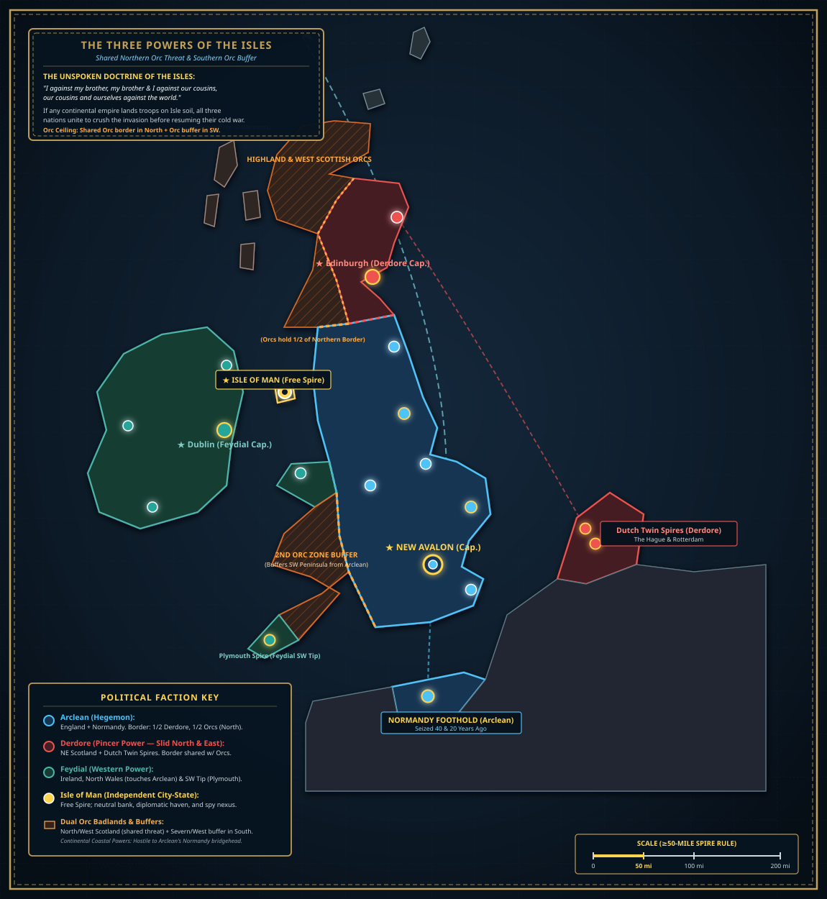
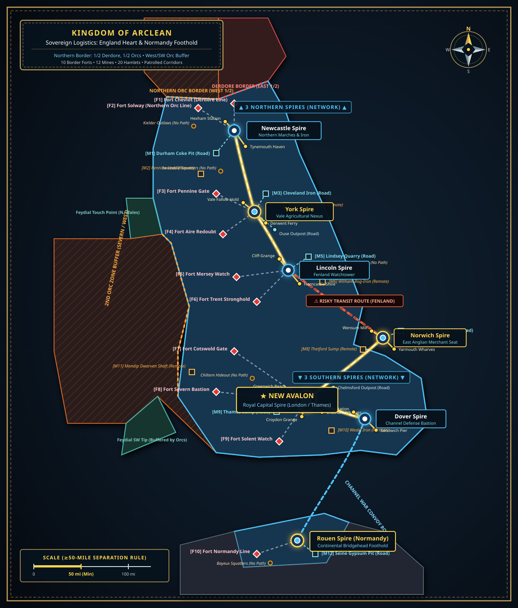
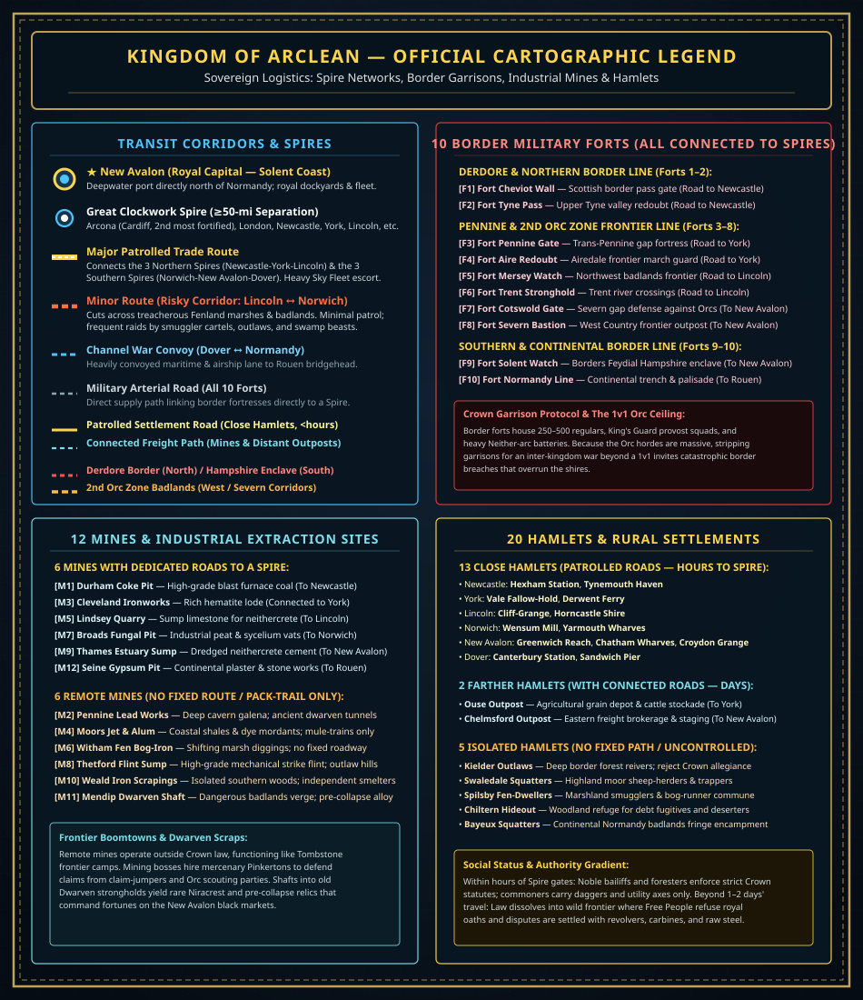
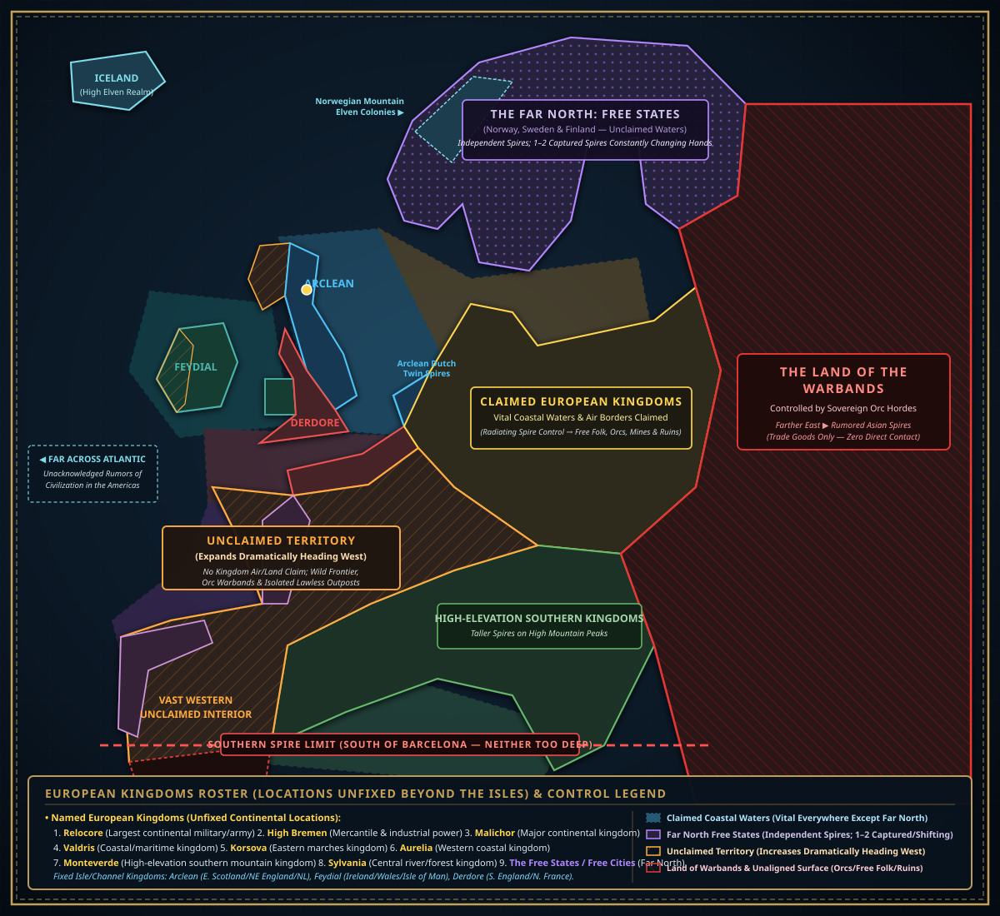

# World, Social Order & Law

- **Topic:** Setting Explanation, Social Structure, Municipal Wards, Governance & Legal Hierarchy
- **Status:** **Draft**
- **Authoritative Reference:** `AISummary/WorldSummary.md`

---

## 1. Setting Overview & The Clockwork Spire

The world of Clockwork Cities is a setting defined by atmospheric stratification, environmental pressure, and rigid institutional hierarchy:
- **Atmospheric Reality:** The world's surface is submerged in a corrupting, toxic, sun-obscuring miasma known as the **Neither**. Above the Neither lies the turbulent, lightning-wracked **Zone** (which powers wireless radiant lamps, airships, and city grids), and above that sits the pristine, uncorrupted air of the **Aither**.
- **The Spire as Fortress:** To escape the deadly Neither fog, the vast majority of civilization (~87%) lives inside gargantuan megalithic spires constructed from **Neithercrete** (a stone-like substance that functions perfectly within the Neither but degrades under direct Aither sunlight). 
- **The Capital Spire (New Avalon — London & Thames Estuary):** The center of the Kingdom of Arclean, New Avalon stands ~14,000 feet tall and 3 miles wide at its base (with a 9-mile-wide Outer Wall ring), commanding the **Thames Basin and the English Channel approaches** via its `1/2-mile` fortified Sea Corridor, while opening directly onto the shires and radiating frontier roads into the Midlands. **New Avalon is one of—if not the—largest and safest Spires in the world**; smaller Spires, hamlets, and frontier outposts across the kingdom face far greater daily peril.
- **Geography of the Kingdom of Arclean & The Regional Hegemony:** **Arclean is the dominant industrial hegemon in the region, holding a population slightly under Derdore and Feydial combined.** Enforcing the setting's **$\ge 50$-mile Spire separation rule**, King Macelus Wilheart controls **most of England** (*New Avalon/London*, *Newcastle*, *York*, *Lincoln*, *Norwich*, *Dover*, *Birmingham*) and maintains an embattled **continental bridgehead along the Normandy coast (*Rouen Spire*)**, seized in two hard-fought campaigns 40 and 20 years ago. While Arclean commands the premier industrial engine and sky-fleet of the Isles, it is locked in a paranoid Cold War balance against Derdore (holding 2/3 of Scotland and the continental Dutch Twin Spires), Feydial (commanding Ireland, North Wales, and a forward enclave in Hampshire), and the hostile coastal European powers.
- **Social Philosophy:** **Status is greater than the individual.** In Arclean, personal worth is measured by *who you represent*—your Noble House, Trade Guild, University Collegium, or Merchant Cartel. Individuals without institutional backing are viewed with suspicion and possess minimal legal standing.

---

### The Political Map: Arclean, Neighboring Kingdoms & The Known World

#### 1. The Regional Powers & The Balance of the British Isles, Channel & North Sea ($\ge 50$-Mile Spire Rule)
Except for rare exceptions like the twin Dutch ports of **The Hague and Rotterdam** (~15 miles apart), **Spires are always separated by 50 or more miles** of agricultural shires, frontier boomtowns, or open wilderness. The British Isles, adjacent Channel coasts, and adjacent North Sea rim are divided among three rival powers and strategic buffer territories:

| Power / State | Territory & Real-World Spire Locations | Scale & Geopolitical Character |
|---|---|---|
| **Arclean** *(Dominant Hegemon)* | • **Most of England:** Capital *New Avalon* (London / Thames Basin), Midlands, Northumbria, East Anglia. • **Normandy Coast Foothold:** Fortified continental bridgehead across the English Channel (*Rouen Spire*). | **The Industrial Hegemon.** North border is split: 1/2 with Derdore (East) and 1/2 directly with the Orcs (West). West border: touches Feydial only in North Wales, while the 2nd Orc Zone buffers Arclean from Feydial's SW foothold. |
| **Derdore** | • **Slid North & East:** NE Scotland, Grampian Coast, Firth of Forth & Eastern Marches (Edinburgh & Aberdeen Spires). • **2 Continental Spires (Netherlands):** *The Hague* & *Rotterdam* (rare $<50$-mi Twin-Spire exception across North Sea). | **The Northern & Maritime Pincer.** Slid north and east; shares a lethal western and southern frontier with the Scottish Orcs; borders only the eastern half of Arclean's northern line. Menaces eastern sea lanes via Dutch Spires. |
| **Feydial** | • **Ireland:** *Dublin* (Cap.), *Belfast*, *Galway*, *Cork*. • **Northern Wales:** *Caernarfon* Spire (the only direct touch point with Arclean). • **Southwest Peninsula Foothold:** Plymouth / Cornwall (last 1/2 of SW peninsula, buffered from Arclean by the 2nd Orc Zone). | **The Western Power.** Commands the Irish Sea; touches Arclean directly only in Northern Wales; its southwestern foothold (Plymouth) is buffered from Arclean by the 2nd Orc Zone. |
| **Isle of Man Spire** | • **Isle of Man:** Single massive Spire located centrally in the Irish Sea. | **Independent Sovereign City-State.** Maintains inviolable independence because if any one of the three powers makes a move to seize it, the other two intervene immediately to prevent losing control of the Irish Sea. Premier global banking haven, neutral summit ground, and hotbed of international espionage. |
| **The Hebrides** | • **Western Isles of Scotland:** Spireless territory. | **Free Fishing & Smuggling Settlements.** Autonomous whalers, Neither-shark hunters, and unaligned traders living outside Spire law and selling black-market goods. |
| **Orc Badlands (Dual Buffers)** | 1) **Highland & Western Scottish Orcs:** Envelops the north and west of Scotland, holding the western 1/2 of Arclean's northern border and boxing Derdore into the east. 2) **2nd Orc Zone (Severn / West Country Buffer):** Buffers Arclean from Feydial's SW peninsula tip. | **Constant Frontier Threat & Strategic Buffers.** Orcs are a shared existential wall in the North (holding half of Arclean's northern border) and act as a neutral buffer badlands in the South. Any war beyond a 1v1 triggers catastrophic Orc breakthroughs. |

- **The Hegemon’s Dilemma & The 2.5-Front War:**
  - Arclean is the unquestioned industrial powerhouse, but it is locked in a state of **mighty paralysis**. If Arclean moves its grand army north against Derdore, Feydial attacks Hampshire/the Channel, and coastal European powers assault Normandy.
  - Open total war is suicidal; the region is locked in a **Victorian Cold War equilibrium** of espionage, privateering with Crown Letters of Marque, border skirmishes, and proxy conflicts.
- **The Unspoken Doctrine of the Isles ("Me Against My Brother..."):**
  - While none of the three kingdoms on the British Isles would ever admit it in public, in Privy Council chambers, or in diplomatic dispatches, all three live on a primal, unspoken cultural foundation: ***"I against my brother, my brother and I against our cousins, our cousins and ourselves against the world."***
  - Arclean, Derdore, and Feydial may scheme, spy, sabotage, and raid each other constantly, but **if any foreign continental empire (such as Relocore, Malichor, or High Bremen) ever dared to land a hostile invasion force on the soil of the British Isles, the response would utterly shock the invaders**.
  - Ancient hatreds and border disputes would vanish overnight beneath an avalanche of combined sky-fleets, royal marine divisions, and coordinated naval blockades, obliterating the foreign bridgehead before turning right back to their own bitter civil cold war.
- **The Continental European Web & Proxy Coalitions:**
  - **The Normandy Grudge (40 & 20 Years Ago):** Coastal European kingdoms facing the Channel bitterly resent Arclean's military bridgehead in Normandy and covertly sponsor anti-Arclean privateers and Feydial/Derdore proxies.
  - **The Dutch Spire Fracture:** A rival coalition of Lowland and Rhenish kingdoms resents *Derdore's* overseas control of *The Hague and Rotterdam*, and covertly supplies Arclean with intelligence, trade, and materiel to dislodge Derdore from the continent.
  - **Deep Inland Empires (Neutral Colossi):** Giant ancient empires deep within the European interior (deep Germany, France, the Alps) are as powerful as Arclean, but remain indifferent to coastal Channel/North Sea squabbles as long as their interior borders and deep mines remain untouched.

- **Tense Cold War, Covert Fighting & Recent Border Wars:** Relations between **Arclean**, **Feydial**, and **Derdore** are **tense**. While all-out total war is not currently active, **covert fighting, espionage, privateering, and ruthless political maneuvering** are constant, and **open military conflicts to determine actual territorial borders have been fought within the last few years**.
- **Two-Layer Sovereignty — Air Borders vs. Radiating Surface Control:**
  - **Overlapping Claims & Non-Aligning Borders:** Overlapping territorial claims on both land and air are common, and **realities on the ground do not align with the borders drawn in the air**.
  - **The Kingdoms Control the Air (And Draw the Borders):** On royal maps, in Privy Council chambers, and up in the **Zone and Aither**, the Spire kingdoms control the skies, patrol the aerial trade lanes with war-dirigibles, and formally define where one kingdom's border ends and another's begins.
  - **Radiating Settlements From Each Spire (Hours $\rightarrow$ Days):** Down on the surface **beneath the Zone**, settlements **radiate outward from each Spire**. The closest settlements (**hours** of walking or riding from the Outer Wall) are the most tightly controlled and patrolled; as travel distance shifts from **hours to days**, Spire authority steadily diminishes into **frontier lands** and **areas completely outside the control of the Spires**.
  - **What Lies Beyond Spire Control (Warbands, Free Folk, Dwarven Exits & Ancient Ruins):** While **Orc Warbands** do hold dedicated territories (such as the northern part of Scotland and the eastern Land of the Warbands) and roam the wilds, the unaligned surface lands between and beyond Spires are a diverse frontier mosaic:
    1. **Orcish Warbands** holding tribal territories or roaming between Spire spheres of influence;
    2. **Communities of Free People** who live outside the Spires and **refuse to swear loyalty to the King**;
    3. **Dwarven Mines with Surface Exits** emerging in seemingly abandoned or remote areas; and
    4. **Remnants of Older Spires and Ancient Dwarven Strongholds**, which often hold forgotten **history and rare, unplundered materials** (`Niracrest`, `Mitheral`, and pre-collapse relics) waiting to be discovered.

#### 2. Mainland Europe: Areas of Control, Vital Coastal Waters & The Free States

Across the European continent, geopolitical control is shaped by maritime trade lanes, altitude, and the limits of Spire power projection (without fixing specific Spire names or exact kingdom borders on the continent at this stage):

1. **Vital Coastal Waters (Claimed Everywhere Except the Far North):**
   - Because maritime shipping and coastal approaches are the lifeblood of Spire trade, **coastal waters are vital strategic assets**. Nearly every stretch of European coastline and adjacent sea lane (the North Sea, Irish Sea, English Channel, southern Baltic, Atlantic coast, and northern Mediterranean) is **actively claimed and patrolled by a kingdom**—with the sole exception of the **Far North**, where open waters remain unclaimed.
2. **The Far North — The Free States (Norway, Sweden & Finland):**
   - The northern reaches across **Norway, Sweden, and Finland** are designated as the **Free States**.
   - Rather than answering to a single unified crown, **most Spires in the Free States are independent city-states**—though at any given time **1 or 2 Spires may be captured or subjugated** by a rival Free State or neighboring power, with ownership **constantly changing hands** in shifting northern alliances and sieges.
   - High in the **mountain peaks of Norway**, small **Elvish colonies** also dwell in the pure Aither above the Zone.
3. **Expanding Unclaimed Territory (Increasing as You Head West):**
   - Outside the vital coastal belts and the central kingdom heartlands, Europe contains a **substantial amount of completely Unclaimed Territory—and the proportion of unclaimed land increases dramatically as one heads West** (across the interior of France, Brittany, the western Uplands, and vast stretches of the Iberian peninsula, as well as the western Highland/Atlantic fringes of the Isles).
   - In these unclaimed expanses, no kingdom even pretends to hold sovereign jurisdiction; they are open frontier badlands of roaming Orcish warbands, outlaw settlements, and independent mining boomtowns.
4. **Going South — Higher Elevations & The Barcelona Limit:**
   - Because the Neither layer deepens and rises in altitude toward the equator, **going south requires Spires to be built progressively taller and sited on higher mountain elevations** (the Alps, Pyrenees, and northern Apennines) to pierce the Zone into the clean Aither. **The southernmost Spire in Europe lies just south of present-day Barcelona**; south of that line, the Neither is too deep to breach.
5. **Roster of Named European Kingdoms (Locations Unfixed Beyond the Isles):**
   - Beyond the three fixed Isle/Channel powers (**Arclean**, **Feydial**, and **Derdore**), the major European powers—whose exact continental borders and Spire locations are intentionally left unfixed for flexible campaign placement—include:
     - **Relocore** *(the largest known continental military and standing army)*
     - **High Bremen** *(major mercantile and clockwork-industrial kingdom)*
     - **Malichor** *(formidable continental kingdom and naval/aerial power)*
     - **Valdris** *(maritime kingdom claiming vital coastal waters and shipping lanes)*
     - **Korsova** *(eastern marches kingdom bordering the Land of the Warbands)*
     - **Aurelia** *(western kingdom holding coastal strips bordering the vast western unclaimed interior)*
     - **Monteverde** *(high-elevation southern mountain kingdom of towering peak-spires)*
     - **Sylvania** *(central continental heartland kingdom)*
     - **The Free States / Free Cities** *(the shifting independent Spires of the Far North)*

#### 3. Beyond Europe: The Land of the Warbands, The Far East & The Americas
- **East of Europe — The Land of the Warbands:** East of the European Spire kingdoms and Finland lies the vast **Land of the Warbands**, dominated by roaming Orc hordes and savage tribal coalitions that reject Spire law.
- **Rumored Far-Eastern Spires:** Despite the barrier of the Warbands, **persistent rumors and exotic trade goods** trickling westward make it clear that **farther East (in Asia) some form of civilization with its own Great Spires still exists**—though there is currently **no direct communication** between the European Spires and the East.
- **The Americas — The Unacknowledged Mystery:** The **Elves and Half-Elves have never officially acknowledged it**, but from **what has slipped in guarded conversations and been glimpsed at the edges of northern/oceanic routes, some sort of civilization still exists in the Americas**—though even less is known about it than the distant eastern lands.

---

### The Dual World: Victorian London Spires vs. The Wild West & Savage Frontier

While the Great Spires are modeled on **circa-1860 Victorian London**—vertical metropolises of gas-lit salons, rigid class etiquette, guild monopolies, and constabulary patrols—**the surface world outside the Spires is modeled on the American Wild West and the untamed frontier**. Moving away from a Spire is literally and culturally **"going West"** into progressively less populated, less civilized, and more lethal lands:

| Frontier Zone & Distance from the Spire | Historical / Cultural Model | Environment, Settlements & Law |
|---|---|---|
| **1. The Great Spires** *(Specifically **New Avalon**)* | **Victorian London (c. 1860)** | The major eastern cities. Rigid social classes, unarmed municipal corridors, Privy Council statutes, and wireless radiant grids. **New Avalon is the largest and safest Spire in existence**; other Spires are smaller, more isolated, and carry far more risk. |
| **2. Radiating Shires & Outer Fields** *(Hours of Walking / Riding)* | **Settled Homesteads & Cattle Trails** | Settlements radiate outward from each Spire; those within **hours** of the gates are the most tightly controlled—noble-leased agricultural combines, walled hamlets, and guarded caravan roads. Workers carry axes and sidearms openly; Crown law is enforced by outriders and local bailiffs. |
| **3. The Frontier & Mining Towns** *(Days of Walking / Riding)* | **Tombstone, Deadwood & Boomtowns** | As travel shifts from **hours to days**, Spire control fades rapidly into frontier lands: semi-lawless mining camps, deep-shaft company towns, and fortified trading posts where disputes are settled by frontier marshals, hired guns, merchant-house pinkertons, or six-shooters and pulse-rifles in saloon streets. |
| **4. Outside Spire Control — The Unaligned Wilds** *(Days to Weeks Beyond)* | **The Alaskan Wilderness — Inhabited, Unaligned & Ancient** | Areas completely outside Spire control do not align with air borders. They include **Orc Warband territories** (like northern Scotland), **communities of free people who refuse to swear loyalty to the King**, **Dwarven mine surface exits** in seemingly abandoned areas, and the **remnants of older Spires and ancient Dwarven strongholds** holding forgotten history and rare materials (`Niracrest`, `Mitheral`, Era-1/Era-4 relics) yet to be plundered. |

#### "The Good Times" vs. "The Bad Times" (Frontier Raids & Spire Sieges)
- **The Good Times (Cold Frontier Equilibrium):** During periods of relative peace ("the good times"), the danger waits out on the frontier. Spire citizens stay inside their walls, while caravans, prospectors, scouts, and Tombstone-style mining towns contend with roaming bands of Orcs, claim-jumpers, and savage tribes when venturing away from the cities.
- **The Bad Times (Invasions & Spire Sieges):** During "the bad times," those roaming Orc warbands, savage coalitions, and bandit armies **push inward and attack the settled frontier**, burning hamlets, overrunning Tombstone mining towns, cutting trade roads, and **even laying direct siege to the Spires themselves** (seeking to starve a Spire's food and military cartridge reserves until its defenses fail). While massive New Avalon is virtually impregnable, smaller and more distant Spires face the very real terror of siege, breach, and destruction.

#### The Sea & The Zone: From 1860s Patrolled Lanes to the Golden Age of Piracy (1650–1730)
Maritime shipping on the surface waters and aerial shipping through the cloud-seas of the **Zone** follow a parallel spectrum across an even wider historical span:
- **Near the Spires & Major Patrolled Trade Routes (Circa 1860s Naval Order):**
  - Within sight of the Great Spires (where Zone-powered **Great Arc Cannons** command the sky and coast) and along heavily patrolled Royal Navy / Sky Fleet trade lanes, vessels face the threats and regulations of the **1860s Victorian maritime era**: customs cutters, quarantine inspections, naval blockades, tariff smugglers, and regulated merchant convoys.
- **Out of Sight of the Spires & Patrol Lanes (The Golden Age of Piracy, 1650–1730):**
  - The moment a sea vessel or Zone airship sails out of sight of the Spires and off the major patrolled trade routes, the world shifts back into the **Golden Age of Piracy (1650–1730)**—amplified by the fact that Zone airships float on a single 2D buoyancy plane where broadsides, grappling hooks, and cutlass boarding actions rule combat:
    - **Freebooters & Pirate Havens:** Uncharted island coves, hidden Zone-cloud anchorages, and rogue ports shelter outright pirate fleets that prey on isolated merchantmen.
    - **Letters of Marque & Crown-Funded Privateers:** **Rival kingdoms actively fund and commission privateers** (issuing formal or deniable *Letters of Marque*) who operate right alongside legitimate merchants—flying lawful mercantile or neutral flags near port, then running up privateer colors in open water or deep Zone cloud-banks to seize rival kingdoms' cargo, bullion, and weapon-cartridge shipments for a share of the prize court.
- **Sudden Inter-Kingdom Warfare & Spire Blockades:**
  - Because long-distance communication is limited to physical couriers and vessels, geopolitical realities across the sea and the Zone can shift without warning. **Militaries from different kingdoms periodically erupt into open warfare**, and an expeditionary or merchant crew arriving after days or weeks of travel may **suddenly find that the Spire they were hoping to trade with is under a full military and naval/aerial blockade**—enforced either by **their own kingdom's armada** or by **a rival foreign kingdom's war-fleet** attempting to starve the Spire's food and military cartridge reserves into submission. Crew and merchants must then choose on the spot whether to turn back, negotiate with the blockading fleet, or attempt a perilous blockade run.

---

## 2. Municipal Geography & Spire Transit

The spire is partitioned vertically and horizontally into distinct concentric circles:
- **Circles:** Each major ward consists of three stacked circles (Low, Mid, and High), measuring 300 to 600 feet in vertical height and ½ to ¾ mile deep into the spire's mass. 
- **Sanctioned Transit Routes:** Unsanctioned movement between wards or carving unauthorized tunnels through Neithercrete walls is considered a high civic crime and culturally unthinkable. All legal traffic flows through four major transit networks:
  - **The Peasant Paths (Wards 1 through 13, Low Circles):** Heavy industrial and public transit. Includes the South Route (private carriages, small freight), North Route (heavy 100-ton cargo haulers), and East/West Transit (commuter trams carrying 200+ passengers and 10 tons of cargo).
  - **The Noble Path:** Elevated, secure transport. North route open to high-paying public carriages (10× cost), East route strictly noble-only (stops at high circles), West route connecting the University Collegium, and the South Route forming the sealed **Royal Road** reserved for Crown business.
  - **The Trade Road:** Dedicated freight lines and elevators connecting the Merchant Ward (14), Sea Docks, Sky Docks, and Guild Craft Foundries (11).
  - **The Warrens Corridors:** Informal, narrow service passages running ½ to 1 mile behind the wards. Subject to underworld tolls (12 Pins to 1 Labor) controlled by syndicates.

### Ward Breakdown (New Avalon)

| Ward | Name / Designation | Social Stratum & Primary Function |
|---|---|---|
| **Docks** | Sea Port (External, Sea Level) | 4 sq mi dry docks, shipwrights, naval marine garrisons, and deep sea trade. |
| **Ward 1** | Labor Ward | Gateways to outer agricultural fields, foundries, haulers, stables. Modest but healthy outdoor life. |
| **Ward 2** | Military Ward | Sealed garrisons, armories, high-circle gun emplacements, barracks, and King's Guard headquarters. |
| **Ward 3** | Food Ward | Processing plants, refrigerated silos, fungal storage vats, distribution warehouses. |
| **Ward 4** | Lower Slums ("Lost Ward") | Deep poverty, failed debtor families, day-laborers, heavy criminal syndicate presence. |
| **Ward 5** | Upper Slums ("Orphans Ward") | Pensioners, disabled laborers, charities, orphanage workhouses, second-hand markets. |
| **Ward 6** | Mid-Tier Worker Ward | The transition line: first massive 100×50 ft exterior windows, fresh breeze, upward social mobility. |
| **Wards 7–9** | Lower, Mid & Upper Workers | Dense middle-class artisan residential tenements, clerks, and small shopkeepers. |
| **Ward 10** | Garden Ward | Outer agricultural ring, hydroponics, Farmers Guild headquarters. |
| **Ward 11** | Craft Ward | The industrial heart: blacksmith foundries, tanning vat-houses, textile mills, mass manufacturing. |
| **Ward 12** | Traders Ward | Small shops, general merchants, warehousing, caravan brokerage firms. |
| **Ward 13** | **Luxury Ward (PC Base)** | High artisans, guild headquarters, private estates, public parks. Low circle holds highest prestige. |
| **Ward 14** | Merchant Ward | Billionaire Wall Merchants, corporate banking houses, private fortified estates with walled gardens. |
| **Ward 15** | Spire Dock Ward | Under the Zone; energy collector rods, airship mooring lines, heavy mechanical transit. |
| **Sky Docks** | Airship Port (~800 ft above Zone) | Winch-docked zeppelins, power generation, foreign embassies, and international trade Enclaves. |
| **University** | The Collegium | Academic colleges, lecture halls, research libraries, teaching hospitals, and professional guilds. |
| **Noble Ward** | Estates | Multi-acre noble manors, manicured parks, personal household retinues, strictly freemen servants. |
| **Royal Spire** | Crown Peak | The 25 Great Houses, Privy Council chambers, royal food greenhouses, and King Macelus's palace. |
| **The Warrens** | Behind Wards 1–13 | Fungal sewage farms, black markets, gambling dens, goblin populations; crown law absent except for treason. |
| **The Tombs** | Levels 1–9 (Subterranean) | Ancient, deeply corrupted, pre-collapse ruins; troglodyte rumors; scavengers rarely return. |

---

## 3. Governance & The Power Structure

Arclean operates as a centralized constitutional monarchy, backed by hereditary noble charters and institutional assemblies:

### The Sovereign Hegemony: Why the King & Nobles Rule Despite Being Outnumbered
Across the Great Spires, the ruling aristocratic caste—the King, the Royal Family, and the 25 Great Houses—numbers fewer than a fraction of one percent of the total population, yet their rule remains virtually unshakeable. This stability rests on four interlocking pillars of power:

1. **Absolute Monopoly on Land & Institutional Wealth (The Feudal Chain of Ownership):**
   - **The King Owns Everything:** By sovereign law, the King owns the entirety of the Spire and all outside territory. Through royal decree, he assigns responsibility for managing all Spire property and exterior lands to the **Great Noble Houses** (a single Great House may have a presence in multiple Spires, and the **25 most important Great Houses** all hold sections of the capital, **New Avalon**).
   - **Noble Houses as Working Administrators & Landlords:** The Great Houses manage their territory through lesser and middle **Noble Houses**, who perform the actual work of collecting taxes and running holdings. Any non-dedicated decent-sized holding has a noble running it (specialized operations like mines or farmers' combines may or may not have a noble). Like most things in the Spire, leasing a location follows a **strict formula (with a regulated surcharge on wealth generation)**; Nobles collect the rent and handle finding new tenants when properties are empty. Citizens are free to move up and down across wards (and locations within a ward) as their fortunes vary, and since most people live in apartments supplied by their guild or family, maintaining the group's status and wealth is paramount to their living conditions. Nobles also fill much of the Spire's government offices, while **non-nobles who have completed their education in the University Collegium make up nearly everyone else** in government administration.
   - **The Great Disruption (Merchant Co-ops, Marriage & Outland Leases):** Over the last few centuries, clockwork technology and stability both enabled and demanded massive trade to keep the Spires supplied. Small merchant co-ops grew into giant Merchant Houses whose wealth exceeded the Noble Houses and rivaled or surpassed the Great Noble Houses. To absorb this new wealth: 1) it suddenly became acceptable for ultra-wealthy merchants to **marry into Noble or Great Noble Houses**, and 2) the King began **leasing royal grants to properties outside the Spires** directly to top merchants, where previously only the Great Noble Houses were ever allowed to hold them.
   - Every trade guild, merchant syndicate, and factory operates under these royal charters and property leases. Because private hoarding and money-laundering do not exist (institutions strictly audit and confiscate unapproved liquid fortunes), wealth is synonymous with Crown-backed property. Defying the nobility means immediate economic ruin, eviction from the Spire, and revocation of guild livelihood.
2. **Deep-Seated Cultural Conditioning & Hierarchy of Expectations:**
   - Centuries of post-collapse civilization have conditioned the populace to view aristocratic hierarchy as the natural, inevitable order of existence. Common laborers and guild artisans do not expect egalitarian democracy; they expect strong, paternalistic oversight that maintains the dynamos, repels savage outland warbands, and ensures food and air transit remain orderly. Rising in social class is celebrated, but seeking to abolish the class structure is viewed by the masses as dangerous, chaotic madness that would collapse the fragile machinery keeping humanity alive in the Neither.
3. **The High Aither Ballistic Fortress & Elven Armaments:**
   - The ultimate military deterrent is geographical and technological: the King and high nobility dwell in **pure Aither** at the Spire summits, above the Zone (Strata 1).
   - Any rebellious underclass or rogue mercenary force attempting to ascend and challenge them faces an insurmountable tactical disparity:
     - **Neither-Tech Dies in Aither:** Lower-circle Neither weapons, arc capacitors, and energy devices fail completely upon crossing the Zone into pure Aither; their clockwork escapements stall, and Neither-infused materials begin leaching and decaying.
     - **The Gunpowder & Elven Edge:** The King and Great Houses hold exclusive diplomatic treaties and purchasing monopolies on **Elven gunpowder, rifles, and lightweight ballistic plate**. In the pure oxygen of the Aither, Elven rifles operate at lethal, long-range ballistic perfection (+1 die damage, extreme range, and deadly fatal criticals). Direct assault against disciplined royal riflemen positioned behind manicured Aither redoubts is suicidal slaughter.
4. **The Insurgent's Dilemma (The Stockpiling Bottleneck):**
   - Because of atmospheric decay rules, rebellious factions, criminal cartels, or insurrectionists face a near-impossible logistical barrier when attempting to arm themselves for a summit coup:
     - **Neither Weapons Can't Be Pre-Staged:** Smuggling Neither-weapons into the high circles in advance is futile; within weeks to a month, exposure to Aither permanently leaches their enhancement bonuses away, and their clockwork components freeze immediately upon entry.
     - **Elven Gear Rot in the Lower Spire:** Conversely, any Elven firearms, composite armor, or black powder smuggled down into the lower circles rot and degrade at **–1 enhancement per day** from ambient Neither exposure.
     - **The Only Two Routes to an Aither Arsenal:** Consequently, the only conceivable ways an insurrectionist group can ever amass viable weapons for an assault in the Aither are:
       1. *High Treason from Within:* Corrupting and flipping turncoats inside the **25 Great Noble Families or Royalty** who already possess legal high-altitude armories and sovereign ammunition rites.
       2. *Massive Airship Smuggling:* Concealing crated Elven ordnance inside heavy, hermetically sealed canisters aboard high-altitude **Airships**, flying directly above the Zone, and somehow bypassing all King's Guard customs manifests, physical cargo searches, and dock inspections at the royal summit wharves.

---

### Governing Councils & Institutions

1. **The King (King Macelus Wilheart):** Supreme sovereign executive. Holds ultimate veto, direct control over the King's Guard, power to grant noble patents, and absolute command of the Crown military.
2. **The Royal Council (Kingdom-Wide):**
   - Composed of representatives from the **25 Great Houses**.
   - Requires 15 votes to pass kingdom-wide statutes; the King may bypass or overrule at will.
   - Organized into five permanent sub-councils (by seniority):
     1. *Military & King's Guard Sub-Council* (National defense, fortress garrisons)
     2. *Foreign Trade Sub-Council* (Airship treaties, foreign kingdom diplomacy)
     3. *Finance Sub-Council* (Coinage, university funding, deep-vein mineral leases)
     4. *Security Sub-Council* (Constabulary standards, municipal courts, postal courier safety)
     5. *Domestic Trade Sub-Council* (Internal peasant roads, shire trade, agricultural quotas)
3. **The Privy Council (Municipal Capital Council):**
   - 25 voting seats: 15 Ward Representatives + 2 University Collegium + 3 Noble Ward Delegates + 5 Direct Crown Appointees.
   - Requires 16 votes to pass municipal ordinances.
   - Any ordinance passed automatically becomes law if the King does not formally veto it within 5 calendar days.
4. **The Voting Franchise:**
   - Universal suffrage does not exist. Voting power is strictly weighted by social backing:
     - **Warrens, Serfs, Debtors:** 0 votes (No franchise).
     - **Freemen & Enlisted Citizens:** 1/10th vote.
     - **Trade Guild Masters & Journeymen:** 1/2 vote.
     - **Educated Citizens (BA+), Merchants, Commissioned Officers:** Full 1 vote.
     - **Lesser Nobles & Guild Leaders:** 1 vote (with direct council lobbying access).
     - **Great Houses & Royal Councilors:** Imperial veto and direct crown petition rights.

---

## 4. Law Enforcement & The Court System

Arclean recognizes three tiers of statutory law: **Royal (Crown) Law**, **Privy (City) Council Law**, and **Local Ward Regulations**. No lower regulation may contradict a higher statute.

### Law Enforcement Branches

- **Ward Constables:**
  - Municipal peacekeepers assigned to specific wards.
  - Jurisdiction is strictly limited to their home ward and its immediate servant quarters / upper Warrens.
  - Can enforce Crown Law on all individuals, but enforce Privy and Ward law **only on non-nobles**. In practice, constables cannot arrest or detain a Noble without explicit authorization from the King's Guard.
  - Foremen and trade guilds often pay supplemental stipends to ensure constabulary presence in commercial circles.
- **The King's Guard:**
  - An elite, highly disciplined corp limited to no more than 1,000 sworn knights and investigators.
  - Holds universal jurisdiction across every ward, spire, road, and enclave in Arclean; answers **solely to King Macelus**.
  - Possesses the legal authority to commandeer municipal constables, seize evidence, command garrison troops, and deputize any citizen on the spot. Refusing a direct order from a King's Guardsman is treated as high treason.
- **Foresters & Outriders:**
  - Rural and frontier equivalent of constables, patrolling the satellite hamlets, peasant roads, and agricultural zones at the base of the spire.

### The Judicial System

- **Low Court (Magistrates' Bench):**
  - Handles petty crimes, theft, minor assault, debt defaults, and unauthorized low-circle trade.
  - Presided over by a appointed municipal magistrate. Fines, penal labor in the sump-mines, or public lashings are standard.
- **Mid Court (Commercial & Guild Court):**
  - Handles contract disputes, corporate patent infringement, guild border disputes, smuggling, and manslaughter.
  - Involves legal barristers, forensic accountants, and formal juries drawn from property-owning freemen.
- **King's Court (Noble & High Treason):**
  - The only court with legal jurisdiction over the Nobility, Great Houses, university deans, and senior military officers.
  - Presided over by the Chancellor or the King himself. Punishments range from asset forfeiture and revocation of noble titles to permanent exile or execution by royal decree.

---

## 5. Municipal Weapon Laws & Cartridge Regulations

Life within the megalithic spires is dense, crowded, and heavily policed. To prevent catastrophic violence, gang skirmishes, and mass panics in narrow municipal corridors, the Crown and Privy Council enforce strict weapon statutes across all wards:

### Public Carry & Ownership

- **The Common Utility Dagger (Mundane Tool Only — The "Carrying with Intent" Reality):**
  - **Universal Right on Paper:** Every free person in the spire is legally permitted to carry a common knife or utility dagger (`1d4 P/S`, Mundane Base only) openly or concealed as a basic daily tool and personal defense implement.
  - **Strictly a Tool, Never a Weapon of War:** To qualify as a legal daily-carry utility dagger, the blade **must be a standard mundane steel/iron tool**. It **cannot** be a combat weapon forged from rare materials that improve combat performance (such as **Niracrest** `+1/+1 Striking`, **Mitheral** `+2 Greater Striking`, or higher tiers), nor can it possess **clockwork components, pneumatic/galvanic attachments, poison reservoirs, or other modifications** that turn it into a weapon of war instead of an everyday tool. Any enhanced or clockwork-modified dagger is legally classified as a weapon of war and must be peace-bonded/boxed in public wards just like a broadsword or battleaxe.
  - **The Severe Legal Risk of Drawing a Blade ("Carrying with Intent"):** In reality, **most citizens will not even draw the utility dagger they carry during a brawl or street confrontation**. The law is brutally punitive toward the lower and working classes: the moment steel is drawn, constables and magistrates aggressively presume **"Carrying with Intent to Commit Violence"** rather than legitimate self-defense. Proving self-defense requires immense social standing, credible witnesses, or expensive legal retainers that commoners do not have.
  - **Seldom Worth the Risk:** Because a conviction means penal labor in the sump-mines, severe corporal lashings, or ruinous fines that bankrupt an entire family, **winning a street fight is seldom worth the catastrophic life risk of clearing leather**. Most urban conflicts are settled with fists, boots, bludgeoning cudgels, or broken tankards, keeping the dagger firmly sheathed unless facing imminent, certain death.

- **The Law’s "Golden Children" — Aristocratic Dueling Swords vs. Common Brutality:**
  - **The Law is Not Fair to All:** Like most institutions in the Spires, the legal framework has its favored "golden children." While common citizens, laborers, and even guild artisans face immediate arrest and prosecution for brandishing or utilizing any weapon in a Spire ward, **Nobles and Wall Merchants get away with drawing and using dueling swords or rapiers with near-total impunity**.
  - **The Presumption of Innocence & Polite Honor:** When a Noble or Wall Merchant runs someone through with a rapier in a salon, restaurant, or municipal promenade, **the law inherently assumes that it is just fine**. Municipal magistrates, ward constables, and Privy Council statutes view it as an affair of honor, lawful caste defense, or an aristocratic prerogative. Unless the victim is of equal or higher noble station, constables will actively assist in clearing the scene, interrogating the commoners who "provoked" the gentleman, and dismissing the violence as righteous defense of rank. Carrying and using a dueling sword is not merely permitted—it is backed by the full weight of royal class bias.

- **The Severe Cultural Taboo & Enforcement on Concealed Weapons in the Spire:**
  - **Unlike Traditional RPGs, Concealed Carry of Weapons of War is Not a Normal Outcome:** In many fantasy tabletop campaigns, players treat concealing firearms, energy pistols, or combat daggers as routine adventurer behavior. **In the Clockwork Cities setting, carrying concealed NeitherTeck weapons, combat firearms, or illegal ordnance inside the Spire is virtually unthinkable and almost never done.**
  - **Familial Exile & Societal Self-Preservation:** Due to ancient tradition and immense societal pressure (*Worth = Who You Represent*), the consequences of an individual being caught carrying concealed weapons of war inside civil wards fall directly upon their entire family, trade guild, or noble house. To protect the organization's standing from catastrophic downgrade, **the family or guild will immediately exile the offender, sever all legal ties, or at the very least impose a severe lifetime demotion** to salvage whatever social status they can before the crown magistrates intervene.
  - **Why Even the Criminal Underworld Avoids It:** The Spire's crime syndicates and Ward 13 vice bosses actively enforce this taboo within their own ranks. Any criminal crew or smuggling ring that earns a reputation for members carrying concealed weapons of war or live NeitherTeck firearms inside the civil wards immediately becomes the **number one priority target of local Ward Constables**.
  - **The Threat of the King's Guard (Total Organizational Annihilation):** Worse still, regular violations bring down **The King's Guard**. While ward constables manage day-to-day street crime, the King's Guard represents sovereign violence and treason suppression. When the King's Guard is mobilized against a criminal syndicate, **they are an overwhelming, existential threat that does not negotiate, execute targeted arrests, or offer fines—their deployment almost universally results in the total destruction, eradication, and execution of the entire organization**, along with the seizure of all front businesses and assets. For this reason, underworld bosses ruthlessly police their own people to keep concealed weapons of war out of the civil circles.

- **Dueling Swords (Class Privilege, The "Fair Steel" Mandate & Impunity Limits):**
  - **Nobility & Wall Merchants:** Only recognized **Nobles** and **Wall Merchants** (along with commissioned military officers and active King's Guards) are legally entitled to openly wear sidearms, rapiers, and dueling swords in public spaces. Carrying a sword in the upper circles is an explicit visual badge of authority, breeding, and high social caste.
  - **The Strict "Fair Steel" Definition of a Dueling Blade:** Under Spire honor codes, fencing guild charters, and municipal statute, **a dueling blade is strictly defined as standard, unenhanced craftsmanship**. It **must be forged from ordinary, mundane steel or iron**.
  - **By Definition NOT a Dueling Blade:** If a sword incorporates **exotic materials that improve combat performance** (such as *Niracrest* `+1 Potency / Striking`, *Mitheral* `+2 Greater Striking`, or deeper metallurgical tiers) or features **clockwork enhancements, spring-loaded escapements, pneumatic pistons, weighted balances, or galvanic channels**, **it is by legal definition NOT a dueling blade**.
  - **Loss of Immunity & Weapon of War Classification:** A blade forged from exotic performance-enhancing alloys or fitted with clockwork mechanisms is classified as a **mechanized weapon of war**. If worn openly in the Spire—even by a Noble or Wall Merchant—it loses all dueling exemptions. The wearer faces immediate confiscation, heavy censure from their peers for bringing "unfair/mechanical cheat blades" into polite society, and prosecution for carrying an unboxed weapon of war in civil wards.
  - **Combat Balance in Civil Wards:** This hard restriction prevents high-level Soldiers or Dandies from dominating Spire social play with high-potency Striking weapons. In an urban parlor or street duel, a Wall Merchant Soldier is capped at a standard mundane steel rapier (`1d6 P`, Deadly d8, no potency bonus, no striking dice), keeping them grounded and competitive with unarmored **Pugilists** (`1d6` fists) and **Survivors** (`1d4` utility daggers with sneak attack).
- **General Weapon Ownership:**
  - **Who May Own:** Any free citizen (anyone not actively enslaved, serving a penal term, or imprisoned in the workhouses) has the legal right to purchase and own weapons—including broadswords, polearms, bows, crossbows, and firearms.
  - **Peace-Bonding & Packaging in Public:** Unless an individual or caravan is actively departing the spire, larger weapons **must never be displayed openly in public corridors, streets, or transit trams**. When transported through the spire, all non-dagger weapons must be **securely boxed, bound, or peace-packaged in a manner that prevents them from being easily or quickly drawn**. Walking openly through a municipal circle brandishing a polearm, battleaxe, or rifle will prompt immediate interception by ward constables, confiscation of the arms, and heavy fines in the Low Court.
  - **The Civil Spire Physical Threat (Pugilists, Dandies, Survivors & Inspectors Dominate):**
    - Because military firearms, energy carbines, and radiant emitters require strictly guarded ammunition or heavy converter modules that are banned from civilian wards, and because martial weapons (greatswords, polearms, warhammers) must be peace-bonded and boxed in public, **the actual lethal physical threat in everyday Spire society shifts away from gunners and armored soldiers to a specialized urban quartet**:
      - **The Pugilist (including Savage Combatants):** Entirely unhindered by weapon prohibitions or armor restrictions. In any drawing room, ballroom, tavern, or alleyway, an unarmored Pugilist can deliver blinding flurries of lethal strikes with bare fists, weighted wraps, or brass knuckles against citizens wearing only everyday padded coats or linen—and those trained in *Savage Combatant* (Levels 2/4/8) can tap into raw pit-fighter adrenaline at the cost of social penalties.
      - **The Dandy:** The sole class possessing the legal class privilege to openly wear and draw dueling swords and rapiers in public spaces; masters of agile, unarmored Panache footwork in tailored silks.
      - **The Survivor:** The lethal covert shadow. Fully leverages legally permitted mundane utility daggers for deadly Sneak Attacks (`+1d6` to `+4d6` precision damage comes from the Survivor's anatomical skill rather than illegal weapon enhancements); unarmored and trained in urban infiltration to bypass ward checkpoints and strike from darkness.
      - **The Inspector:** Commands legal authority, forensic precision Strikes, and subtle `[Professional]` / `[Clandestine]` tools that pass Spire checkpoints.
    - Consequently, noble houses, wealthy merchants, and criminal bosses retain Pugilists, Dandies, Survivors, and Inspectors as personal enforcers and inner-ward bodyguards, knowing that when metal weapons are locked away or peace-bonded, raw physical mastery, dueling finesse, and clandestine opportunism decide who survives.

### Firearms, Constables, Guardhouse Controls & Arms Bunkers

- **Arms Bunkers (Heavily Secured Spire Munitions Vaults):**
  - Within the Spire and its defensive rings, **Cartridges**, **Radiant Converter Modules**, and (in the case of Ward Constables) **duty weapons** are stored inside heavily fortified, blast-shielded vaults known as **Arms Bunkers**.
  - **Where Arms Bunkers Are Located:**
    1. **All King's Guard Offices:** Every King's Guard station and precinct office houses a secure Arms Bunker for their cartridges and converters.
    2. **Larger Constable Locations:** Major ward constabulary precincts and headquarters contain Arms Bunkers storing both cartridges/converters and the constables' heavy duty weapons.
    3. **Dedicated Locations Near the Sky Docks:** Fortified bunkers adjacent to the aerial wharves in Ward 15 / Sky Docks allow airship crews, marines, and departing passengers to check out or store cartridges and converters immediately before boarding or upon landing.
    4. **Private Living Locations of Wall Merchants & Greater Nobles:** By sovereign privilege, **Wall Merchants** and **Greater Nobles (the 25 Great Houses and High Nobility)** are permitted to maintain private, certified **Arms Bunkers directly inside their own living estates and mansions**. *(Note: Because Greater Nobles reside above the Zone in the pure Aither—where Neither-tech is inert and Elven firearms rule—the Arms Bunkers inside Greater Noble living locations store **gunpowder and ballistic ammunition** under the King's Sovereign Estate Rite rather than Neither cartridges/converters, though their security purpose is identical).*
    5. **Inside of the Outer Walls (Departure & Return Bunkers):** Along the interior face of the Outer Walls, **small Arms Bunkers** are set up specifically to service travelers, workers, and patrols **leaving and returning to the Spire**.
    6. **The Military Ward (Ward 2 — The Largest Arms Bunkers):** Within the Military Ward, the **largest, most heavily fortified Arms Bunkers in the Spire** exist—massive subterranean magazines capable of fully equipping entire regiments of soldiers for **major expeditions into the Neither** as well as **extended siege defense of the Spire**.
- **Cartridge Checkout vs. Weapon & Armor Carriage:**
  - **Only Cartridges (and Constable Duty Weapons) are Checked In and Out:** Across the King's Guard and Crown Military, it is strictly the live ammunition, charged Neither cartridges, and radiant converters that are locked down in **Arms Bunkers**; for Ward Constables, their duty weapons are also stored in the precinct Arms Bunker when not on shift or transit.
  - **Weapon & Armor Carry Permissions:** Personal unloaded firearm chassis, service weapons, and armor may be kept, worn, and carried under designated professional privileges.
- **Constabulary Armament & Transit Rules:**
  - **Armor Permissions:** Unlike ordinary civilians (who are restricted to padded cloth and leather for everyday spire wear), **ward constables may wear any armor they can afford**. In practice, ordinary beat constables typically purchase and wear **chainmail**, while senior ward constables and commissioned officers can afford breastplates or better.
  - **Transit to and from Duty:** Constables are legally authorized to openly wear their uniform, armor, and service sidearms (batons, daggers, and authorized firearm frames) **while traveling directly to and from work/shifts**, as well as while on duty in their assigned ward.
  - **Cartridge Control:** Constables are seldom issued live Neither cartridges on routine beats. Charged cartridges remain locked in the ward guardhouse armory and require **explicit bureaucratic authorization and a high-threat emergency declaration** to check out.
- **The King's Guard (Continuous Wear, Distinct Gear & Anti-Counterfeiting Laws):**
  - **Carried at All Times:** Sworn members of the **King's Guard may wear their armor and carry their service weapons and firearms at all times**, both on and off duty throughout the spire. 
  - **Cartridge Check-in/Check-out:** Only their live Neither cartridges are subject to strict guardhouse logging and armory check-in/check-out when rotating off active watch rotations.
  - **Wide Armor Spectrum & Distinctive Construction:** The King's Guard possesses a wide range of armor—ranging from standard heavy cuirasses issued by the Crown to opulent, masterwork plate harness privately purchased by wealthy guardsmen and high-caste scions. However, **all King's Guard armor and weapons are constructed in an unmistakable, bespoke manner that clearly marks them as official King's Guard gear** (incorporating unique royal livery enameling, royal hallmark stamps, and distinctive heraldic metallurgy).
  - **"Once a King's Guard, Always a King's Guard" (Lifetime Standing & Gear Retention):** It is well known across the realm that *once a King's Guard, always a King's Guard*. Provided an individual was not dishonorably discharged from the corps, retired or inactive guardsmen retain their lifetime oath and **can be recalled back to active service by the Crown at any time**. Furthermore, honorably separated veterans **are legally permitted to retain any weapons and armor they personally purchased and owned while serving with the King's Guard**, provided that this distinctively branded regalia is **used solely for formal ceremonial occasions or upon official reactivation to active service**.
  - **Severe Prohibition on Possession & Counterfeiting:** Because King's Guard gear represents supreme Crown authority, **any non-King's Guard individual possessing authentic King's Guard arms or armor—or possessing any items crafted to resemble or counterfeit King's Guard gear—is in serious violation of Crown Law** (treated as aggravated impersonation of royal authority, treason, and high espionage, punishable by immediate arrest, asset forfeiture, and King's Court sentencing). Retaining gear under the veteran exemption is the sole legal allowance for non-active personnel.
- **Crown Military Personnel:**
  - **Under Orders or Using Personal Gear:** Regular garrison and expeditionary military soldiers may openly wear their armor and carry service weapons through the spire **whenever under active deployment orders, or when carrying and maintaining their own personal armor and weapons**. Like other branches, live cartridges must remain checked into military depot armories unless the unit is mobilized for departure or active combat.

### Cartridge & Radiant Converter Module Prohibition & Gate Exchange Depots

- **Cartridges & Radiant Converter Modules Strictly Illegal in the Spire:**
  - While owning an unloaded firearm chassis or an unconverted radiant weapon chassis is legal, **carrying or possessing charged military Neither Cartridges or active Radiant Weapon Converter Modules within the interior municipal circles of the Spire is extremely illegal** (treated as sabotage, illicit armament, or treason).
- **The Spire Mandate: Converter Modules for Radiant Weapons:**
  - Because Great Spires broadcast continuous wireless radiant power through the Neither medium, a radiant weapon could theoretically draw limitless electrical energy directly from the ambient air.
  - To prevent catastrophic shootouts or unauthorized continuous weapon discharge inside populated circles, **Crown Law strictly mandates that all radiant weapons operated within Spire jurisdiction must incorporate a standardized, detachable Converter Module** to interface with the ambient radiant grid.
  - Without an installed converter module, the weapon's inductive receptor coils are mechanically decoupled and inert, incapable of harvesting radiant current from the air.
  - **Converter modules are classified and regulated under the exact same legal framework as military cartridges**: locked in guardhouse armories, strictly forbidden from civilian transit, and requiring identical military/bureaucratic checkout procedures or warrants.
- **Ambient Bleed, Illicit Low-Power Converters & Dynamic Frequency Security:**
  - **Strict Prohibition on Non-Intended Receiver Use & Weaponization:** Using **any receiver of radiant power** (from street lamps, domestic appliances, or workshop tools) for a non-intended purpose is illegal under Spire law, and **even more so when used for weapons**. **Any item or modification that converts radiant energy into a weaponized item outside of authorized legal usage is highly illegal and carries major criminal penalties** (prosecuted as grid sabotage and unlawful armament).
  - **Ambient Grid Bleed & Illicit Low-Power Converters:** Due to massive radiant energy bleed from spire streetlights, industrial lifts, and domestic utilities, black-market machinists and Warren tinkerers can physically fabricate crude, bootleg converter modules (despite the severe criminal penalties if caught). However, these bootleg units are only capable of pulling **low-power trickle current**—sufficient to run small civilian tools or fire radiant weapons at diminished, low-power effectiveness.
  - **The Dynamic Frequency Shift Measure:** As a fundamental security protocol developed in the early days of NeitherTeck, central dynamos continuously vary the **frequency, phase oscillation, and resonance pattern of stored and broadcast radiant power**.
  - **High-Energy Converter Bulk & Intense Checkout Monitoring:** High-energy radiant converters are among the most strictly regulated and closely watched pieces of hardware in the realm. The risks posed by unregulated high-radiant energy—catastrophic grid surges, unauthorized siege discharge, and mass-casualty energy blasts—are so severe that **high-energy converters are intentionally designed and manufactured to be extremely large, heavy, and conspicuous**. Their sheer physical bulk prevents clandestine concealment beneath civilian coats or small bags. Even when authorized, each unit is registered by a stamped serial number, logged with strict checkout timestamps, and tracked under constant watch.
  - **Generator Pattern Adjustments (Grid Recalibration):** Spires and military generator stations have the ability to **alter the master pattern and timing of their energy release** (whether as routine security rotations, during civil unrest, or upon suspected unauthorized tapping). Whenever a generator alters its release pattern, **all authorized high-radiant converters connected to that grid immediately require precise mechanical and resonance adjustments** by trained technicians to re-synchronize. Unadjusted or bootleg converters immediately decouple and drop dead, nullifying rogue high-energy weaponry across the district.
  - **High-Radiant Coupling Constraint (Calibration & Operator Skill):** To draw the massive current required for **High-Power Radiant operation** (delivering full ballistic damage, full range, and maximum capacitor cycling), a weapon requires an official, precision-crafted **calibrated converter module** synchronized to the current broadcast pattern, as well as an operator possessing the technical skill to calibrate and synchronize the device during operation. Without this synchronization, radiant devices cannot access high energy levels.
- **Gate Depots & Military Ward Cartridge & Converter Exchanges:**
  - Authorized cartridge and converter shops operate exclusively at the **Outer Spire Gates** and immediately adjacent to the **Ward 2 Military Garrisons**.
  - **Deposit & Pricing Structure:** 1/2 of the cost is a refundable hardware deposit on the insulated catalytic cylinder or converter module casing, and 1/2 is for the charge / municipal grid activation seal.
  - **Returns for Deposit:** Returning any cylinder or converter module (functional or spent) redeems the deposit.
  - **Full Refund on Unused Sealed Units:** Factory-sealed cartridges and untouched converter modules that pass verification receive a **full 100% refund** (deposit + fee).

### Gunpowder Prohibition & Estate Ammunition Rites

Because black powder is violently unstable outside the pure Aither (possessing an unpreventable 20% daily risk of spontaneous ignition in the Neither and extreme combustion volatility in the Zone), its presence within a crowded Neithercrete spire poses an catastrophic fire and explosion risk. Consequently, the Crown imposes near-total bans on gunpowder possession:

- **Forbidden to the General Public:**
  - It is **strictly forbidden for most citizens to even be in possession of gunpowder or black powder ammunition** within the Spire or Arclean territory.
- **Weapon Ownership vs. Ammunition Rules:**
  - While a citizen is legally permitted to own a traditional gunpowder weapon (such as a collector piece, antique, or Elven ballistic firearm), you are **strictly forbidden from transporting powder through the city**.
  - If you intend to use a gunpowder firearm for an expedition or target trial, you are **legally expected to purchase and store your powder and ammunition directly at the specific destination or outer port you are traveling to**, rather than carrying it through the municipal wards.
- **The Sovereign Estate Rite (King's Ammunition Warrant — High Aither Estates Only):**
  - The **sole exception** to the gunpowder ban is by direct, exclusive sovereign grant from the King: the **Great Noble Families** whose private estates lie above the Zone in the pure Aither may purchase an exclusive **Royal Rite from the King alone**.
  - **Wall Merchants Excluded (Below the Zone):** Because **Wall Merchants reside in Ward 14 beneath the Zone**—where ambient Neither fog still presents an unpreventable 20% daily risk of spontaneous explosion—they are **strictly denied this exception**. No amount of commercial wealth permits gunpowder stockpiles below the Zone ceiling.
  - This rite legally permits noble personal household guards and family members to possess and store gunpowder ammunition **strictly within the boundaries of their private walled estates or fortified mansions in the High Aither**.
- **Leaving the Estate is a Serious Crime:**
  - Carrying gunpowder ammunition **beyond the physical boundaries of the estate without explicit, written royal permission from the King is treated as a major treasonous felony**, resulting in immediate confiscation, massive crown fines, and the potential revocation of the house's ammunition charter.

### Armed Bodyguards & Special Warrants (Royal vs. Ward Rites)

Carrying martial weapons or fielding armed escorts through the municipal circles requires formal legal dispensation:

- **King's Rite (Firearms & Cartridge/Converter Retinues):**
  - By **King's Rite** (a sovereign patent bearing the royal seal), a high-ranking individual may be granted the extraordinary legal privilege of maintaining armed bodyguards equipped with firearms, live cartridges, and radiant converter modules.
  - This privilege is almost exclusively reserved for the **25 Great Houses, high nobility, Wall Merchants, and senior government ministers**. King Macelus seldom approves this rite for anyone outside the ruling elite.
- **Ward-Level Rites (Swords & Crossbow Retinues):**
  - Ward-level charters, granted by the local Alderman or Privy Council magistrate, can authorize a citizen to employ security retainers armed with **dueling swords, broadswords, or crossbows**.
  - This is reserved for powerful guild factors, major banking heads, and upper-middle-class figures. **Nobles and Wall Merchants always possess this right by default** without needing ward-level petitions.

### Volatile Concoctions, Chirurgeon Medical Kits & Mad Bomber Ordnance in the Spire

Ward Constables, gate inspectors, and the King's Guard **do not make any legal distinction** between standard manufactured weapons/ordnance and the improvised chemical concoctions of **Mad Bombers** or **Chirurgeons**:
- **Carrying Volatile Solutions = Carrying a Live Grenade:** Possessing volatile solutions, concentrated caustic acids, lethal poisons, or reactive chemical precursors capable of synthesizing offensive mixtures inside civilized Spire wards is a **severe criminal violation treated just as harshly as carrying a live fragmentation grenade or illegal military cartridge**.
- **What a Chirurgeon May Legally Carry in the Spires:** Within civilized Spire wards, a Chirurgeon is legally permitted to carry **pre-made healing and restorative items** (such as *Cellular Restorative Sera*, *Antitoxins*, *Smelling Salts*, and surgical sutures), and any chemical reagents/vials they carry in the city **can only be benign medical precursors capable of making healing and restorative items**. They cannot legally walk through Spire wards carrying versatile chemical precursors capable of whipping up acids or poisons on the fly.

### Armor Regulations: Everyday Wear vs. Departure Exceptions

- **Everyday Municipal Armor (Padded & Leather Only — Must Resemble Normal Civilian Attire):**
  - To prevent intimidation and military tension in public wards, **padded cloth and leather armor are the only legal armors permitted for everyday wear within the Spire**, and **they must look as close to normal civilian wear as possible** (such as tailored wool frock coats, quilted waistcoats, or ordinary riding/working dusters).
  - **No Visibly Tactical Gear or Clockwork Attachments:** Clearly combat-oriented clothing (tactical harnesses, spiked/studded battle leathers, bandolier rigs) and **almost anything with visible clockwork attachments, servos, or external tubing are strictly not allowed** for daily wear in the Spire.
  - **Hiding Rare Material Enhancements Under Over-Garments:** Unlike daggers (where any rare combat material is banned from daily carry), **over-garments can hide material changes in padded and leather armor**—allowing citizens to legally wear *Niracrest Weave*, *Mitheral Weave*, *Ebon Leather*, or *Gildrod Leather* linings beneath a respectable coat or cloak, provided the exterior looks like normal civilian attire and has no visible clockwork hardware.
  - Wearing chainmail, scale, breastplates, heavy plate harness, or visibly tactical/clockwork-augmented leather through standard municipal corridors is prohibited for civilians and will be stopped by constables.
- **The Departure Exception (Strict Direct Transit, Surveillance & Social Ostracism):**
  - When an individual, expeditionary team, or adventuring party is **actively departing the spire**, traveling to an outer gate, or preparing to descend into the hazardous **Warrens**, armor restrictions are waived only for the direct transit out, permitting travelers to wear heavy mail, breastplates, or full plate harness and carry boxed/peace-packaged weapons.
  - **Strict Weapon Packaging in Public Spaces:** Even during departure, **weapons must remain clearly packed in a manner that renders them completely unusable** while passing through any public municipal corridors, lift stations, or market avenues. Large blades, bows, polearms, and uncharged firearms must be tightly wrapped in oilcloth, bound with sealed leather straps, or secured inside locked wooden weapon crates.
  - **More Than Peace-Bonded — Active Surveillance & Direct Route Mandate:**
    - **Constables & King's Guard Question and Watch:** Travelling in armor with packed weapons is **far more restricted than simply peace-bonding your gear and wandering around town**. Ward Constables and the King's Guard will actively stop, question, and watch you to verify that you are **moving directly out of the Spire (or directly to your declared storage/departure location)**.
    - **Businesses Refuse Service:** Ordinary shops, taverns, restaurants, banks, and guild offices **will not do business with you** while you are wearing combat armor and hauling packaged weapons of war. You cannot "go shopping" or run city errands under the Departure Exception.
    - **Zero Stealth ("Forget About Passing Unseen"):** Everyone on the street immediately sees and stares at someone clanking through a civilized ward in armor carrying bundled weapons. **Passing unseen or blending into a crowd is completely impossible** while dressed for war.
    - **Citizen Neighborhood Watch:** Normal Spire citizens are deeply conditioned to view armed/armored movement inside the wards as a dangerous threat. **If ordinary citizens see you linger, turn down side streets, or fail to move directly toward a valid exit or gate, they will immediately contact the Ward Constables to alert them to what you are doing.**
  - **Unpacking Beyond the Spire Proper & The Three Enforcement Zones:**
    - **1. Inside the Spire Proper (Wards 1–15 — Strict Enforcement Always Applied):** All strict weapon, armor, cartridge, converter, and volatile-concoction laws are **always enforced without exception** inside the enclosed vertical structure of the Spire proper. Weapons may only be unpacked once you have cleared the public interior of the Spire proper (or passed beyond the Ward Gate checkpoints into the deep Warrens).
    - **2. Outside the Spire Proper Within the Outer Wall (Walled Yard / Grounds — Usually Not Enforced):** As soon as you step **out of the Spire proper**, even within the expansive yards, industrial compounds, fungal farms, and transit grounds **contained inside the Outer Wall**, restrictions on weapons and armor are **usually not enforced**. Real danger (burrowing Neither beasts, sump breaches, feral vermin, or desperate raids) can strike even within the outer walls: **most workers openly carry a dual-purpose axe** (serving as both tool and weapon), and **those with money openly carry pistols**.
    - **3. Aboard Airships (Captain's Law Only):** Unlike Spires or municipal encampments, **Airships only have the rules that the Captain chooses to—and physically can—enforce**. Aboard an expeditionary, merchant, or mercenary skyship, passengers and crew may wear full combat armor and carry loaded firearms, energy weapons, or munitions whenever the Captain permits it.
    - **4. Beyond the Actual Perimeter of Any Neither Location (Zero Enforcement):** Once you leave the **actual perimeter of any settlement or fortified location in the Neither**, **none of the weapon, armor, cartridge, or ordnance rules are enforced at all**—travelers wear full combat armor, carry unboxed longarms and live cartridges, and deploy any clockwork or chemical gear they possess to survive.
- **The Warrens Exception & Cartridge/Converter Arrangements:**
  - Descending into the lawless lower circles of the Warrens or the subterranean deep Warrens/Tombs presents lethal dangers.
  - If a group possesses sufficient **social influence, guild standing, or bribery coin** to convince the **Ward Gate Guards** that they are embarking on a legitimate, high-risk foray into the deep Warrens, they can make special legal arrangements to check out and carry **charged Neither cartridges or radiant converter modules** directly through the ward check-points.

### The Citizen Bulwark (Ancient Militia Upkeep Law & 3-Item Resource Exemption)

Clockwork and NeitherTeck equipment require constant maintenance, calibration, and costly spare parts—an ongoing financial burden far beyond what most residents of the Spire could ever afford on their personal wages. To ensure the city always possesses a core of well-equipped defenders, this cost is offset by one of the oldest statutes in Arclean legal history: **The Citizen Bulwark**.

- **The Statutory Grant (3 Subsidized Items):**
  - The Citizen Bulwark grants recognized "skilled citizens" municipal and guild-backed funding and spare-parts access to maintain **three personal defense items**:
    1. **1 Suit of Protective Armor**
    2. **1 Primary Weapon**
    3. **1 Additional Clockwork Item** (a spare weapon, shield, tactical rig, or other device that can aid in the defense of the Spire).
- **The Militia Clause (An Ancient Legal Fossil):**
  - Under the wording of the Bulwark, each citizen participating in the grant formally agrees to serve in the Spire Militia in times of need.
  - *Historical Irony:* More recent Crown and Privy statutes have long since codified that **every citizen is legally required to serve in the militia and submit to conscription during a crisis regardless**. The fact that the Citizen Bulwark still treats militia service as a voluntary agreement is a legal anachronism that shows just how ancient the law truly is.
- **Player Resource Rule (Exempt from Normal Spire Limits & Level-Scaled Valuation):**
  - Mechanically, the Citizen Bulwark ensures that **every PC can keep and maintain 3 core items (1 Armor, 1 Weapon, 1 Additional Clockwork/Defense Item) completely outside of their normal Spire resource limits, Personal Property Caps, and social wealth ceilings**.
  - **Level-Adjusted Price Ceiling (`[GM Core p.58]`):** The allowed price and tier of each of the 3 Bulwark items scales by **Character Level** (supporting permanent items up to **Item Level = Character Level**), aligning directly with the normal Pathfinder 2e permanent magic item progression (`[GM Core p.58]`). This guarantees that every PC—regardless of social class—can maintain level-appropriate fundamental weapon/armor enhancements (`+1 Niracrest`, `Striking`, `Resilient`, `+2 Mitheral`, etc.) and clockwork upgrades as they level up.
  - Note that while the Citizen Bulwark subsidizes the ownership and mechanical upkeep of these three items, **all standard municipal carry, peace-bonding, and cartridge/converter checkout laws still apply** while walking through interior public wards.

### Bribery, Greed & Law Enforcement Realities (What is Tolerated vs. What Ends Families)

Bribery in Arclean is not a rare, covert anomaly; it is a semi-institutionalized grease that keeps the vast machinery of the Spire moving. How bribery is viewed, tolerated, and punished depends entirely on **what is being bribed for, who is taking the bribe, and whether the transaction threatens the political hierarchy**:

#### 1. Social Expectations & Passive Acceptance:
- **The Lower Classes (Expected Greed):** Common ward constables, gate turnstile tenders, dock weighmasters, and freight clerks earn modest wages. Society tacitly expects them to be a bit greedy and pocket small gratuities, tips, or "convenience fees" to expedite transit or look past minor infractions.
- **The Nobility (Expected Due):** High-ranking magistrate clerks, noble factors, and customs commissioners expect deference and "tribute" as their natural aristocratic due. Bribery here is reframed as administrative gifts, salon sponsorship, or expedited processing fees.
- **Routine Non-Prosecution:** Because of this passive cultural acceptance, low-level bribery is rarely if ever prosecuted. If an ordinary constable takes a silver or a few Slivers to let an overloaded cart pass or look the other way regarding curfew, Crown magistrates view it as background noise.

#### 2. The Bribery Skill Bottleneck: Knowing Who, How & When to Bribe:
- **Not All Officials are Corrupt:** Passive cultural acceptance does **not** mean that every constable, dock inspector, or clerk is corruptible. Many officers are fiercely loyal, proud veterans of the Crown military, religious zealots of municipal duty, or simply paranoid about King's Guard stings.
- **The Grave Risk of Guesswork:** Approaching the wrong official with a crude handful of coin is often treated as an immediate, insulting criminal offense. Honest or cautious constables will **not accept bribes and will immediately arrest or report you** to the watch station for attempted corruption of an officer.
- **The Role of Understanding & Soft Skills:**
  - Successful bribery requires institutional knowledge (`Understanding: Law & Municipal Codes`, `Understanding: Underworld & Street Crime`, or `Understanding: Guard & Military`). 
  - A character must actively investigate or observe shift patterns to determine **who is on the take, who is untouchable, what currency or favor they actually desire, and the proper indirect etiquette** to broach the transaction without triggering an alarm.

#### 3. The Absolute Zero-Tolerance Exception: The King's Guard
- While ordinary ward constables treat grease as a normal supplement to their wages, **The King's Guard operates under a merciless code of absolute purity**:
- **Draconian Consequences:** Any sworn King's Guardsman discovered soliciting, negotiating, or accepting a bribe—regardless of the amount or the item—is **immediately stripped of rank and dishonorably expelled from the corps**.
- Depending on their family status and the severity of the violation, corrupt guardsmen are routinely sentenced to the deep penal mines or **publicly executed for high treason**. 

#### 3. What is Tolerated (Low Stakes & Minor Repercussions):
- **Basic Commercial Goods & Raw Materials:** Bribing a gate guard or constable to overlook undeclared grain sacks, untaxed textiles, uninspected personal baggage, or moving people (who are not known rebels or wanted felons) in and out of the Spire is viewed as petty graft.
- **Clockwork Raw Materials:** Smuggling brass cogs, uncharged springs, optical lenses, or raw Neither-infused ore for artisans is not investigated with any real vigor. 
- **Consequences if Caught:** If a constable or clerk is caught taking bribes for ordinary trade goods or clockwork parts, the fallout depends on the lost tax revenue:
  - *Minor infractions:* A modest fine or an administrative **black mark** on their guild record.
  - *Repeat/major graft:* Removal from their post or reassignment to a grim lower ward. It **never results in execution or penal servitude**, provided the smuggled goods have zero potential to destabilize the political or military order of the Spire.

#### 4. The Red Line: Destabilizing Arms (Cartridges, Converters & Gunpowder)
- The entire tolerance system vanishes the instant contraband touches **military Neither cartridges, active radiant converter modules, or black powder**:
- **Why It Almost Never Happens:** Attempting to bribe a constable or guard to smuggle live cartridges or converter modules into the municipal circles almost never occurs. Constables know that if an unbonded cartridge or converter they let through is later traced to a shootout, robbery, or rebellion:
  - The guard is arrested by the King's Guard for conspiracy and treason.
  - **Total Family Destruction:** The punishment goes far beyond losing a job; it destroys the social standing, wealth, and guild employment of their **entire extended family for generations**, resulting in permanent penal servitude or the gallows.
- Constables will cheerfully pocket a handful of Slivers to let three crates of smuggled fine silk or clockwork escapements pass through the gate, but will draw their clubs and scream for the watch the moment someone reaches into a coat pocket containing a lead-sealed Neither military cartridge.

#### 5. Organized Crime in the Wards: Legitimate Fronts & The Three-Part Tolerance Rule
- **Legitimate Fronts & Social Class Integration:** While crime families and organized criminal syndicates are common inside the civilized Wards themselves, they never operate as open, unaligned outlaw gangs. Every Ward crime family is built directly around **ties to legitimate commercial or institutional fronts**—such as smaller trade guilds, taverns, bars, restaurants, freight haulers, or social clubs.
- **Living Within the Front's Means:** Most members of a crime family live within the visible financial means of a **slightly more profitable version of that legitimate business or guild**, and **Spire society treats them socially and legally as members of that legitimate social class** (e.g., as respectable tavern-keepers, minor guild factors, or small merchants).
- **The Spire Tolerance Doctrine:** Like most things in the Spire, organized crime in the Wards is passively tolerated by the magistrates and constabulary so long as it abides by three unwritten rules:
  1. **Don't Cause Too Much Problem:** Keep street violence, public disorder, and extortion quiet and contained.
  2. **Make People Happy:** Provide desired entertainment, drink, gambling, discreet favors, or hard-to-find consumer luxuries that keep the working and upper classes content.
  3. **Do Not Decrease the Wealth of the Spire:** Never sabotage municipal infrastructure, disrupt major guild production, or bleed capital and strategic resources out of the city.

---

## 6. Obligations (Forced Behavior via Societal Pressure & Soft Social Currency)

While **Social Skills (`Understanding`)** are permanent, long-term roleplay aids representing **who you know and what you know about** (allowing players to build out a detailed world and differentiate their character from other PCs), **Obligations** are **limited-use markers of forced behavior driven by societal pressure** (see [`ClockworkPathfinder/Rules/Skills.md`](file:///c:/Users/mncoc/OneDrive/Documents/Git/ClockworkCities_Pathfinder/ClockworkPathfinder/Rules/Skills.md)):

- **No Affection or Dice Roll Needed:** An NPC bound by an Obligation **may not like you at all, requires no dice roll to compel, and may deeply resent what you force them to do**. They comply because in a society where *"Worth = who you represent"*, publicly defaulting on a recognized debt or obligation brings ruin upon their family name, guild standing, and personal honor.
  - *Bribery vs. Obligation Example (`Constable Johnathan Treible`):*
    - **With a Social Skill (`Understanding: Law Enforcement [13th Ward Constables]`):** Your knowledge of the 13th Ward precinct tells you that Constable **Johnathan Treible** accepts bribes to let people travel into the Warrens off-book, and that you should slip the coin to him framed as a *"donation to the Constable Fire-Rescue Team."*
    - **With an `Obligation` (`Johnathan Treible`):* *"Johnathan Treible owes me big—he will smuggle us into the Warrens off-book, and it won't cost a thing."*
- **Consumption & Step-Down:** Calling in an Obligation at its maximum held tier discharges it completely; calling it in 1 tier below steps the Obligation down by 1 tier; calling it in 2+ tiers below functions as a sustained weekly courtesy without reducing the tier.

| Obligation Tier | Level Name *(Legacy Alias)* | What You Can Force Them to Do | Legal / Personal Risk to the NPC |
|:---:|---|---|---|
| **Tier 1** | **Trivial** *(Friend)* | Minor courtesies, common gossip, unsealing low-level records, or setting up an entry-level meeting with a clerk. | None. Standard social courtesy. |
| **Tier 2** | **Favor** *(Boon)* | Legal actions that do **not** violate their career or self-interest (granting an audience, fast-tracking a permit, non-public records). | None. Routine administrative discretion. |
| **Tier 3** | **Debt** | Serious financial, legal, or career-risking actions (loaning funds without collateral, "misplacing" an audit file, overlooking a cargo crate). | Moderate. Contact risks reprimand, fine, or demotion if caught. |
| **Tier 4** | **Risk** *(Obligation)* | Willing to **break the law** or face substantial danger (smuggling past an armed checkpoint, forging Spire passes, destroying evidence). | High. Contact risks imprisonment, job loss, or penal mining if exposed. |
| **Tier 5** | **Life Debt** | The NPC owes you their life, their child's life, or salvation from utter ruin; compelled to **willingly risk death** or extreme peril to repay the debt. | Extreme. Discovery can mean public execution or total loss of family standing. |

### Redeeming Favors: Opportunity Actions vs. Downtime Preparation
Favors in Arclean are not rigid administrative activities; they are dynamic **Opportunity Actions**:
- **Immediate Opportunity (On-Site):** If the contact is directly present at the scene (e.g., a warehouse watchman who owes a *Debt* is standing at the gate), the player simply redeems the marker on the spot to unlock the gate or turn a blind eye. No downtime is consumed.
- **Indirect Opportunity (Downtime Preparation):** If the person who owes the favor is not on-site, the party spends downtime to **create the opportunity**:
  - *Example:* To infiltrate a sealed manor, the party calls in a favor from a merchant who holds a catering contract for the evening gala. The party spends a day of downtime meeting the merchant, arranging fake identities, and procuring livery uniforms and delivery carts to walk right in through the pantry entrance.

---

## 7. Birth Status Origins & Social Mobility

Every citizen of Arclean begins life anchored in a Birth Status Origin that influences their perspective, early training, and cultural expectations:
- **Serf-Born / Outcast:** Born into bonded labor in the Warrens or agricultural vats. Accustomed to physical hardship; carries a permanent stigma in polite society unless legitimized through a 10-year military hitch or an officer's commission.
- **Guild-Heir:** Raised in the clattering forge-halls of Ward 11. Instinctive respect for trade tools, craft quality, and guild solidarity.
- **Watch-Born:** Raised in the barracks of Ward 2 among the marching boots and whistle codes of municipal constables.
- **Student-Prodigy / Academic Scion:** Raised in the University Ward surrounded by lecture halls, anatomical atlases, and blueprint draughts.
- **Ward-Merchant / Wall-Merchant Heir:** Raised in mercantile shops or multi-spire shipping dynasties, taught the ruthless logistics of balance sheets and speculative futures from childhood.
- **Noble Scion:** Born into the manicured estates of the Noble Ward or the 25 Great Houses, trained in genealogy, fencing etiquette, and sovereign entitlement.

### Social Mobility: The Double Standard of Rising vs. Falling

Social mobility in Arclean is an intense cultural focus within the Great Spires. Because social class dictates legal weight, voting power, and municipal privilege, moving up or down produces powerful social reactions:

- **Rising in Social Class (Admired & Celebrated):**
  - Upward mobility is deeply **appreciated and respected** by most spire citizens. Overcoming the harsh limitations of one's birth—whether by earning a guild mastership, securing an officer's commission through courage, graduating from the University Collegium, or winning royal patents—is seen as proof of extraordinary character, competence, and inner grit.
  - While hereditary elites may occasionally display petty salon snobbery, the dominant civic ethos of Arclean celebrates self-made men and women who conquer adversity.
- **Falling in Social Class (Scorned & Disgraced):**
  - Conversely, downward mobility is viewed as a **catastrophic personal failure of character, discipline, and family honor**.
  - A noble scion or merchant heir who slips into manual labor, loses their family fortune, or is cast down into the slums or debtor ranks receives no sympathy. Those of higher status treat fallen individuals with bitter scorn, viewing them as weak-willed degenerates who disgraced their ancestral name and squandered their birthright.

### Victorian Sexism vs. Cultural Exceptionalism (The Cancellation Rule)
- **Dual Cultural Forces:** Spire society carries strong Victorian gender expectations, yet deeply reveres **personal exceptionalism**.
- **Women in Male-Dominated Roles:** The constabulary, for instance, is 95% male. While the 5% who are female are looked down upon by traditionalists due to their sex, they are simultaneously respected for succeeding in a difficult field. **To ensure players can play whatever they want, these two reactions always cancel out.**
- **Men in Female-Dominated Roles:** The exact same balance applies in reverse: while men are generally treated better under Victorian norms, any man working in a traditionally female craft is looked down upon to the extent that **he is treated the exact same as anyone else in that role**.

