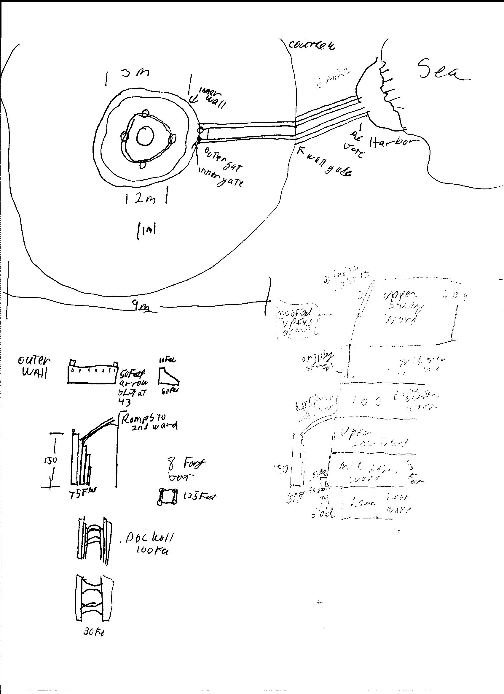
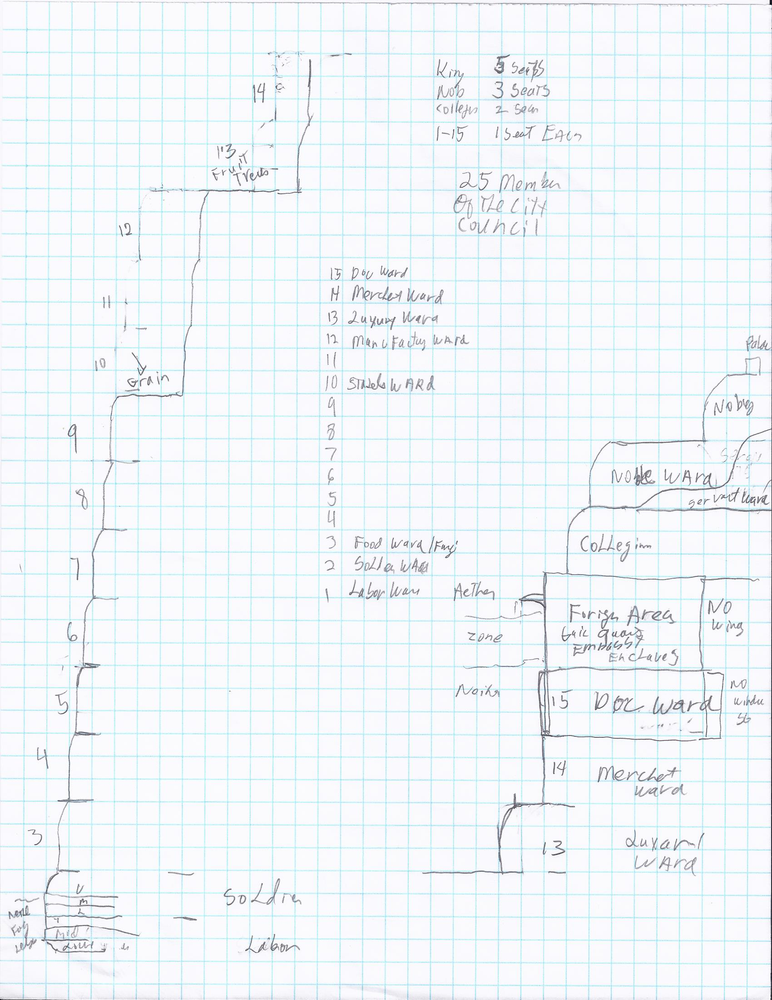

Table of Contents

[Where people live 8](#_Toc89541400)

[PC Intro 10](#_Toc89541401)

[Skills 15](#_Toc89541402)

[Stats and Skills 15](#_Toc89541403)

[Inherent Stats 16](#_Toc89541404)

[Stats Allocation 18](#_Toc89541405)

[Overlapping skill types explained 28](#_Toc89541406)

[Pull 30](#_Toc89541407)

[Modifications to skill rolls 33](#_Toc89541408)

[Time 33](#_Toc89541409)

[Multiple people where appropriate 33](#_Toc89541410)

[Environment 33](#_Toc89541411)

[Health Levels and Healing 34](#_Toc89541412)

[Edges and Hinderances 37](#_Toc89541413)

[Edges 37](#_Toc89541414)

[Hinderances 40](#_Toc89541415)

[**Favors (not for purchase are earned in game)** 40](#_Toc89541416)

[NPC 41](#_Toc89541417)

[Combat 41](#_Toc89541418)

[Neither Affects 42](#_Toc89541419)

[Arclean 48](#_Toc89541420)

[New Avalon (See Maps) 48](#_Toc89541421)

[Government Domestic Issues Affecting the City 55](#_Toc89541422)

[Local Government 55](#_Toc89541423)

[Kingdom Level Government is done by the Royal Council. 55](#_Toc89541424)

[Law Enforcement 56](#_Toc89541425)

[Laws 57](#_Toc89541426)

[Society 57](#_Toc89541427)

# [Other Locations 60](#_Toc89541428)

[Relocore 60](#_Toc89541429)

SETTING

A world of wonder, where ships travel thru the air, and a person’s worth is defined by who they represent. From noble houses to merchant families to guilds to succeed one most rely on others. Individuals are fundamentally untrustworthy and what is important is the power of the group standing for you .

The world differs from us in many ways. The clearest is the atmosphere lives in multilple levels. The Aither air as we breath. The Zone a violent area of weather at the edge of Neither and Aither violent turbulent area. The Neither composed of multiple zones. The lighted Neither where the sun and moon can be clearly identified most days. The dark Neither where the days can be tracked but the exact location of the sun or moon cannot be determined. The lightless Neither the deepest valleys or caves or underground locations where the Neither pools in darkenss and can be felt. Lastly the deep Neither areas deep under the earth where it is thick and most creatures cannot survive for over a few minutes.

The Zone is a region between 20 and 150 feet thick where the Aither and Neither mix, this creates a charged zone that allows for airships to fly and be powered, energy captured for the great cities, near constant storms rage here. At times called the dead zone for where the Aither the Neither and earth meet the furry of the gods is unleashed and lightning strikes kill anything foolish enough to attempt to live in that area. Even on the best of days the Neither is translucent making it hard to make out anything but the largest outlines of lakes and valleys below, and often so thick no details can be seen. The range is not stable or consistent in most areas the dead zone covers between 100 and 300 feet and during storms may extend another 200 feet. In most areas this moves back and forth in area 2 or 3 miles long, the faster the land gains altitude the shorter the area and along cliffs etc. it may be as short as 600 feet. On land where the Zone lands tunnels often over 2 miles long allow goods to pass through safely, however even in the tunnels they are limited in size by the reaction of the Aither and Neither and most are no more than 20 by 20 openings where the electrical discharges can be safely controlled. (The Zone is not impassible on foot; on a good day you only have about a 1% chance of being hit by lightning of course most days are not good days.)

The Neither corrupts man and most plants twisting them from their natural form making them less and eventually other. For instance, many fungi seem to be able to grow with just a bit of water and pull almost all their nutrients from the air or at least Neither that they need and these plants are incapable of surviving outside of the Neither. However, eating these plants or anything grown in the Neither brings with it its own risks both long and short term. It should be noted that those plants those fungi growing from the Neither appear unable to handle sunlight and rabidly rot if exposed to even the least amount or most eclectic lights for that matter.

At times, the Neither rolls in far thicker, this is referred to as the Neither Fog and it can prove lethal to those who are caught out in it. The fog is part of the reason that humans do not live outside large settlements or in caravans able to protect them from the fog, the other part is the Orcs and other creatures living in the Neither, the Neither adapted creatures have come to rely on it and actually take damage when exposed to the Aither or supplied food that has not been affected.

Recently society has learned the secrets of the Neither. While radiant power has been used for at least 2500 years ago about 900 years ago the first Airships able to ride and be powered by the Aither were discovered. While scattered records exist, told in the realm of myth and legend and 500 years were lost completely. The great kingdoms of today started to take form shortly after that and by 800 years ago most of them had created their own traditions and rules. Before this Mankind was living in independent city states. These great cities referred to as Spires, extended into the Aither and contained 1,000s of residence. Between the cities dangerous trade routes traveled by land and sea resulting in isolated Spires, in few place spires were close enough to created kingdoms but none of these where greater than 5 spires and most only 2 or 3 and travel time in days, the largest of the proto kingdoms could be walked across in less than a week.

World History aligns with our current world till about 1715. In 1715 the Neither first appeared and slowly spread across the planet. By 1790 the tropics and sea level areas started to be covered. The largest change was that by 1790 electric radiant power for lights became common within the Neither. At this point Neithercrete was discovered allowing the the creation of the first spires. The Spires then spent the next 150 years racing the advancing Neither by 1940 the world was nearly completed covered with only the highest levels of the Rockies, Andeis and other mountains over 10,000 feet completely covered with the except North of Iceland and Northern Greenland.

The first erra resulted in the formation of the 5 great kingdoms. English, German, Scandavain and the isolated Western American and New Zealand. Over the next 300 years the great kingdoms struggled in the new world and the rise of the Orcs and Dwarfs in different parts of the world. Advancement was almost entirely focused on Neither-tech, Lights became common and even basic Neither weaponry was developed. Perhaps the greatest advancement in human history also took place driven by the need to communicate and move goods Air flights between the northern kingdoms became common and non Neither technology advance to about 1940. A few flights maintained contact with Australia but they were not common. The great kingdoms abused the science they developed over the few interactions with those infortune enough trying to survive in the Neither.

First age of Storms.

Starting in around 2250 to 2400 the Neither levels rose even higher, covering all of the world and violent storms ravished the land. All the cities fell technology regressed while the dwarfs managed to maintain basic Neither tech all other knowledge was lost. The great kingdoms fell and hords of Orcs ravished the land and only a few isolated dwarven communities were not destroyed at least once in the centuries. Humanity had not fully adabted yet and the affects of Neither was catastrophic, however the southern areas in the tropics were far more stable. They great Orc armies moved out and north, these groups did not appreciate how they were treated by the Great kingdoms. These hordes attempted to erase all knowledge of the 5 great kingdoms.

As the Neither fell the Spires using dwarven technology started to rise again, humanity had mostly adapted and even more importantly all of nature had became use to the Neither, especially fungus that could exist directly off them appeared.

About 50 kingdoms started to appear and dominate the world, these kingdoms and great armies of orcs resulted in a constant changing of leadership and control over the world. Even worse each kingdom justified themselves as the rightful heirs of one of the 5 great kingdoms and each time they captured an area they attempted to erase any civilization that existed between them and the Great kingdoms.

This constant change resulted in some minor advancements but mostly static world for 1500 years as no one group could maintain control and communication was limited.

A second great Neither storm struck covering the entire planet and a collapse of all civilization, while a few Orc groups maintained control of a few spires the Elves, ½ elves and Humans were unheard of. The only exception was 2 spires of humans living in Iceland that maintained some history of the world and technology.

1000 years ago this the Neither started to drop and the Icelandic humans and improved Neither technology greatly, Neithercrete used to be able to build up 500 or more feet suddenly good build to over a mile.

The age of spires began, during the next 200 years most of the great spires were created and stretching as far up as they did kingdoms slowly spread across the world, however travel between spires was difficult and empires could not maintain control of spires more than a few hundred miles away.

Just as things began to move forward another Neither storm along with a collapse of Neither fungus (for some reason they all started dieing as they were only about 2 forms used for substance). This resulted in a callapse of the humanity the world was reduced to a isolated dwarfen communities and the Icelandic spires, over 50 years about a 80% callapse of humanity. 200 years later when the Neither storm calmed down the good news is 100s of Neither fungus have been created and the variety and types should prevent any repeat of the fungal callapse. The dwarfs and already reestablished the deep ones and orcs and the removal of the goblins that survived in the sprires.

Between all the fungal types the dwarfs had developed, the remaining technology from the Icelandic elves a very different world appeared, populations in the spires were 10 to 100 times higher, food was not as restricted and sailing and Neither technology were at the highest levels they had been at since the era of the Great Kingdoms. Some dwarven areas and the Elves in Iceland have decent history of the first age of spires. Very little non oral records exist from anything before then and the elves and dwarfs guard the knowledge they have. Most of humanity only has oral stories for anything occurring before the callapse.

200 years have passed and perhaps the larges change in history has occurred. The creation of Airships. These crafts sailed thru the Zone and suddenly goods and people could be transferred between spires even it the area between was controlled by orc hords or hostile territory and not limited to waterways. These crafts traveled far faster than any sail ship allowing 100 miles being able to traveled in a single day. This brings us to about 700 years before the current day

700 to 300 years ago The age of Conquest as Kingdoms rose and fell, airships would land troops on the top of a spire and conquer the populace. Usually be controlling all supplies by disrupting all ground transportation of food until the starving masses surrendered, or all that was left was crazy fungus eaters. The first small arc cannons were developed, the largest could easily be mounted on airships.

The Great Weapons large Arc canons were perfected 300 years ago the great weapons of defense, when powered by the energy in the Zone they can release destruction at ranges far greater than any existing mobile weapon. The larger the gun the more power, and larger resulted in guns with more range and more damage. Since the Spires mounted weapons greater in both size and number than any airship it was nearly impossible to take a city by force. Sometimes an army would lay siege long enough for a city to surrender but that was an extremely rare event. For over 200 years the kingdoms and even a few independent spires were stable.

40 Years ago the first Cartridge Weapons were created. These weapons relied on rare materials to create a supercharged discharge with ranges around twice what a Great Arc Cannon can fire. The guns however are fragile and ammo is unstable and after a few months will become inactive. Only a few spire has access to all the materials needed to build a cartridge trade routes have become more and more important. This means that sieges are once again possible as attackers can outlast cites ability to supply working Cartridges and then destroy all the remaining Arc Cannons, the age of Conquest has returned forcing cities to quickly build larger armadas of airships to defend the land that they have.

In the last 20 years a number of cities have fallen to this tactic, while slow and expensive it is now possible to capture a spire by force. Smaller kingdoms have willing merged with larger ones and a new arms race is taking place.

Most of Humans lives within the great cities of the world, these cities stretch in places from sea level to over 4 miles tall. With the rulers living above the Neither above the Zone in the Aither and the least living deep within the bowels of the cities harvesting mushrooms and never seeing the light of day. Even among the more well to do many people never leave the city they were born in.

Food: Most people in the great cities rely at least partial on the mushroom farmers for food, the most common Mushroom is Sycelium which may be eaten raw, not without some effects though. And when processed has a minimal effect on most people. Sycelium grows incredibly fast in the dark and a 10 by 10 by 10 area dedicated to its growth can feed 15 people unprocessed and up to 10 people when processed into Mela the safest form to consume.

Types of Humanity (Most other life has a similar 6 forms)

Type 1: Usually referred to as the ELF the Fair Folk or High Elves are the unadapted version of Humanity basically people as we are now. They are deathly allergic to the Neither and will be made uncomfortable by items that have recently spent and extended period of time within it. Even being around the Zone can make them ill. They are restricted to areas where no contamination is present far to the north or the tops of spires. Most do what ever they can to avoid and airship travel even though they could survive years in the Zone.

The ruling families of some distant lands are Type 1 also those living far to the north (Iceland) or south but are by far the rarest type of humanity as the locations they can survive in are extremely limited and they are very susceptible to even indirect exposer. However, they are the most intelligent branch of humanity and have technology superior to any other group. Each group of humanity is affected more and more by the Neither.

Type 2: Usually referred to as ½ Elves are rare but are able to interact with humans and travel in the Zone, these people have an extremely limited ability to handle the Neither but they can survive exposer and even some food and handling items from the Neither have no ill effect on them. While they have a wider areas that they can survive they are still extremely rare as prolonged exposure to the Neither can kill them. They can deal with it for months and only a few days outside will allow them to deal with it again, but after that they begin to get ill. They can be found in a few spires and traveling in airships. They often co-exist with the Elves who supply them with equipment far superior to what is commonly available, and they can make up for the shortage in numbers with superior equipment. The largest issue is next to the Elves they have the smallest area of survival, mostly those who split their time between the Aither 70% plus and the upper Neither less than 30%.

Type 3: Humans are the dominant version on the planet while they may not be the most common due to spires and the civilizations they support only outnumbered by only the Orcs, they do have large numbers and superior technology furthermore they have the ability to thrive within the Neither so long as they get some exposer to the sunlight and food that has not been corrupted. (See goblins below for what happens if they do not get this, but even then, they do not die). Humans can be most places on the planet, and some will even be found under the earth mining, but this can be extremely damaging to them if they are not able to leave the mines often. With proper precautions humans can be found just about anywhere. Their natural environment is the Upper Neither.

Type 4: Orcs are the most common type of man and are mostly adapted to the lower Neither, while they need some sunlight to resist the affects of the Neither they need to limit the amount of Aither food they eat or Air they breath however like humans if need be they can exist in the Aither and will not die because of it however long term exposer can make them sick. In fact the Aither affects the orcs in almost the same way the Neither affects Humans. They can be found across most of the planet. The line between humans and Orcs can often blur and they may co inhabit an area. While key differences exist between Humans and Orcs this is more a characterteristic of the group and the not person. A skinny less brawny Orc can not be visible differentiate from a brawny human.

Type 5: Dwarfs are nearly completely adjusted to the Neither and unfiltered direct sunlight causes them intense pain and prolonged exposer to the Aither food or air can eventually kill them however with that said they can exist for a time in the Aither. They are probably the 3rd most common form of humanity existing in large underground layers of the earth. Most dwarven homes have a limited number of shafts to the surface but the actual homes are usually 100 to 5,000 or so feet underground. Those locations closer to the surface usually have fallen to orc or human raiding. While not comfortable some dwarfs have moved into the spires. These are either merchants or outcasts. A few dwarfs however have chosen to live with humans often running and working in the mines near a spire.

Type 6: The deep ones are reliant on the Neither to exists and even holding Aither food can cause burns on the skin and breathing the Aither is poisons for them. They are so sensitive that unless the Neither is exceptionally thick being out during the day will cause them damage and most of them have never been to the surface of the earth nor would they every willing go. Even the air within the warrens found in the spires will slowly kill them. As the name infers most deep ones live even below the dwarfs and are found over 5,000 feet deep to about 12,000 feet. They also require temperatures above of 100 degrees to survive comfortably and require appropriate clothing if the temperature is cooler and often prefer temperatures greater than 120 degrees.

These types are not fixed and do not dermine who a person is. Most people can pass as two different types of humanity and coexist without drawing attention. For instance orcs and ½ elfs often live mixed with humans in the spires and they do not think of themselves as anythine other than humans. Players can determine if they tend to resemble a level 1 off from their base or if they are clearly a single type. None of them are a separate species and the children can often be a different category than their parents. For instance orcs who capture a city/spire in the light Neither within the first generation will start having humans as children and unless food or time is spent at a different level will completely convert to the new environment in 5 generations becoming humans.

Sub Types (almost all are offshoots of either type 3 or 4 human. Orcs and Humans account for about the majority of humanity.

Type 3a or 4c goblins: Long term exposer to Neither for Humans and in rare cases Aither for Orcs result in goblinization. Loss of mental and physical abilities, This state also can occure in areas of high flux in exposer. In the flex areas goblins often breed true, Goblins that are isolated into less stable areas follow the normal adapaton pattern.

Type 3b Vampires creatures who have lost the ability to consume Aither food and suffer physical decay but can reverse the process temporarily by consuming the blood of type 1-3 humans. Orc blood does help some but only has a partial affect. Vampires do not breed true and often live undetected within the spires (mostly because if they are found out they are quickly killed or exiled from the spire). Humans become Vampires after the consumption of human flesh, the longer and more eating the more likely a vampire will be created.

Type 4 a: Beasts creatures that can consume the flesh of Type 3 or better creatures and have the negative affects to intellect reversed. No one knows exactly how Beasts are created. Failure to regular consume the flesh of sentient creatures doubles the negative affect on intellect.

Type 4 b: Neanderthals these are orcs that have no exposer to the Neither after a prolonged period and suffer a physical degradation of health and strength, just like goblins after enough time or growing up in this environment these affects can be permeant. After a few generations these groups give birth to Type 3 humans.

All versions of humans can technically interbreed but the chance of an offspring surviving anything more than 1 shift is nearly non existent as both the mother and child need to be able to survive and stay healthy for 9 months. Even 1 shift off 80% of the surviving children will be the same type as their mother and only 20% as father and 2 shifts off will seldom make it to term and will never be more than 1 shift towards their father except for the rarest of cases. Seldom do people 3 shifts apart even interact due to how the Neither affects them. It is also possible either after extended generations or if within the last few generations a crossbreeding occurred for mothers to give birth to children +/- 1 level from their own but this too is not very common and results in a very difficult pregnancy.

Each shift between the 6 main types of humanity takes place fairly quickly. Any group forced to live their entire life in a not optimal environment will move to adapt in 2 or 3 generations. The only semi exception is Goblins as if the exposer to Aither is seasonal they will often not complete the shift between human and orc, combined with the fact in most communities those born as Orcs or Humans often escape from these communities and resulting in only the Goblins remaining.

|  |  |  |  |  |  |  |  |
| --- | --- | --- | --- | --- | --- | --- | --- |
|  |  | elf | 1/2 elf | human | orc | Dwarf\* | deep ones\* |
|  |  |
|  |  |
| aITHER | Noon Sun | 0 | 1 | 2 | 4 | 5 | 7 |
| Bright Sun | 0 | 0 | 1 | 3 | 4 | 7 |
| Overcast | 0 | 0 | 1 | 2 | 4 | 7 |
| night time | 0 | 0 | 1 | 2 | 3 | 6 |
| Zone | Sun | 1 | 0 | 1 | 2 | 3 | 6 |
| Night | 1 | 0 | 0 | 2 | 2 | 6 |
| Lesser Storm | 2 | 0 | 0 | 2 | 1 | 5 |
| Storm | 2 | 1 | 0 | 2 | 1 | 5 |
| Upper Neither | Calm | 3 | 1 | 0 | 1 | 2 | 5 |
| Minor | 4 | 2 | 0 | 1 | 1 | 4 |
| Storm | 4 | 2 | 1 | 0 | 0 | 4 |
| Greater Storm | 5 | 2 | 2 | 1 | 1 | 3 |
|  |  |  |  |  |  |  |  |

|  |  |  |  |  |  |  |  |
| --- | --- | --- | --- | --- | --- | --- | --- |
|  |  | elf | 1/2 elf | human | orc | Dwarf\* | deep ones\* |
|  |  |
|  |  |
| Lower Neither | Calm | 5 | 2 | 2 | 0 | 2 | 4 |
| Minor | 5 | 3 | 2 | 0 | 1 | 3 |
| Storm | 5 | 3 | 2 | 0 | 0 | 3 |
| Greater Storm | 5 | 3 | 3 | 0 | 0 | 3 |
| Reactive | 5 | 4 | 3 | 1 | 1 | 3 |
| Underground | Calm | 6 | 4 | 3 | 2 | 0 | 2 |
| Normal | 6 | 4 | 3 | 2 | 0 | 2 |
| Reactive | 6 | 5 | 4 | 3 | 1 | 1 |
| The Deep | calm | 7 | 5 | 4 | 3 | 1 | 0 |
| normal | 7 | 6 | 5 | 4 | 2 | 0 |
| reactive | 7 | 6 | 6 | 5 | 3 | 0 |

0 Natural environnement

1 Unconfortable, trouble sleeping

2 Slow healing 75% minor negative affect extended exposer issues sleeping

3 Slow healing negative 50% affects exposer -1 to -3 skill after each week exposer.

4 Slow healing negative affects exposer -1 to -3 skill after each day exposer.

5 Physical damage every hour exposer -1 to -5 skill after each hour exposer.

6 Physical damage every minute -1 to -5 skill after each minute exposer.

7 Physical damage in seconds -1 to -5 skill after each minute exposer.

Extended exposer to levels 2 or 3 results in non standard creatures.

Living in a zone that does not align with your base environment starts a transition. After 3 generations living in this environment children will have shifted one zone and have a different version of humanity than their parents. (this is not exact at times it happens in a single generation or sometimes takes 10 or more generations. Also for many generations a child can be born with a shift of up to 1 genartion towards their ancestors.

Being within a permanent structure can decrease affects by one level.

Food Affects are different from environmental.

Food is rated as

Aither Grown above the Zone or deep water fish

Zone Food Grown on Airships exposed to sunlight

Upper Neither: Food grown in the upper Neither exposed to sunlight

Lower Neither: Food grown in the lower Neither exposed to sunlight and processed fungus Fish 100 feet or less.

Underground: Fungus unprocsses

Deep Fungus: Fungus grown 1000 or more feet underground

|  |  |  |  |  |  |  |
| --- | --- | --- | --- | --- | --- | --- |
|  | Elf | ½ Elf | Human | Orc | Dwarf | Deep one |
| Aither | 100 | 100 | 100 | 10 (b) | c | e |
| Zone | 50 (1) | 100 | 100 | 50 (a) | b | d |
| Upper Neither | 10 (2) | 50 (1) | 100 | 100 | 50(a) | c |
| Lower Neither | 3 | 2 | 50 (1) | 100 | 100 | 10(b) |
| Underground | 4 | 3 | 10(2) | 50 (1) | 100 | 50(a) |
| The Deep | 5 | 4 | 3 | 2 | 50(1) | 100 |

Exceeding percentage listed applies affects.

1 effect starts after a month (every 2 days of good food decrease days by 1) -1 to -3 for all mental stats per week

2 effect starts after a week (every 2 days of good food decrease days by 1) -1 to -3 for all mental stats per day

3 effect starts after a day (every 2 weeks of good food decrease days by 1) -1 to -3 for all mental stats per day

4 and D Poison affects of 3 but after 2 weeks -1 physical stats per week death if when any physical stat equal 0

5 and 6 Poison affects of 3 but after 2 days -1 physical stats per day death if when any physical stat equal 0

a effect starts after a week (every 2 days of good food decrease days by 1) -1 to -3 for all pyhsical stats any stat reaches 0 death

b effect starts after a day (every 2 days of good food decrease days by 1) -1 to -3 for all physical stats any stat reduces to 0 results in death

c effect starts after a week (every 2 weeks of good food decrease days by 1) -1 to -3 for all physical stats anystat reduces to 0 results in death

Elves: They only exist in the far north, southern regions of the planet. They can also be found on some of the highest peaks in the northern hemisphere. They react very strongly to the Neither and have trouble tolerating even the Aither. Living outside of the Aither they are the only group that regularly uses explosives including gunpower. This makes their locations nearly immune to any attacks from other groups. Also the use of iron and steel.

Their homes are composed of steel and wood and exist in the Sunlight. Extended generations with exposer to the Neither/Aither cause a conversion to ½ elves.

½ Elves live around the outsides of Elven communities and often work as traders/diplomates for elves as they prefer to live in the Aither and have limited ability to tolerate the Zone and Light Neither. Steel rusts rapidly and explosives are unstable however they are able to take advantage of the advanced knowledge of the elves and are some of best equipped people. They build in wood and cement. (racial +1 skill tree, exceptiona intelegence (max 16).

Humans: Most humans live in the spires. The light Neither just below the Zone is the natural location for humans. They build in perdium and solidified version of the Neither that allows for amazing structures (mile high buildings) this material can also slow down how fast the changing Neither affects an area. The light Neither is where the sun can be easily seen most days. Shadows exist and plants grow well. Extended food options. They treat Aither and Sunlight food as beneficial. Increased healing.

Orcs: Very similar in many ways to Humans orcs are creatures of the dark Neither which is the surface of most of the planet. Of all the current versions of humanity they have the widest range of locations they can live and can be found in the lower levels of the Spires to shallow caves to most of the land on the planet. Orcs build in stone and are masters of the craft. The lightless Neither is areas where it is deep enough to prevent the sun from clearly being seen. Often only seen by a large area of light. (think very cloudy days). Increased healing, delayed storm affects takes 6 hours for Neither storm levels to start affecting them.

Dwarfs: The lightless Neither (location that never see the sun.) living under the earth but above the mist which is the denses level of Neither found. Dwarfs are master diggers and live in huge structures under the ground. Low light vision extended hot and cold tolerance

Deep Ones: Living far under the earth the deep ones are the least human of all humanity and almost seem to exist as their own species. (they are not and after a normal 3 generations or so the children are Dwarfs). Due to the depth of the earth they live at they are adapted to high temperatures and limited food. Deep ones are experts in fungus and actually breed the versions that humans use in the spires for food and medicine. These fungus after a few generations decay so fresh samples are always in demand. They live in the mists. Low Light Vision, Heat adapted, and exceptional resolve (max 16)

Each version of humanity has a certain area they need to live in or after a few generations they shift to another type. This means that population is extremely dependent on how much space exists and how much food is available. Humans ability to create spires has resulted in them being the one group that can increase the amount of space they have to live.

Estimate world population

300,000 elves

200,000 ½ elves

400,000,000 humans

600,000,000 Orcs

10,000,000 dwarfs

200,000 deep ones

Other

200,000 Goblins humans living like orcs

20,000 Neanderthals Orcs living as Humans

10,000 Troglodytes. Orcs living as dwarfs

10,000 vampires mutated humans that need blood of dwarfs or better to maintain intelligence

10,000 beasts mutated orcs that require human or better flesh to maintain self-control

## Where Humans live

The Civilized World

The great cities about 87% of humanity (type 3). Life here varies greatly from the suffering of those in the Warrens who live life’s as bad at the miners in the deepest darkest holes to the nobility that exist in luxury. About ¼ to 1/3 of a city’s residents live in the Warrens.

The Highlands about 1% of humanity places around the Zone, living around the Zone is usually only available in areas with harsh weather but access to sunlight and fresh food makes them some of the healthiest and most admired people. Strangely though without the wealth of the nobility or the radiant power of the Neither they live a bit more primitively than most. The major raiding societies also exist with the Highlands as they unlike ½ elves they spend time in both the Aither and Neither.

Island folks living on smaller islands in the ocean or in large lakes about 3% of humanity, these people have plentiful supplies of deep-water fish and their isolation protects them from many threats found on the mainland allowing for a life much different from those living elsewhere outside of the cities. While not as nice as the highlands many city dwellers dream of living here. Unlike hamlets most island folks own the land they live on. The vast majority of island folks live an isolated life as they have not access to anything but trade ships on the Sea and these are slow and unreliable means of transportation. Other islands see boats once a year or even daily depending on how close they are to trade routes and Spires. Those closest to spires may actually fall under the laws and rules of the nearby spire (usually well less than 1 day sailing from the spire). Those islands losing access to fish in just a few generations shift to type 4. The difficulty of getting to these islands along with the fact that Orcs do not value deep-water fish has resulted in less raiding than anyone attempting to live on the mainland experiences.

Hamlets (smaller cities without airships may or may not have access to a lake or ocean) about 7.75% of humanity, the fringe of humanity often under threat. These very from encampments to full cities and the safety depends on locations, some are within sight of the great cities, almost all are owned by one noble family or another, a few of the larger ones may have 2 or even 3 noble families claiming the territory. Without direct access to food and the numbers to defend themselves these settlements are owned and controlled by nobles residing in the spires. Only the constant supplies of fresh food and rotating inhabitants with the spires prevents them from turning into Orcs.

The Depths living underground about 1% of humanity. These are the miners that supply so much for the cities and live perhaps the most dangerous lives of any human. Serfs and Debtors and prisoners are the most common miner, while freeman and woman can make good money at the mines few are willing to live this life. One exception is claims where the mine is owned by the miners. Most claims however do not provide much wealth as the nobility has claimed the best locations.

Less than ¼ of a percent living in the Neither on the mainland and not part of a larger community. The few the free the outcasts only with proper equipment and filters can one hope to survive. Most live without considering themselves part of any country no matter where they live. These wonders are seldom treated well, they however should not be confused with merchants that own travel between city as they technically live in one city or another and are members of that community.

About 50 years ago improvements in Airships massively increased range if not speed. These airships have started trade routes with strange lands and countries that were unknown to the local kingdom as no land or water route connected them. About 10 years ago more improvements were made in both speed and distance and reports recently suggest that contact has been made with places so far away that they had never seen an airship before, these lands are months of travel away but hold much interest to the powers of the civilized lands.

# PC Intro

Clock Work cities is a role-playing game based in a world were science works differently than in our own. Primarily using the concept of the Neither that interferes with the reliable use of combustion for anything. This means that cars and guns and most forms of electrical generation simply do not work and that even in the locations where they might the use is so marginal it has simply never been developed. Inventions that we take for granted such as the telegraph, phone and radio simply do not exist. The primary setting for the game will be the great city of Abelanth and based around the 13 ward. Clockwork cities is a steam punk inspired game of politics and intrigue with just a bit of fisticuffs thrown in for fun. Players will take on the role of a resident of the 13 Ward. Most players will be well off Middle Class members of society with some doing a bit better and some much worse.

Character Generation is covered in a separate document.

Wealth and Status.

In many ways these are the same thing, the more wealth you have access to the higher your status and if you are not expending that wealth at the level of your status you will lose that status. While coins and money are used it is important to remember that it is your family or guilds money that is most important.

Transitory and Permanent wealth.

Permeant wealth is what your Family/Guild supplies you and you do not have direct access to it. This covers you house, your standard equipment food and entertainment. It allows you to live a style of life matching your assigned social level +/- 1 depending on how well you are regarded by your house, family or guild. Note you are expected to contribute to this as well so your status affects your transitory wealth limits. If needed the story teller will assign a value between -99 and +99 to determine how much you can afford as well as how close you are to moving up or down a social class.

Transitory Wealth is the number that we track. Players have Base Gold, if they ever have less than this amount in spending cash at the beginning of the month wealth will be set to this, they also have Maximum wealth and maximum equipment they can own, if they have over this amount subtractive greater off the base amount or ½ the amount they are over the limit from this total as the family takes back the wealth or the players spend and loose it on non important items or it is simply stollen. More well off pc have the ability to grant others access to more goods than normally allowed. This does not include cargo for merchants held by the merchant house, but this is not the pc and using it may result in the pc being disowned.

- Non Citizens no rights should not be PCs however a PC may have been one at some point
- Citizens Members of society with very limited wealth and options any pc at this level should be attached to another character at some level.
- Guild Member/Professional: The lowest level of society that has both money and freedom of activity they are however bound to the guild they are part of, and their loyalty lies in that direction. They might also be loyal to a merchant houses or royalty.
- Merchants: Wealthy individuals who are loyal to a family and will employ individuals granting partial rights for those working for them.  The merchant’s family controls wealth distribution unlike Guild Members who are responsible for their own spending.  Individuals of worth may join into a merchant house and at times people can be expelled.  The merchant houses have only been around for about 300 years.
- Royalty the great noble families of the realm, one can only join thru marriage or adoption however the royal families have been known to adopt people well past 80 years old if it servers their interests.  Just like Merchant houses however wealth is controlled by the family not the individual.

Non Citizens

|  |  |  |  |  |
| --- | --- | --- | --- | --- |
| Status | Roll |  |  |  |
| -3 | Wanted (Kill on site) |  |  |  |
| -2 | Slave/Prisoner |  |  |  |
| -1 | Indentured Servant |  |  |  |
| 0 | Unaligned |  |  |  |

These status should not be played and have large disadvantages.

Unaligned may only visit the city may be treated well and can trade/buy goods they are not allowed to stay over 7 days or buy housing etc. and their ability to travel within the city is very limited. Not are not the same as members of other civilizations that happen to visit, this are independent people not bond by normal society.

Indentured Servants are people who have lost their rights for a fixed period of time or conditions with the expectation that at some point they will be returned. All their gear and money must be granted to them from another pc and this total will be subtracted from what they are allowed to own. Furthermore, they need to expend that amount of gold each month to maintain the gear. However, since they have the potential to rejoin society some measure of respect is granted them, this often depends on the status of the patron.

Slaves are indentured servants except that they will not be restored to rights and while still considered human they have no real rights and can be legally be killed at whim and are basically treated as property. However this status is extremely rare as Slavery is not widely accepted.

Wanted: The city has declared you an enemy you may be killed any goods go to those who kill you and if they supply proof a reward may be offered.

Non citizens are those people from other kingdoms and lands who visit. These visitors will be treated as their wealth and the current relationship between nations (or more accurately the future perceived relationship).

Citizen

|  |  |  |  |  |
| --- | --- | --- | --- | --- |
| Status | Roll | Base gold | Max Gold | Max Gear |
| 0 | Bum/Homeless | 0 | 0 | 0 |
| 1 | Laborer | 1 | 1 | 1 |
| 2 | Foreman | 2 | 6 | 6 |
| 3 | Leader | 3 | 9 | 9 |

PC are exceptional npcs access to 2 base gold this in base gold and 2 of the values in max gold and max equipment.

Laborers live in communal houses with 4 or 5 families living in one set of rooms and all meals not eaten at home must be paid for.

Foreman are more skilled often in charge of multiple citizens and live in 2 small rooms inthe least expensive areas of the community. They may eat out 1 or 2 times a week at a low level diner.

Leader are the most successful citizens living in small apartments and may have a periodic nice meal out.

Citizens however are perhaps the most free members of the world as their loyalty is only to themselves and what ever temporary employment they can find. Other may hire citizens, if so they may grant them more material wealth but this will be counted against their total wealth for everything in excess of what the citizen is allowed to own.

Citizens who have a professional type skill may move over to a Guild Member and this is an easy change. 1 dice in any skill makes you an apprentice and 3 dice a guild member and 4 a master but non game time the PC is assumed to be working for the guild.

Guild Members

Guild Members are skilled workers and professionals who owe loyalty to either a Guild or to Merchant or Royal Families. Players need to declare what ones they currently have however they can change it during play. If you do not have a sponsor you will lose 1 status and become a citizen.

|  |  |  |  |  |
| --- | --- | --- | --- | --- |
| Status | Roll | Base gold | Max Gold | Max Gear |
| 1 | Apprentice | 2 | 1 | 1 |
| 2 | Guild Member | 4 | 4 | 4 |
| 3 | Guild Master | 6 | 9 | 9 |
| 4 | Guild Leader | 8 | 16 | 16 |

Citizen who join guilds (minimum skill level for a guild status)

1d20 Apprentice

2d20 Journyman/Leader

3d20 Master (Guild Masters also often have this skill)

4d20 Legendary Artificer extremely rare, still a craftman but have the status of a Guild Master

Merchant

|  |  |  |  |  |
| --- | --- | --- | --- | --- |
| Status | Roll | Base gold | Max Gold | Max Gear |
| 4 | Lesser Merchant | 8 | 16 | 32 |
| 4 | Merchant | 10 | 25 | 50 |
| 6 | Lesser Merchant House | 12 | 36 | 72 |
| 6 | Merchant House | 14 | 49 | 98 |
| 8 | Wall Merchant | 16 | 64 | 128 |

Noble

|  |  |  |  |  |
| --- | --- | --- | --- | --- |
| Status | Roll | Base gold | Max Gold | Max Gear |
| 5 | Poor Noble | 10 | 25 | 25 |
| 5 | Lesser Noble | 18 | 72 | 72 |
| 7 | Noble | 21 | 98 | 98 |
| 7 | High Noble | 24 | 128 | 128 |
| 9 | Greater Noble | 27 | 162 | 162 |

Military/Constable (Players may use the Noble/Merchant rank instead if they can retire to that rank)

|  |  |  |  |  |
| --- | --- | --- | --- | --- |
| Status | Roll | Base gold | Max Gold | Max Gear |
| 2 | Enlisted Military | 1 | 4 | 8 |
| 2 | Enlisted Constable | 2 | 4 | 8 |
| 3 | Military sergeant | 2 | 8 | 16 |
| 3 | Sargent Constable | 3 | 8 | 16 |
| 4 | Captain Constable | 3 | 12 | 24 |
| 4 | Military officer | 4 | 12 | 24 |
| 5 | Military General | 4 | 100 | 100 |

Retired may either revert to original social class or loose 1 status -1 base gold X2 Max Gold and X3 Max Gear. Retired military are still subject to recall from the crown.

University (May revert to family social class instead of graduating. Graduates must have an employer, or they revert to the old family status.)

|  |  |  |  |  |
| --- | --- | --- | --- | --- |
| Status | Roll | Base gold | Max Gold | Max Gear |
| 4 | Student | 1 | 4 | 2 |
| 4 | BA Graduate | 12 | 60 | 30 |
| 5 | Upper Grad | 2 | 8 | 4 |
| 5 | Advanced Degree | 20 | 80 | 40 |
| 6 | Professor | 10 | 120 | 60 |

BA and Advanced Degree can go into government rolls, in this case

|  |  |  |  |  |
| --- | --- | --- | --- | --- |
| Status | Roll | Base gold | Max Gold | Max Gear |
| 4 | Bureaucrat | 10 | 80 | 30 |
| 5 | Management | 15 | 160 | 45 |
| 6 | Minister | 20 | 200 | 60 |

Note Level 10 is reserved for the royal family.

Note on how merchants and Nobles differ.

Merchants wealth is based on goods and contracts this form of wealth is very liquid and transitory if you destroy a merchants warehouse a lot of their wealth will be destroyed or if their ships are damaged they may loose everything.

Noble wealth is based on grants and property and is far more difficult to damage long term and they may actually get the aid of the kingdoms to rebuild their wealth when damaged.

One example is a Noble owns the mine that the merchant buys metal at and transports and another noble owned the hamlet where the merchant sells the oar for those working for the noble to build weapons.

Resources and Money.

Social status and wealth is key to life in the Spires and if you cannot maintain your lifestyle or your family fails to maintain its you will loose all benefits of that status.

Resources represent the living expenses your character has and is outside of wealth or money and is not tracked. However this means you cannot purchase anything with resources that would have an impact on your character sheet. However it does cover your day to day expenses and living arrangements. Your character may choose any one of their apprenticeships to determine the characters current social standing and resources.

Resources -1: None

Resources 0: You share a room with 10 to 20 other people and substance on Mela

Resources 1:

Resources 2:

Resources 3:

Resources 4:

Resources 5:

Resources 6:

**Money**

Pin (P)

Bit (B) worth 10 pins

Crown (CR) worth 10 bits

Imperial (I) worth 10 crown

Silver Imperial (S) worth 10 imperials

Gold Imperial (G) worth 10 Silver Imperials

Silver Bar (SB) worth 10 Gold Imperials or 100 Silver Imperials

Gold Bar (GB) worth 10 Silver Bar 100 Gold Imperials

A bar has enough metal to make 110 coins

Unstamped raw metal, enough to make a gold bar is only worth 90 coins maybe less. Gold flake runs about 60 coins.

**Armor**

|  |  |  |
| --- | --- | --- |
| Armor | Cost |  |
| Cloth | 40 C |  |
| Leather | 6 Imperials |  |
| Chain | 9 Silver |  |
| Plate | 12 Gold | Tough |
|  |  |  |
| Buckler | 1 Imperial |  |
| Sm Shield | 3 imperial |  |
| Large Shield | 7 imperial |  |
| Tower Shield | 1 Silver |  |

Shield price, you can also get cheaper shields same price in crowns as imperials but they are limited in total soak

(Buckler 5 soak, Sm Shield 8 soak, Large Shield and tower shield 10 Soak) before they are destroyed.

Stories should be worth between 1 and 3 sxp with most one night sessions worth no more

XP can be used as follows

1 me skill

1-3 new skill chart

Stat current level x 2 increase by 1

New Merit X 4 cost

Buy off a flaw X 4 cost

## Neither Affects

**Humans (Type 3) and Neither do not go together well (Strength, Durability, Agility)**

Living in the Neither and no exposer to Sunlight or fresh air -3 all Physical stats living in the warrens or those restricted to deep mines

Living in the Neither and no exposer to Sunlight -2 all Physical stats but can get fresh air from the outsides. Life in the lower wards 3 -5 miners that are supplied good air etc. ward 1 an 2 people who wrk outside do not have this level but if they stay in the city they do.

Living in the Neither with limited sunlight exposer -1 all Physical stats able to spend time outside word 6 -9 those living in hamlets or miners that can leave mines soldiers who tend the wall and those that work the land. Merchants who travel on the land are here.

Living in the Neither with good sunlight exposer No Affect (Farm ward or better) those on airships or living in the noble district.

Effects take about 1 month to start and each month the stat drops by -1 and fade after 1 week in open air or 1 month in a better level.

**Food Affect.**

This affects stack, but eating a variety of foods counters the affect as each type seems to affect humans differently.

Some one who eats 50% Neither Crops, 10% Mela processed Sycelium, 40% ocean fish and as most members of the 13th word or better do would have no affects.

For foods take the worst affect and add all the types together when rolling up so 10% Mela and 85% Neither Corrupted would be treated as 95% Neither Corrupted while 30% Mela and 20 % Neither corrupted would be treated as 30% mela as the affect is stronger than 50% (20+30) Neither Corrupted

**Class 0 Ocean Deep Water Fish (150 or more feet) and animal’s plants raised above the Neither No Affect**

**Class 1 Neither Corrupted Crops, Fish 50 to 150 feet deep**

0 to 59 % no affect

60 to 95 % -1 mental stats

95+ % -100% -2 mental stats

**Class 2 Mela processed surface fish less than 50 feet animals raised in the Neither**

0 to 20 % no affect

21-60 % -1 mental stats

61-90 % -2 mental stats

91 to 100 % -3 Mental

**Class 3 Raw Sycelium Consumption**

5 to 20 % -1 mental stats

21-60 % -2 mental stats

61-90 % -3 Mental

91 to 100 % -4 Mental

**Class 4 Other Fungi (Best case some are far worse) Animals raised underground**

0 to 10 % -1 mental stats

11-40 % -2 mental stats

41-60 % -3 Mental

61 to 100 % -4 Mental

Well off members of the 13th ward will eat

10 % Mela 45% Neither Corrupted and 45% Class 0 food for no affect

Those not as well off

40 % Mela 55 %Neither Corrupted and 5% Class 0 for a -1 mental Stat

The poorest members of society in the Slum wards will be eating

85% Mela and 15 % Neither Corrupted for -2 all mental stats

While those in the warrens often eat

80 % raw Sycelium and 20 % Mela for -3 all mental stats

(Should be moved, using Elven tech in the Neither)

Elven technology is extremely unstable in the Zone, every use roll 1d20, in fact the Zone actually fades slowly and this affect extends for about 200 feet above where we would say the Zone ended.

1-4 no affect

5-8 ¼ power

8-12 ½ power

13-16 normal

17-19 Double effect

20 Explodes

In the Neither

1-5 no effect

6-9 ½ effect

10-12 normal

13-16 double effect

17-20 Explodes

Elves (Iceland) live in a tech around 1930 and sometimes in the noble district these items are used.

## Arclean

Arclean is a collection of 15 Cities and about 1000 hamlets under the control of King Macelus Wilheart. It is one of the larger countries in the known world (isle of man and the orkney islands as well as northern scotland) Orcs are only found on northern Scotland and some dwarfs live on the isle of Man but the Orkney islands has only humans a few orcs serve as sailors but other than that they are not found in Arclean. The capitol is however in Northern Scotland.

### New Avalon (See Maps)

Capital of the Kingdom of Arclean. Spires are built out of Neithercrete or solidfied Neither an increadable tough substand but deteriots under sunlight the top of the spries are made out of stone and steel.

New Avalon is one of the larger Cities in the Known world, its outer walls are nearly 30 miles long and they in close around 50 square miles of land used for growing crops to feed livestock to support those who can afford it in the city.

The outer wall is heavily fortified and 50 feet tall at its lowest point and at least that thick. ½ mile away lies a port with a secured passage with walls stretching to over 100 feet tall both around the port and to the city proper.

In the center of the outer wall is the city, at its base it is 3 miles across stretching up nearly 14,000 far above the Zone safely into the Aither to where the king lives, the city is still a mile across for his palace grounds and castle.

The lower part of the city is divided into 15 wards each composed of three levels known as the low mid and high circle in some of them travel between circles is as easy as walking along a path in others it is a difficult as travel between wards.

Wards are between 300 and 600 feet in height and extend into the city between ½ and ¾ of a mile. Farther into the mountain is the warrens this is the area ½ a mile to 1 into the city, between the areas is either solid stone or open areas where waste and water well waste water is transferred to allow for the growth of fungus. The warrens while technically part of the city and of the Ward at the same level are not under crown control on a day to day basis (at times the crown may enter in force to retrieve people and enforce laws but short of treason the crown seldom travels to these areas). The poor live a sad existence harvesting mushrooms and eating raw food, here organized crime and the black markets may also be found openly running things.

Beyond the warrens lies the tombs, who or what lives here is a matter of debate everything is so far Neither corrupted it’s hard to call most of what is here human or even to be sure it ever was. Rumors of small safe enclaves exist but no one has ever returned from them.

Travel both two and from the warrens requires a toll of between 12 pins and 1 crown depending on where you try and cross.

Travel between Wards is only allowed in certain places and will cost depending on where you are going. It is a high crime to create another way to travel between wards and is simply not done. This is so deeply ingrained the pcs will not even attempt anything to disrupt the structure of the city.

How to travel between wards.

4 outer tunnels exist, called the peasant paths these move between wards 1 and 13 and can be traveled by anyone with the money to pay the fee. Large openings stretch from the bottom of Low Circle of Ward 1 to the Low Circle of Ward 13 within each opening are multiple tracks private passage in the south are carriages holding no more than 10 people while the freight gondolas in the north can move 100 tons of cargo in a trip. East and west are mixed use with mass transit gondolas holding 200 or more people and cargo of up to 10 tons.

Located farther in is the noble path, the north carriage is open to all who can pay it costs 10 times what the peasant road does for the same service except it also reaches the merchant, doc, sky docs and university levels and also caries cargo from 1st ward all the way to university the cars are however far nicer and seldom do you need to wait this line only stops on at the low circle. The east carriage is reserved for those living in the Noble ward and carries cargo up to 50 tons from the 1st ward to the Noble Quarters this line only stops at the High Circle in each ward.. The west tunnel is reserved for the university and has private cars of 5 to 100 and freight cars as well This line only stops on the mid Circle. Lastly the South or Royal road is reserved for the crown and the area around it is secured, only the king royalty and those on business of the crown may use it it has high security locations on every level.

A few wards have other access, The trade road extends in the north and south between the merchants Ward, through the Doc Ward across the Skyships docs and up to the Collegium.

The Labors ward (Ward 1 at the bottom of the tower) or the center circle has gates leading out into the city, while the lower circle of the military ward has bridges leading to the top of the inner wall and from paths leading down to the area between the city and the inner walls.

One can also walk from the Noble Ward up to the palace. The 7 and 8 as well as 10 and 11 levels have freight elevators connecting theml, passenger travel is not allowed.

Areas of the City

1. The Docs an includes area of about 4 square miles at the ocean where sea going vessels doc and unload their goods and are reloaded for trade at other ports, connect to the city by a secured pathway between 100 foot walls patrolled by the military. Also the dry docs are here where new ships are built and older ones repaired. The area around the docs is considered part of the 1st ward or labor ward and Sailers and Shipwrights live here. Some area is also reserved for the Marines and the Wall guard and they fall under the jurisdiction of the Military Ward.
2. Outer wall 50 foot reinforce defense of the city has room for the army, artillery mounted on the top and internal areas sheltered from the Neither it encloses all of the city.
3. The Fields area outside the city inside the outer wall, used to raise livestock and food for those who can afford to eat other than Mela and wear clothing. Also blacksmiths and foundries are tanneries are found here anything that does not work well indoors. However even here smaller shops are found with the city.
4. Inner wall a 150 foot tall wall reinforced for defense, with small gates for the labors who need to leave through and the military who leaving the area can travel through, the top is connected to the lower circle of the military road by 50 bridges.
5. The city proper, first are the 15 Wards

Ward 1 the Labor ward, each circle is only 100 feet tall and the lower circle is entirely underground. Other than the doors in the middle circle to connect outside (heavily defended if needed) no openings exist to the outside. Most people in the Labor ward actually live a reasonable life as they have free access to the area around the city, and most of them actually work the land doing harvesting. A few even have jobs that take the outside the walls of the city. The lowest of the merchant class may live here when their caravans take them into the city. Stables and warehouses also take up large area of this ward.

Ward 2 the Military Ward the first two circles lower and middle are only 100 feet tall and have no openings to the outside other than the bridges to the inner wall and even these can be sealed and guarded. The upper circle is the military ward and it is 200 feet tall or so like most other circles. The top of the ward has large windows about 50 by 10 that can be closed but are usually left open. These first windows are over 500 feet above the ground and well above the normal levels the Neither Fog (extremely dense Neither may force them closed) reaches. Armoires and training areas fill much of this level.

Ward 3 The Food Ward most food is processed and prepared here it is composed of 3 circles each around 200 feet tall, large open vents connect the lower and mid circle to the outside these openings are 10 feet tall by 5 feet wide with about 10 feet apart the three levels are filled with huge warehouse to store food and to process it for storage This ward is solid and does not have open areas looking out.

Ward 4 The Lower slums composed of 3 circles each around 200 feet tall this and ward 5 are the last refuge before leaving the city or entering the warrens the poorest of the poor live here. Some people consider the 4 ward to be as bad as the warrens, but in truth they are far better for while the constables and kings guard are spread thin they still maintain order. Unofficially called the lost ward or the looser ward.

Ward 5 The Upper Slums composed of 3 circles each around 200 feet tall this area is a bit nicer, but the orphans, the pensioners and the widows who are supported here live a hard life. This word is composed of those not completely forgotten but who do not have the wealth to live elsewhere. Often referred to as the Pensioners or Orphans Ward.

Ward 6 composed of 3 circles each around 200 feet tall from this point on each ward is a bit nicer than the one before them, also the lower and mid wards have huge 100 by 50 openings to the outside only about 25 feet of stone between them that allow sunlight and air in, also farms are often found along the back wall and trees and parks growing in the circle between homes and business. Upward mobility is key with most people striving to live in an ever higher ward (Except for doc ward that is ward 15)

Ward 7 composed of 3 circles each around 200 feet tall, this nondescript ward is sometime referred to as the lower workers Ward

Ward 8 composed of 3 circles each around 200 feet tall. this nondescript ward is sometime referred to as the Mid workers Ward

Ward 9 composed of 3 circles each around 200 feet tall. this nondescript ward is sometime referred to as the Upper workers Ward

Ward 10 The garden ward, composed of 3 circles each around 200 feet tall on long with a 1/3 mile circle around the outside of the city at each level where vegetables etc are grown and the inner part of each level is dedicated to gardens as well. Those people grain and other products are grown here. Some farmers actually prefer to to the 13 ward and the Farmers Guild has its headquarters on this level. Of course this Guild is one of the least prestigious guilds in the kingdom.

Ward 11 composed of 3 circles each around 200 feet tall Craft Ward, this ward has many skilled craftsmen and guildsmen, however most of the goods here are mass produced and the workers for the most part a a level below in skill to those living in the Luxury Ward

Ward 12 composed of 3 circles each around 200 feet tall This ward is referred to as the Traders Ward. Those merchants who are not well enough off to afford quarters in the Merchant ward fill the upper circle of this ward.

Ward 13 the luxury ward composed of 3 circles each around 200 feet tall the 2nd terrace in this case about ½ a mile across is where most luxury items are made, the very best crafters of all types are allowed to live and set up here and while not as nice as the noble quarters or even the merchants ward it is far nicer than the rest of the Wards and people work hard to live and stay here. And while the Warrens extend to the 13 ward the area is more an unregulated underworld to serve the needs of those with money and is far safer and nicer than what is found lower in the city. It is also the only Ward with public parks outside the city walls that people can enjoy. Most wards the upper circle is the most prestige place to live, but with the public gardens and open areas most people wish to live in the lower circle of Ward 13. this ward has about ¼ the population of lower areas due to its smaller size and larger living quarters. Nearly all Guild Masters live on this ward and most Guilds are based in the Mid Circle.

Ward 14 Merchant Ward composed of 3 circles each around 200 feet tall. The population of this ward is about 1/10 of the lower wards, it is where the more successful merchants have built their homes, instead of a warrens in the center is an area for the servants (unofficially called the inner ward but it has no say in government and is almost entirely populated by serfs), this area is about as nice as the lower wards and many people attempt to live here so they have no shortage of people striving to be servants for the Merchants found here. Like Ward 13 the lower circle is the most prestige as opposed to the upper circle, the small (200feet or so area) is reserved for private gardens of the most successful merchant families often referred to as Wall merchants people have been killed to keep or get that privilege.

Ward 15 the Doc Ward composed of 3 circles each around 200 feet tall this is the bottom of the Zone and none of the 3 levels of doc ward have any open windows to the outside, around the bottom of the upper circle a series of 3by 3 heavily fortified and reinforced windows look out into the Zone, the low end of the Zone extends here and rods stick out from mid circle and high circle to try and capture the energy released in the Zone. The quarters are small and is filled with those who make their living on the docs or support those that do. No toll is ever charged for moving between the Doc Ward and the Docs, as to many people make that trip every day to try and enforce that type of control. Life here is not nice and is closer to living conditions in the 6th ward than anywhere else. However it is the only level that makes no distinction between Serfs and Freeman/women.

The Warrens, After the Wards as one moves in is the Warrens, the warrens are separated from the Wards by solid rock or large open caverns, only in a few locations in each circle can one travel from the Wards to the Warrens, however waste water, sewage and sometimes fresh water are sent across the openings. Using these supplies the fungus farmers grow Meala and all other fungus they can for profit. Also illegal gambling, brothels and other activity takes place in the Warrens. The extend from level 1 to level 13 and unlike the Wards one can travel between areas fairly easy. Due to the connection to the Wards the Warrens are also labeled 1 to 13 to help define where one lives. Most people in the warrens never leave the toll is such that they simply cannot afford to, and they live entirely on raw fungus so that the affects of the Neither are very strong. Those burdened by the lack of fresh air, sunlight and fresh food are known as Goblins, 90 % of the warrens are filled with goblins the other 10 percent gets food or maybe even can afford to visit the wards at times.

The Warrens in the 13 ward are very different from the lower Wards. The constables actually have a presence here year around (its where the nobles go to experience the underworld and living here is almost like living in a lower Ward. Johnny Ralen and Amanda Coren split the ward into a North South areas of control, and they also guard the only entrances to the lower Warrens (in fact they charge a toll of 1 crown to travel into or out of the lower warrens for those they do not know) Even crime here tries to stay respectable. For the most part only gambling and brothels are on this level and supposedly they even pay Crown taxes, well at least for part of the business they do.

The warrens 1-12 are far more dangerous and chaotic, outside of raids for people or to enforce particular law you will never see constables or kings guards around, and if a crime is committed you have no one to turn to other than the person who those criminals probably work for. .

The Tombs, deep in the city in levels 1 to 9 is the tombs, these are places where event those who live in the warrens are unwilling to go. This is an area of despair of desperate existence and only the lowest of the low live here. Rumors of Troglodytes, goblins that have lived without access to the outside for so long the changes are permanent and no amount of food and light can restore them.

The sky Docs, is about 800 feet tall and is extends past the Zone, High Circle Sky crafts are raised on ropes from the Zone into docs where they can be unloaded and loaded and if need be repaired. The docs area about 300 feet high contains storage areas for cargo, equipment to build and repair sky ships as well as military fortifications to defend against skyships. The mid circle is where all the power generating systems are controlled as well as where the paths are powered from. The lower circle is where the enclaves are. Enclaves are areas where people from the skyships can stay and the laws are often based on their home and not the laws of the city (except where the city decides otherwise, but for the most part they ignore what happens here). Also embassies and guild offices can be found on these levels. Strong storms have been known to push the Zone above this area making docing or leaving via sky ships impossible

University District. All higher learning is done here and the colleges of the city exist here to train the next generation of professors, engineers and scientist, while smaller the homes are even nicer than the merchant ward. The center district packed tight with those who work at the university, but it is still a popular place to live and people strive to get jobs allowing them to live there. The worst Zone Storm recorded made it to the middle circle 275 years ago, about once a year a storm will make it to the lower circle.

Noble district, shaming the merchant district in wealth and size is the noble district with the most powerful having estates on the upper tier that are outside of the city proper. 2/3 of the upper circle is built outside the city. Just like the Merchant quarter the inner part is the servants quarters. However only freeman live here and the style of life is about the level of the 11 ward except they have not access to the outside outside of duties. The nobles house have some serfs working in them but they live in small quarters inside the actual buildings.

The Royal district the last section is the royal district the three circles by the most powerful nobility and on top of the city above everything else the royal palace and its gardens dedicated to providing food for the royal family.

One area that the wards have over the Nobel district is in lighting. Within the Neither the power collected by the Zone is used to power lights both inside of homes and in the streets, the Neither allows for radiant power so the lights do not need to be plugged in or attached to anything to work. while usually limited to the light of about a 60w bulb some places it is much brighter even within the Warrens these lights exist except for areas where the Sycelium and other mushrooms are grown and harvested, in this areas special photosensitive light is used to harvest them as even the light produced by the lamps is enough to cause them to start to rot.

In the noble and royal district certain mushrooms can be refined into a fuel that is burned in oil lamps in both the streets and in homes to supply light, those few privileged to visit the royal palace report wires supply power to lights brighter than anything found elsewhere in the city but this could just be rumors.

### Government Domestic Issues Affecting the City

While supreme power resides within the King daily laws etc of the city are done through the Privy Council.

### Local Government

This council has one elected member from each of the 15 wards, 2 elected members from the University and 3 people assigned from the noble district, finally the king appoints 5 members to represent his interests. All laws require 16 votes to pass and are then sent to the king for approval, if within 5 days he does not respond the law goes into effect. Most laws are passed into effect with no action by the king.

### Kingdom Level Government is done by the Royal Council.

The Royal Council is composed of one person from each of the Great Houses and 15 votes is required for any measure to pass, these measures are placed before the king to accept or change. The king of course may overrule this council at any time or bypass it entirely. The Royal Council breaks down into 5 smaller councils for day to day activity. Majority vote of any of the smaller councils may set policy for anything under their jurisdiction, they are listed in order of importance and more important council can overrule a lesser council’s decisions if they feel it intrudes on their area. The King assigns and approves all Royal Council members and what Council they sit on as well as Chair and Sub Chair in the groups. In practice the king merely signs off on most requests.

1. Military includes supervision of the Kings Guards
2. Foreign Trade includes control of ships and crafts engaged in trade outside the Kingdom
3. Finance Controls mining and money as well as the University
4. Security Constables and Low and Mid Justice. All other Government posts in the city
5. Domestic Trade Controls hamlets and shires as well as trade routes internal to the kingdom

### Law Enforcement

Each Ward or area has its own law enforcement branch called the Constables; these people have no power outside their own area and any Warrens or associated with that level (or servant’s quarters etc). The area outside the city and within the city walls has foresters but in all ways they are equivalent to Constables. Each area of the city can create and enforce their own laws so long as they are not in conflict with either royal or privy law. However when available and needed Constables are often conscripted by other Constables or Kings Guard for aid in law enforcements and while serving voluntary other wards Constables or drafted by the Kings Guard have authority as if they were members of the other organization. Constables are charged with enforcing kings law to everyone and privy law to non nobles. (While technically allowed to enforce privy law on noble constables will not do so without good reason as it is a way to be quickly removed from the force).

Kings Guard have power everywhere the city exists and are tasked with enforcing Royal Law, at their discretion they may enforce privy law to both nobles and non nobles however they are unlikely to enforce minor privy law unless you have offended them. Kings Guards are only answerable to the king and are granted wide leeway in how they enforce the law. Currently the Kings Guard is limited to no more than 1000 individuals and at least 1 king’s guard is stationed in each ward. However all Constables and military are under kings guards orders and they can deputize anyone they wish, failure to aid a Kings Guard is treason.

### Laws

Constables bring people to the Low and Mid Court which has say over non nobles, nobles can only be charged in Kings Court which takes place in the noble district. However Constables can request any member of the Kings Guard to charge the person and this is almost never declined.

### Society

The world is very sexist and each gender has a roll to play, with the females considered the weaker/fairer sex that needs to be protected.

For instance the Constables are 95% male and most properly brought up young ladies would never dream of being anything so vulgar. However the members of Arclean value courage and determination above all else, the amount of women shall not do that is matched by the admiration of those who did do this. While some sexism may exist in the society for the most part it does not limit how or what males and females can do. (the opposite exists in traditionally female jobs, the male doing this is looked down on and treated no better than any women doing the job.)

It is possible to have more than one status, people in law enforcement and military most often have this position. When they may use either status unless it would it would prevent them from doing their role ( a lesser noble when in the Kings guard would have less status than his superior so long as the activity dealt with the Guard).

**Fungal Farmers** **or the Nameless** those making their living in the warrens, while technically citizens they are not allowed to mix with proper civilized folks and have no rights. People escape to life and without wealth to bribe, build a better existence no escape exists and since no one with any money would ever be one, combined with the effects of diet and lack of fresh air it is nearly impossible to escape. The one exception is that a few of the healthiest strongest enlist in the military and build a life. In all practicality they have no rights, however murder etc is still a crime.

**Serfs and Debtors** are those with nearly no rights and are the lowest rung of the social structure, this people are treated nearly no better than animals at times. However they are citizens and the crown law applies.. While Debtors may be found doing all kinds of task. Those in training to join the military may also be considered this level. These people do not get a right to vote in local politics. Debtors may eventually pay off their debts and return to another social level. Serfs may be set free by their owner and a writ received by the crown, less than 5% of serfs are freed in their lifetime and 95% of those that are freed served 10 years in the Military.

**Foreigners and visitors** who are not in another group (Sailors servants of nobility etc.) are here not as important as actual citizens but still better off than Serfs or debtors. Most laws protecting them will be applied. Upper Nobles and Great Merchant house may travel both in and out of kingdom and not loose any status if they travel with appropriate expenses to their social levels This increased status applies to all traveling with them.

**Freeman/Freewomen. (Or simply Citizen)**

The vast variety of people fall in this category. They are subject to crown and privy law and treated by occupation. Freeman may visit any other city in the country they are part off and still be considered freewomen/freemen. Each freeman gets 1/10 of a vote for local politics

Privates through sergeants of the military are treated as freeman as well as those serving as Constables

**Guild Man/Woman**

You are a Master in your profession, and it is one of the guilded professions you are considered much more important than a mere freeman. Low Level officers share this social class. Students at the university are treated at this level as well. Guild-man or above receive a vote in matters of local politics. Even when dealing with Lesser Nobles you can expect the laws to apply fully to you and keep you safe. The leader of the Constables fall here, you receive ½ a vote.

**Merchants/Educated** Class (those with at least a Bachelors not skill based but earned at the university) are granted substantially more freedom, this is the lowest level of person that nobility will normally be seen associating with (Being invited to or showing up to gatherings however is unlikely). Merchant families are substantially better off than Freeman and it is really an economic indicator. If you can either afford to live in the Merchant quarters or maintain a decent household with at least 3 servants you are considered merchant class (moving into an out of the merchant class is very easy) mid-level officers are here as well. This is normally the lowest social class a Lesser Noble would ever marry. Unless dealing with a Great House one of this status can expect the law to fully protect them at all times. Active members of the kings guard (if they do not have a higher status already) fall here. Members here receive one vote

**Lesser Nobles**

This group is composed of the least of the nobility, those families with very little money or distant relatives of the upper class, while technically nobles they usually either live in another nobles property or have places in the lower wards. They only have property in one city, for if they could afford more they would not be Lesser Nobility. When a family no longer can maintain this life style they sell the last of their wealth and travel to another city to attempt to make a living. In the new city they would be considered Freeman and Freewoman maybe Educated or Guildsman if they have the appropriate skills. 1 vote

**Guild Master, Ranking Members of the College, Privy Council members, Major Merchant houses**

These are the highest ranking non nobles and in all ways are usually treated as nobles and can both host and arrive when invited to the highest levels of society. This is as far as favors and money can take you. The most important members of the military join this group as well. Socially they are above lesser nobles and can often marry into the noble class including the Great houses. While the Wall merchants fall here they are often so intermarried with the Nobility that they are often treated as middle if not upper nobility in practice even if not in law they do not have any more status than other merchants. You might not have the rank, but who wants to take the risk of offending their uncle….

**Middle Nobility**

The vast majority of nobles fall here, this is the where most of the noble house live and they all have estates in the Nobel quarter. These houses usually only have property in one city and maybe control of a hamlet or two. If they have property in other towers it is the equivalent of a vacation home.

**Upper Nobility**

A few noble families control more wealth and power than the Middle nobles. They will own houses properties in many cities and control large amounts of land and wealth. These houses are not considered a Great house but may rival them in wealth and power.

**Great House**

The 25 great houses are the most powerful nobles in the land, these houses control the most important economic interests, often own large amounts of land controlling many hamlets as well as having large estates at 5 or 6 different cities if not more. Each city however normally only has strong presences of 4 to 5 of the houses, except for the capitol where each one owns land. Most of the lower royal ward and the entire middle royal ward are controlled by the great houses Membership is a combination of money and history and they almost never change. 20 years ago House Adler was banished from the kingdom for treason and House Laeyer was granted much their property for services to the crown. This is the only change in the Great Houses in the last 200 years. When money is short there is usually no shortage of Merchants and Upper Nobility willing to buy into the existing great houses supplying at least enough money to keep them with wealth, in desperate times-even adoption of adult children has happened.

**The Royal Family**

The king and his cousins and those other relatives he grants his favor to would be considered the Royal Family other than the king himself this is the highest social class in the kingdom. The high royal circle and the palace on the very top of the city are completely controlled by the Royal family. The royal family may marry into any social class and every 100 years or so they have even been know to merry Freeman or a Free-women.

**How this can change**

Retiring from the military drops your effective social class by one. When visiting another city and not on official business or a member of the Great Houses or above you are one social class less than you normally are in either the peasant or Nobel listings. The world is a rough place and nobles live and die and houses fade every year. The king each year raises a select few to the ranks of Nobility for services rendered; this is not done by money and these people are the least of the nobility in status regardless of wealth. Every 5 years or so someone is recognized for great service to the kingdom and granted not just nobility but a estate from the king these people would be considered Middle Nobility unless they have great wealth and then they would be Upper Nobility. Those granted land from the king are treated with much more respect.

The other way to gain nobility is to marry into it, it is the only way to join a great house and unless much wealth is available it also the only way to join the Middle and Upper Nobility.

In the peasant ranks one rises by military rank and/or wealth and falls the same. In all but the highest levels movement is common if not talked about.

Also so long as you have money or apparent access to it you social class will not drop below Freemen when traveling within your country of origin, however lesser nobility will drop to merchant.

### Other Locations

Karfcana City of Blimps (unlike other places sky ships are unloaded by blimp which then take the goods to the city, the city proper is in the highlands)

Hamlets/Mines

## Relocore

The largest kingdom and army known on the opposite side of the Inner Sea from Arclean

## Ancient History

The Neither waxes and wanes over large period of time, Usually it varies from when the planet is completely covered to where it cannot be found even in the deepest caves.

This cycle takes about 5,000 years and varies in intensity. We are about 1/6 of the way down from the last peak. This one was especially strong.

The civilization of the last valley is reffered to as atlantis and ruines and records of this society can still be found around the world. The ruines are easily found dotting the landscape.

The society of the previose peak can seldom be found. This society had an exceptionally week max Neither and was extremely advanced. The ruines are very rare but very strange.
